# Diseño e implementación de un tragamonedas en Logisim

**Integrantes**

- Patricio Nuñez Echeverría — N.º de estudiante: 398434
- Rafael Menendez Lema — N.º de estudiante: 391040

## Introducción

En este proyecto diseñamos e implementamos una máquina tragamonedas digital en Logisim con los conceptos que trabajamos en clase.

La máquina tiene tres displays para mostrar los símbolos del juego: un siete, una campana y un rayo. Al bajar la palanca empieza una jugada, se consume un crédito y las pantallas muestran una animación hasta detenerse de forma progresiva. Si los tres símbolos coinciden, se entrega el premio correspondiente y las pantallas parpadean para señalar la victoria. El saldo de créditos se muestra en decimal y en binario.

En el informe contamos cómo fuimos armando los módulos, desde las primeras pruebas hasta conectarlos entre sí.

## Desarrollo del sistema

Seguimos el orden en que fuimos desarrollando los módulos: símbolos, animación, palanca, máquina de estados, créditos y premios. Después contamos cómo generamos los resultados, agregamos el parpadeo y conectamos las pantallas. Terminamos con el estudio de 1000 resultados. En cada parte dejamos las primeras pruebas y cómo llegamos a la versión actual.

### Visualización de los símbolos

Después de leer la letra del obligatorio en clase y siguiendo la recomendación del profesor, decidimos arrancar el proyecto por los displays que muestran los símbolos del tragamonedas.

En las capturas de la letra vimos una matriz LED de 5 columnas y 7 filas. Una **LED Matrix** es una cuadrícula de luces que permite dibujar patrones al encender sus posiciones [1](#fuente-1). Al colocar el componente aparecieron cinco pines en la parte de abajo. Cada pin controla una columna con 7 bits, uno por fila.

Un **Pin** define una entrada o una salida del circuito. En las pruebas, un pin de entrada permite fijar su valor a mano [2](#fuente-2). Para probarlo, conectamos un único pin de entrada de 7 bits a las cinco columnas. Fuimos cambiando los bits a mano para ver qué LEDs se prendían. Como todas recibían el mismo valor, el patrón se repetía en las cinco columnas.

Después conectamos un pin de 7 bits distinto a cada columna. Así pudimos darle un valor diferente a cada una y controlar los LEDs por separado.

<p align="center">
  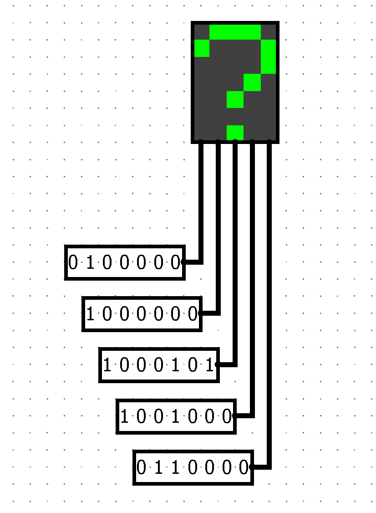<br>
  <em>Figura 1. Matriz LED con una entrada independiente por columna.</em>
</p>

Ya podíamos dibujar los símbolos, pero todavía teníamos que cambiar los cinco valores a mano. Nos faltaba una forma de elegir entre el **7**, la **campana**, el **rayo** y la **pantalla apagada**.

Para ver cómo guardar los patrones y elegir cuál mostrar, consultamos con ChatGPT y Claude. A partir de esas consultas empezamos a investigar las **ROM**.

Una **ROM** (*Read-Only Memory*) almacena valores que se consultan mediante una dirección. La usamos para guardar los patrones de los símbolos. [3](#fuente-3)

Configuramos cada ROM con **2 bits de dirección** y **7 bits de datos**. Con 2 bits tenemos cuatro posiciones (`00`, `01`, `10` y `11`), justo la cantidad que necesitamos para los tres símbolos y la pantalla apagada. En cada posición guardamos el patrón de una columna. Cada uno de los 7 bits de datos indica si el LED de una fila tiene que estar prendido (`1`) o apagado (`0`).

Repartimos las direcciones así:

| Dirección | Imagen |
|---|---|
| `00` | 7 |
| `01` | Campana |
| `10` | Rayo |
| `11` | Pantalla apagada |

Para cargar los símbolos, primero elegimos qué LEDs debían prenderse en cada columna y escribimos ese patrón en 7 bits. Como el editor de las ROM muestra los valores en hexadecimal, convertimos los patrones antes de cargarlos. Cambia la forma de escribirlo, pero el valor y los 7 bits que recibe la columna siguen siendo los mismos. [4](#fuente-4)

Usamos **cinco ROM**, una por columna, porque cada columna necesita su propio patrón. Todas reciben la misma dirección de 2 bits, pero cada una guarda los valores de su columna.

Así, con cambiar una sola dirección, las cinco ROM entregan sus patrones y se forma el símbolo completo.

<table align="center" style="margin-left: auto; margin-right: auto;">
  <tr>
    <td align="center" width="50%">
      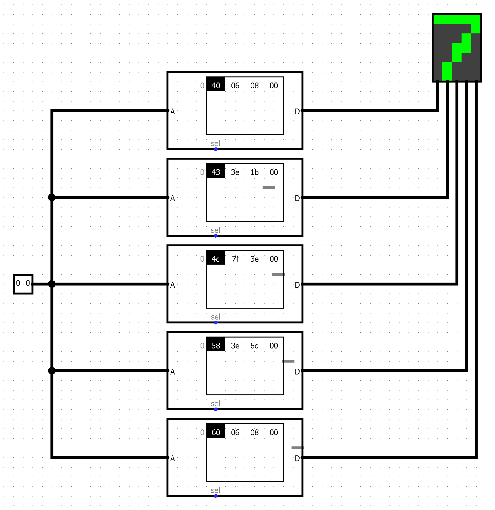<br>
      <em>Figura 2. Símbolo siete, seleccionado con la dirección <code>00</code>.</em>
    </td>
    <td align="center" width="50%">
      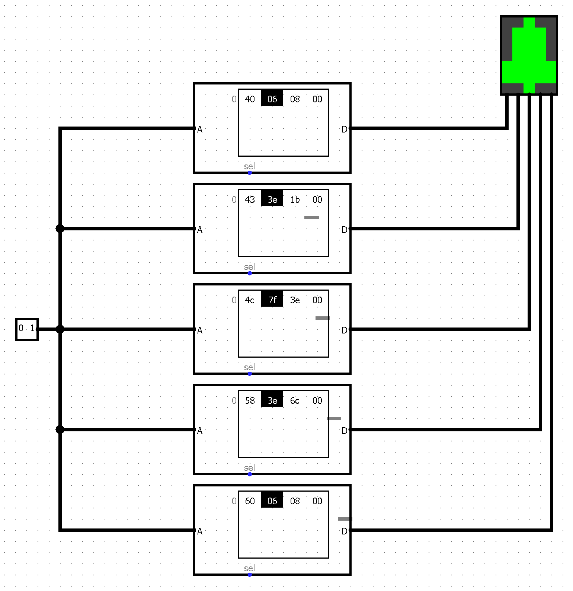<br>
      <em>Figura 3. Símbolo campana, seleccionado con la dirección <code>01</code>.</em>
    </td>
  </tr>
  <tr>
    <td align="center" width="50%">
      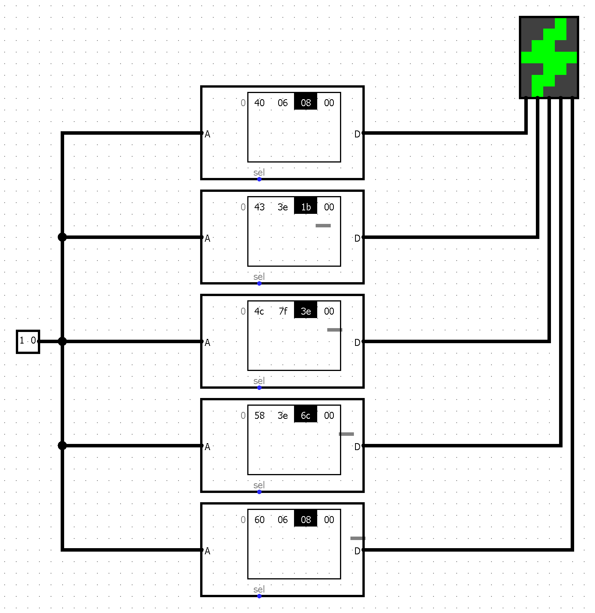<br>
      <em>Figura 4. Símbolo rayo, seleccionado con la dirección <code>10</code>.</em>
    </td>
    <td align="center" width="50%">
      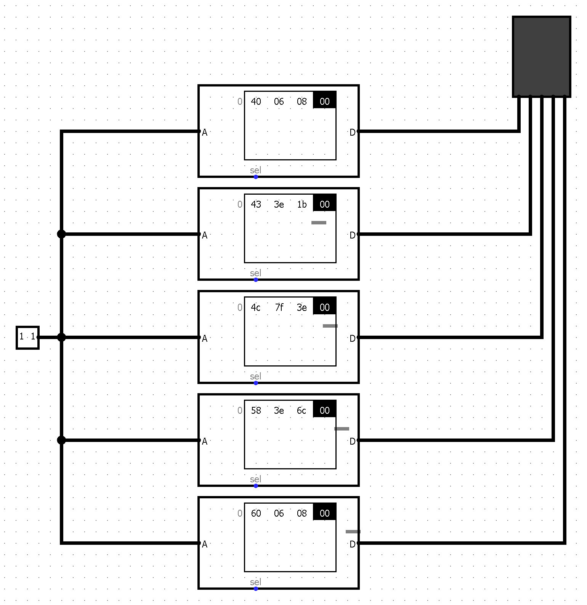<br>
      <em>Figura 5. Pantalla apagada, seleccionada con la dirección <code>11</code>.</em>
    </td>
  </tr>
</table>

El circuito ya tenía bastantes componentes y cables, y necesitábamos repetirlo para los tres displays. Consultamos nuevamente con las herramientas de IA cómo reutilizarlo y empezamos a usar **subcircuitos** en Logisim.

Un **subcircuito** agrupa componentes y conexiones para reutilizarlos como un único bloque, con una interfaz definida por sus pines. [5](#fuente-5)

Armamos entonces `controlador_display`, que recibe el número del símbolo y entrega los valores para las cinco columnas del display.

En esta primera versión, el circuito tenía:

- un pin de entrada de **2 bits**, que indica qué imagen queremos mostrar
- **cinco ROM**, una por cada columna
- cinco pines de salida de **7 bits**, uno por cada columna del LED Matrix

<p align="center">
  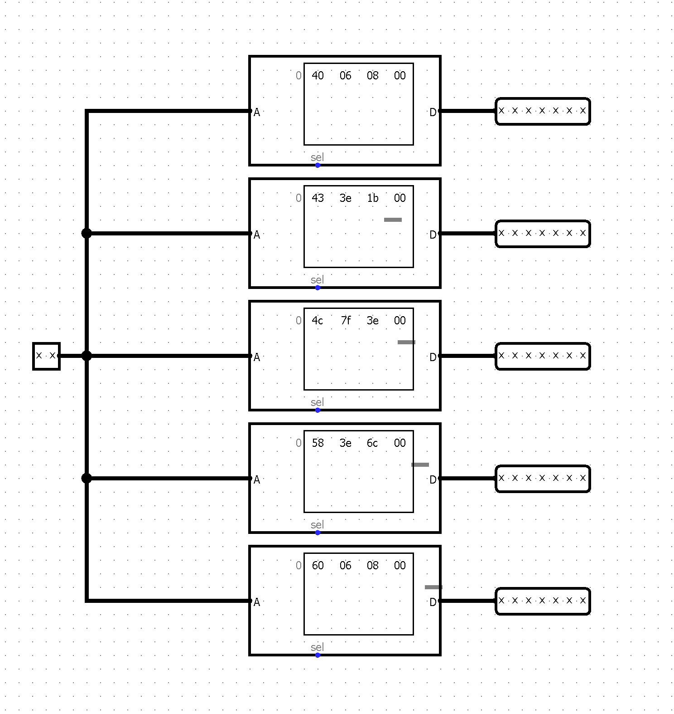<br>
  <em>Figura 6. Subcircuito de almacenamiento y selección de los símbolos.</em>
</p>

En el circuito principal conectamos la entrada de selección y las cinco salidas del subcircuito a las columnas del LED Matrix.

<p align="center">
  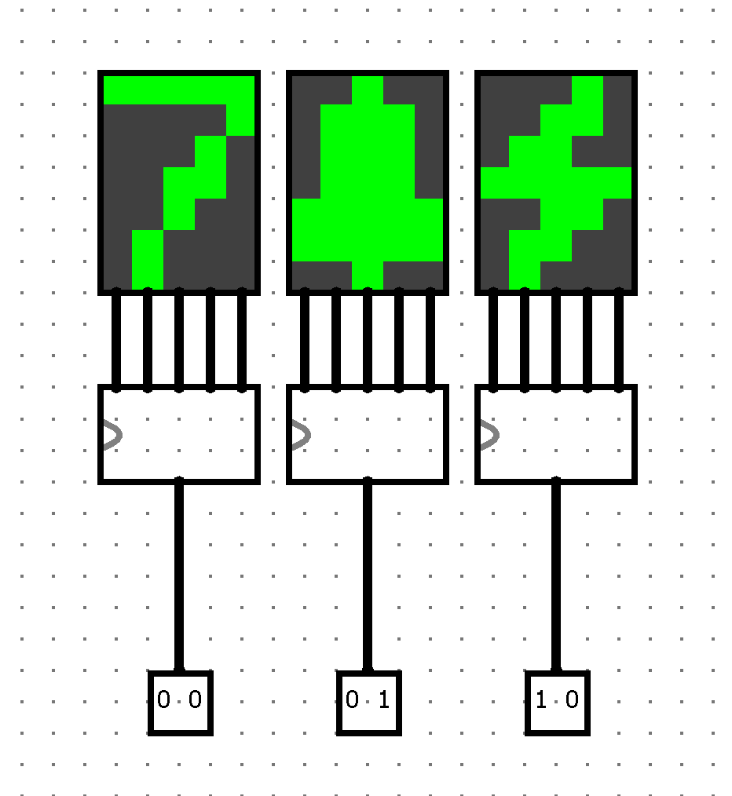<br>
  <em>Figura 7. Conexión del subcircuito a las cinco columnas de la matriz LED.</em>
</p>

Así pudimos usar el mismo diseño en las tres pantallas y dejar más ordenado el circuito principal.

### Animación y detención de los displays

Cuando logramos mostrar los símbolos, seguimos con la animación. Consultamos a ChatGPT para elegir los componentes y configurarlos. Usamos un **contador**, que guarda un valor y puede incrementarlo en cada flanco activo del reloj. El **reloj** alterna periódicamente su salida para marcar el avance del circuito. Un flanco es el cambio de 0 a 1 o de 1 a 0. El flanco activo es el que dispara la actualización del componente. [6](#fuente-6), [7](#fuente-7) Conectamos un contador de 2 bits a `controlador_display`, con un máximo de 2 y vuelta a cero al superarlo. Obtuvimos la secuencia `00 → 01 → 10 → 00`: siete, campana y rayo, sin pasar por `11`, que apaga la pantalla.

Al principio quisimos que las pantallas mostraran símbolos distintos durante la animación. Después preferimos simplificar: los tres displays recorren la misma secuencia al mismo tiempo. Cada uno tiene su contador, inicialmente conectado al reloj común.

Para elegir entre animación y resultado, ampliamos `controlador_display` con dos entradas de 2 bits, `simbolo_animacion` y `resultado`, y una entrada de control de 1 bit, `detener`. Un **multiplexor** copia a su salida una de sus entradas de datos según una señal de selección. [8](#fuente-8) Su salida alimenta la dirección de las cinco ROM. Con la señal `detener` en 0 selecciona el símbolo del contador de animación. Con `detener` en 1 selecciona el resultado que debe mostrar esa pantalla. En esa primera prueba elegimos los resultados a mano con pines de 2 bits. Los contadores siguen avanzando, pero cuando activamos `detener` la pantalla muestra el resultado fijo.

<p align="center">
  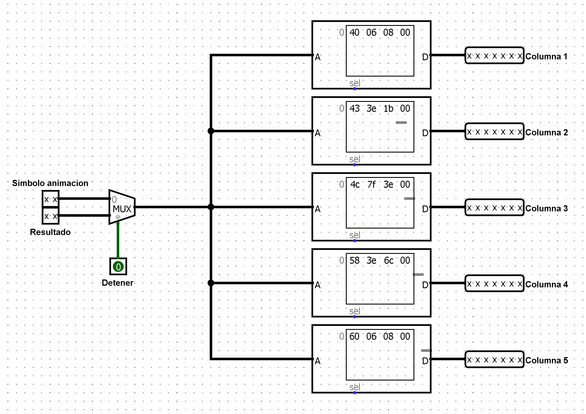<br>
  <em>Figura 8. Selección entre animación y resultado dentro de controlador_display.</em>
</p>

Para que las pantallas se fueran deteniendo de a una, agregamos un contador de tiempo de 3 bits al mismo reloj. Un **comparador** indica si un valor es mayor, igual o menor que otro; una compuerta **OR** entrega 1 si al menos una de sus entradas vale 1. [9](#fuente-9), [10](#fuente-10) Para detener cada pantalla, usamos un comparador y una compuerta OR. Combinamos las salidas “mayor que” e “igual a” para que la señal de detención se active cuando el contador llegue al valor elegido y siga activa después:

| Valor del contador de tiempo | Display 1 | Display 2 | Display 3 |
|---|---|---|---|
| 0 a 4 | Animación | Animación | Animación |
| 5 | Resultado | Animación | Animación |
| 6 | Resultado | Resultado | Animación |
| 7 | Resultado | Resultado | Resultado |

En la prueba nos pasó que el comparador marcaba 1, 2 y 3 como mayores que `101`. Revisamos la configuración y vimos que estaba comparando con signo, en complemento A2: en 3 bits, `101` es −3. Lo cambiamos a **Unsigned / Sin signo** y empezó a comparar como esperábamos. Dejamos los tres comparadores con esa configuración.

Dejamos el contador de tiempo fijo en 7 al llegar al máximo, para que la animación no vuelva a empezar sola. Primero usamos un botón para reiniciarlo y repetir las pruebas. Después juntamos el contador, los comparadores y las compuertas OR en `controlador_animacion`, con entradas de reloj y reinicio y una salida de detención para cada display. Reemplazamos los pines de comparación por componentes **Constante**, que entregan permanentemente el valor configurado en sus propiedades. Los configuramos con 3 bits y valores 5, 6 y 7, conservando los umbrales al reiniciar la simulación. [11](#fuente-11)

<p align="center">
  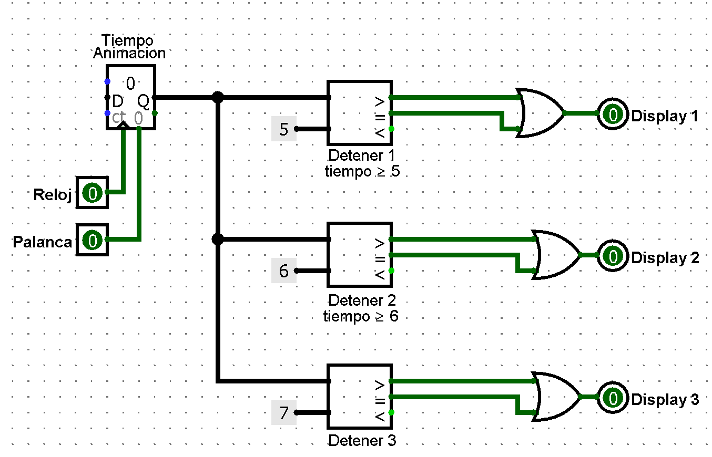<br>
  <em>Figura 9. Control del tiempo y de la detención progresiva de las pantallas.</em>
</p>

<p align="center">
  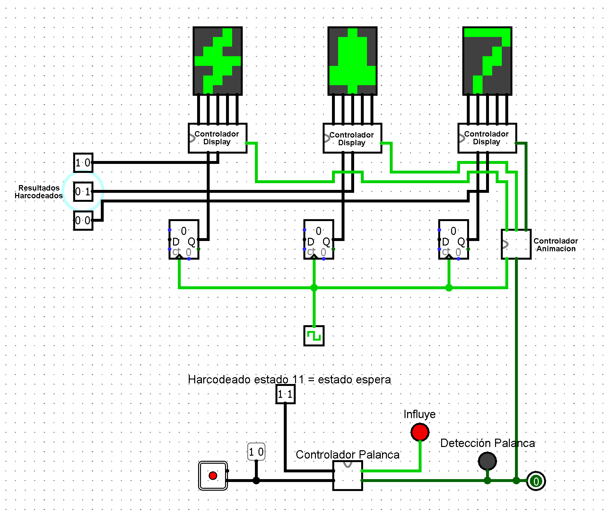<br>
  <em>Figura 10. Prueba de la selección de resultados y de la detención por etapas.</em>
</p>

Probamos la detención con resultados fijos elegidos a mano. La primera pantalla mostró su resultado al llegar a 5, la segunda al llegar a 6 y la tercera al llegar a 7. Cada una quedó fija mientras las otras seguían animándose. En esa primera prueba, bajar la palanca con las tres detenidas volvía a empezar la animación, pero bajarla durante la jugada también reiniciaba el contador de tiempo. Más adelante conectamos la palanca a la máquina de estados para decidir cuándo aceptar una jugada.

Después ordenamos un poco más el circuito: movimos el contador de símbolos y su reloj dentro de `controlador_display`. La entrada externa `simbolo_animacion` dejó de ser necesaria; cada instancia genera su propia secuencia y, en esa etapa, recibe solamente `resultado` y `detener`. También movimos el reloj de tiempo al interior de `controlador_animacion`. Los relojes tienen la misma configuración y, en Logisim, avanzan con los ticks de la simulación [7](#fuente-7). Con estos cambios quitamos los tres contadores y el reloj de animación del circuito principal. Al iniciar otra jugada reiniciamos el contador de tiempo, pero los contadores de símbolos siguen avanzando: las pantallas retoman la secuencia en el símbolo que corresponda en ese momento. Más adelante incorporamos el generador de resultados y el parpadeo de Victoria, que describimos en las secciones siguientes.

### Lectura y control de la palanca

La letra del obligatorio pide iniciar con la investigación de qué es un datasheet y elaborar una hoja de especificaciones para la palanca.

#### ¿Qué es un datasheet?

Unit Electronics [12](#fuente-12) define datasheet como un documento que recopila información detallada sobre las características, el funcionamiento, el uso y las especificaciones técnicas de un componente electrónico, en este caso aplicado a circuitos y subcircuitos digitales.

Este tipo de documentación suele ser elaborada por el fabricante del componente o por quien diseña e implementa el circuito.

Generalmente, incluye información como:

- Diagramas del circuito.
- Gráficos y tablas de verdad.
- Guías de uso y funcionamiento.
- Especificaciones de entradas y salidas.
- Descripción del comportamiento del circuito.

#### Lectura del joystick

Para los indicadores usamos el componente **LED**, que recibe una señal de 1 bit. Configurado como activo en alto, se prende con 1 y se apaga con 0 [13](#fuente-13).

La palanca debe iniciar una jugada únicamente cuando se mueve hacia abajo. Además, el circuito debe distinguir entre detectar ese movimiento y permitir que influya en el juego: durante los estados de Juego y Victoria, mover la palanca no debe iniciar otra jugada. La letra pide mostrar ambas condiciones mediante dos LEDs.

Para estudiar la entrada elegimos el componente **Joystick** de Logisim. Según su documentación [14](#fuente-14), tiene dos salidas: el pin superior tiene la coordenada horizontal X y el inferior, la coordenada vertical Y. Como nos interesa el movimiento hacia abajo, decidimos utilizar solamente Y. La documentación también indica que el valor de reposo corresponde al centro, que arriba vale 1 y que abajo alcanza el valor máximo permitido por el ancho de bits configurado.

Al colocar el joystick observamos que estaba configurado con 4 bits por coordenada. Para esta primera prueba redujimos el ancho a **2 bits**, suficiente para distinguir arriba, centro y abajo. Necesitábamos ver qué valor producía cada posición, por lo que consultamos a Codex cómo observar la salida en Logisim. A partir de esa consulta conectamos una sonda (Probe) al pin Y y seleccionamos la visualización en binario. La sonda muestra el valor de la señal sin modificarla [15](#fuente-15). Esto nos permitió estudiar el componente y escribir la [hoja de especificaciones del joystick](#anexo-hoja-de-especificaciones-del-joystick).

| Posición vertical | Salida Y con 2 bits |
| --- | --- |
| Arriba | `01` |
| Centro (reposo) | `10` |
| Abajo | `11` |

El valor `00` no corresponde a una posición del joystick. En la prueba comprobamos que la sonda muestra `10` cuando lo soltamos, `01` al llevarlo arriba y `11` al llevarlo abajo.

<p align="center">
  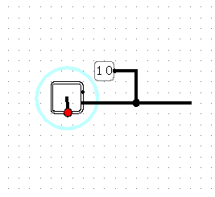<br>
  <em>Figura 11. Prueba de lectura de la salida vertical del joystick.</em>
</p>

#### Detección de la palanca abajo

La salida Y tiene 2 bits, pero para encender un LED **Detección Palanca** necesitamos una señal de 1 bit que valga 1 solamente cuando Y sea `11`. Separamos Y en sus bits `y1` e `y0` mediante un **Splitter** y los conectamos a una compuerta **AND**:

```text
palanca_abajo = y1 AND y0
```

El Separador permite dividir un bus en sus bits o reunirlos [16](#fuente-16), y la compuerta AND entrega 1 cuando todas sus entradas valen 1 [10](#fuente-10). La expresión vale 1 para `11` y 0 para `01` y `10`. Armamos esta lógica en el subcircuito `controlador_palanca` y conectamos su entrada al eje Y del joystick en el circuito principal. Esta detección de posición es la base del controlador; más adelante documentamos las pruebas de su versión integrada.

<p align="center">
  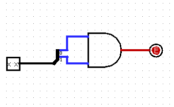<br>
  <em>Figura 12. Circuito controlador de palanca.</em>
</p>

Detectar que la palanca está abajo no equivale a aceptar una jugada nueva, porque la señal permanece en 1 mientras la sostenemos. En los siguientes pasos agregamos la captura de una nueva bajada y la habilitación de la jugada en Espera y con créditos. Esa lógica controla el LED **Influye** y la solicitud de inicio de la jugada.

<p align="center">
  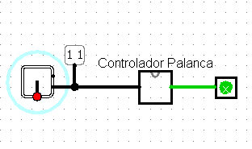<br>
  <em>Figura 13. Conexión del joystick al controlador de la palanca.</em>
</p>

#### Implementación del LED Influye

En el primer prototipo agregamos al *controlador_palanca* una entrada para el estado del juego. En ese momento representábamos Espera con `11` y el LED **Influye** indicaba solamente que estábamos en ese estado. Después corregimos esa lógica para que el indicador mostrara una solicitud de tirada habilitada, como pide la letra.

<p align="center">
  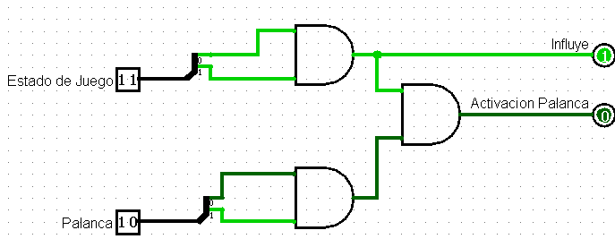<br>
  <em>Figura 14. Primer prototipo del controlador de palanca con habilitación por estado.</em>
</p>

<p align="center">
  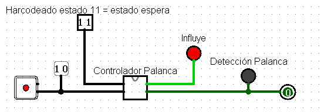<br>
  <em>Figura 15. Primer prototipo de palanca con LEDs de habilitación y detección.</em>
</p>

En la versión actual, Espera se representa con `00` (`Qa = 0` y `Qb = 0`, los bits de estado de la máquina) y el controlador ya no interpreta el estado del juego. Recibe la coordenada Y de la palanca y una entrada de 1 bit, `Habilitar`. En el circuito principal calculamos:

```text
habilitar_palanca = NOT Qa AND NOT Qb AND hay_creditos
```

La decisión de permitir jugar queda en el circuito principal. El controlador detecta y guarda la bajada. Para reconocer Espera usamos NOT, que invierte cada bit [17](#fuente-17), y una compuerta AND [10](#fuente-10).

Separamos las señales para que cada indicador cumpla una función distinta:

| Salida | Qué representa |
|:---|:---|
| `Deteccion Palanca` | La palanca está abajo (`y1 AND y0`), independientemente del estado o los créditos |
| `Salida` | Hay una bajada guardada, pendiente de que la máquina la lea |
| `Influye` | `Habilitar AND Salida`: hay una solicitud pendiente y está permitido jugar |

El LED **Detección Palanca** sigue la posición física y se apaga al soltarla. **Influye** se prende cuando guardamos una bajada estando en Espera y con créditos; al entrar en Juego se apaga.

#### Captura de la bajada y detección de la palanca sostenida

La jugada se solicita al **bajar la palanca**, no al soltarla. Además, mantenerla abajo debe generar una sola solicitud. Para conservar una bajada que ocurra entre dos flancos del reloj de la máquina, agregamos un **biestable D**, que guarda un bit. Copia D a Q en el flanco activo de su reloj y tiene entradas asíncronas que permiten forzar el valor sin esperar ese flanco [18](#fuente-18).

Primero intentamos guardar la solicitud con Set y borrarla conectando el reloj a Reset. Nos encontramos con que, mientras el reloj estaba alto, no podíamos guardar una bajada. Después probamos borrarla al entrar en Juego, pero tampoco alcanzaba: si Set seguía activo por tener la palanca abajo, podía aparecer otra solicitud al volver a Espera.

Lo resolvimos conectando el **flanco de subida de `palanca_abajo`** al reloj del biestable de captura. El flanco de subida es el cambio de una señal de 0 a 1. Acá ocurre cuando la palanca llega a la posición `11`, independientemente del reloj de la máquina de estados.

Al bajar la palanca con la entrada habilitada, Q guarda 1 sin esperar al próximo flanco del reloj de la máquina. La solicitud sigue guardada aunque soltemos la palanca. La máquina la lee en el próximo flanco de subida de su reloj y, al entrar en Juego, desactiva la habilitación. Eso activa el Reset y borra la solicitud.

Si sostenemos la palanca abajo durante la jugada, al volver a Espera no aparece otro flanco. Para jugar de nuevo hay que soltarla y volver a bajarla. Sin créditos, el Reset mantiene la solicitud en 0. Con esto evitamos que quede pendiente una solicitud no permitida o que se reinicie la animación. Probamos la bajada breve entre ticks, la palanca sostenida y la bajada sin créditos con esta versión integrada. Los tres casos funcionaron como esperábamos.

<p align="center">
  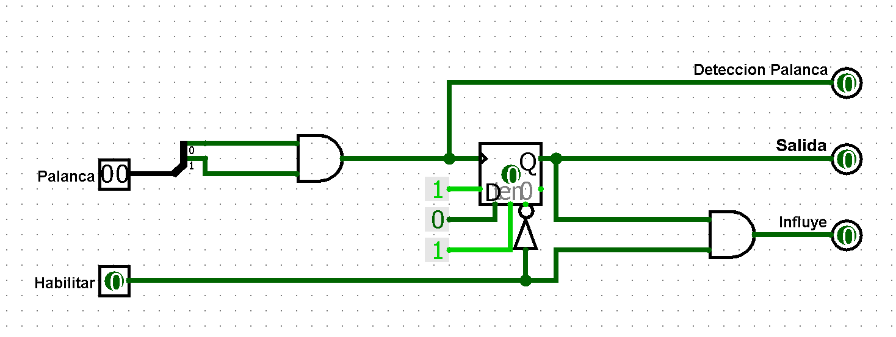<br>
  <em>Figura 16. Captura de una bajada entre ticks y conservación de la solicitud hasta su procesamiento.</em>
</p>

También personalizamos la apariencia del subcircuito para ordenar sus dos entradas y tres salidas. Logisim permite modificar el símbolo y la ubicación de sus puertos sin cambiar la lógica interna [19](#fuente-19).

### Máquina de estados e integración

Para coordinar el juego armamos `maquina_estados`. La idea es guardar en qué etapa estamos y decidir el próximo estado según las entradas. Usamos dos biestables D, A y B: sus salidas `Qa` y `Qb` guardan el estado actual, y sus entradas D reciben los bits del próximo estado. Ambos se actualizan con el mismo flanco de subida del reloj [18](#fuente-18). Si no corresponde cambiar, vuelven a guardar el mismo código.

| Estado | Código `Qa Qb` |
|:---|:---:|
| Espera | `00` |
| Juego | `01` |
| Victoria | `11` |
| No utilizado | `10` |

El siguiente diagrama resume las transiciones. La máquina permanece en su estado mientras no se cumpla la condición de salida.

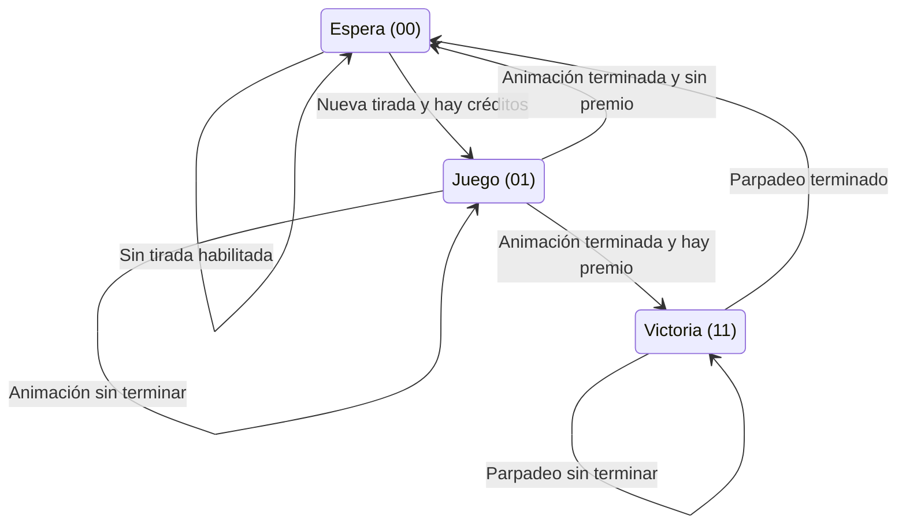

Para expresar las transiciones usamos estas abreviaturas:

| Señal | Significado |
|:---|:---|
| `nt` | Nueva tirada |
| `hc` | Hay créditos |
| `at` | Animación terminada |
| `hp` | Hay premio |
| `vt` | Parpadeo de victoria terminado |


| Estado actual | `nt` | `hc` | `at` | `hp` | `vt` | Próximo estado |
|:---|:---:|:---:|:---:|:---:|:---:|:---|
| Espera `00` | 0 | X | X | X | X | Espera `00` |
| Espera `00` | 1 | 0 | X | X | X | Espera `00` |
| Espera `00` | 1 | 1 | X | X | X | Juego `01` |
| Juego `01` | X | X | 0 | X | X | Juego `01` |
| Juego `01` | X | X | 1 | 0 | X | Espera `00` |
| Juego `01` | X | X | 1 | 1 | X | Victoria `11` |
| Victoria `11` | X | X | X | X | 0 | Victoria `11` |
| Victoria `11` | X | X | X | X | 1 | Espera `00` |

Simplificamos los bits del próximo estado por separado, según las entradas que importan en cada estado. Desde Espera, por ejemplo, el primer bit siempre queda en 0. Desde Juego pasa a 1 solo con `at AND hp`, y en Victoria sigue en 1 mientras `vt` sea 0. De ahí obtuvimos estas expresiones:

```text
D_A = (NOT Qa AND Qb AND at AND hp)
      OR (Qa AND Qb AND NOT vt)

D_B = (NOT Qa AND NOT Qb AND nt AND hc)
      OR (NOT Qa AND Qb AND (NOT at OR hp))
      OR (Qa AND Qb AND NOT vt)
```

Armamos las expresiones con AND, OR y NOT y conectamos cada salida a D de su biestable. Pasamos el reloj al circuito principal y lo hicimos entrar por el pin `Reloj`. Dentro de la máquina lo repartimos a los dos biestables mediante los **túneles** `Reloj`, que unen puntos con la misma etiqueta en ese subcircuito [20](#fuente-20). Las salidas Q vuelven a la lógica para calcular el siguiente estado.

<p align="center">
  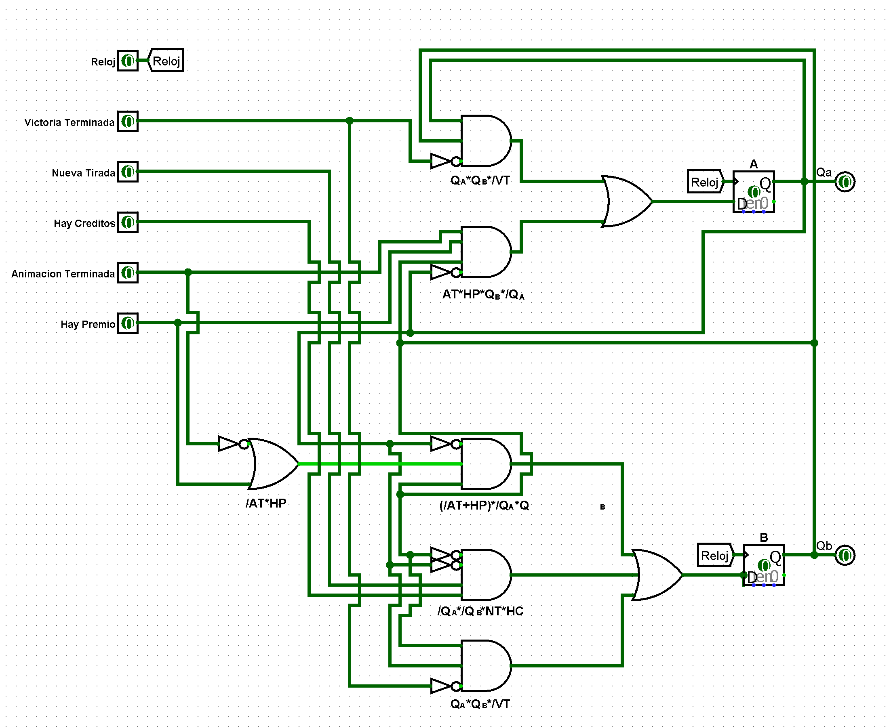<br>
  <em>Figura 17. Implementación de la lógica de próximo estado con dos biestables D.</em>
</p>

Probamos las transiciones de la máquina con entradas manuales y funcionaron según la tabla. Después la colocamos en el circuito principal y conectamos la solicitud pendiente (`Salida`) a `nt`. En una primera integración reunimos A y B con un Separador para llevar el estado completo al controlador de palanca. Al simplificar su interfaz, quitamos ese bus: ahora usamos las salidas de A y B directamente para calcular `habilitar_palanca` junto con `hay_creditos`. También agregamos puntos de observación de ambos bits y ordenamos los bloques y sus conexiones en el circuito principal.

<p align="center">
  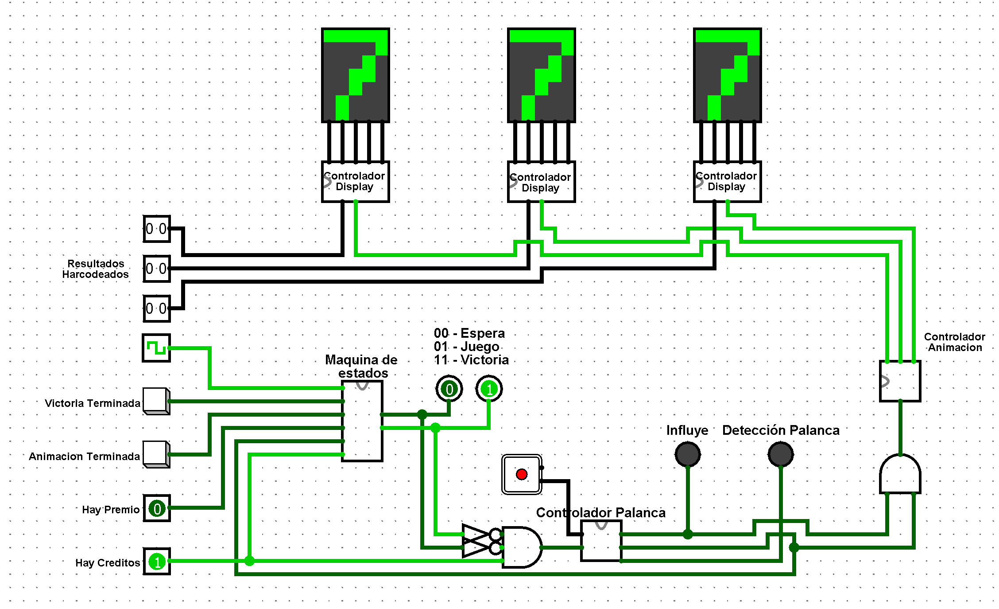<br>
  <em>Figura 18. Integración de la máquina de estados con la palanca y los displays.</em>
</p>

En la primera integración probamos las condiciones de transición con entradas manuales. Después conectamos `hc` al controlador de créditos, `hp` al evaluador de premios, `at` a la detención del tercer display y `vt` al controlador de Victoria. La señal `Habilitar AND Salida`, que llamamos `Jugada aceptada`, reinicia el tiempo de animación, solicita los resultados y habilita el descuento del crédito. Así una bajada durante Juego o Victoria no inicia otra tirada. Los ajustes finales de animación y generación se describen a continuación.

### Manejo de créditos

Para administrar las monedas del juego creamos el subcircuito **controlador_creditos**. Partimos de cuatro reglas: el juego debe comenzar con un saldo distinto de cero, cada tirada aceptada consume una moneda, una combinación ganadora suma su premio y, cuando el saldo llega a cero, no se puede iniciar otra jugada. Elegimos inicialmente 3 créditos para facilitar las pruebas; después aumentamos el saldo inicial a 10 para probar varias tiradas seguidas.

Representamos el saldo con 8 bits, por lo que puede tomar valores entre 0 y 255. Además de actualizarlo, el subcircuito entrega dos salidas: Saldo Actual, con el valor disponible, y Hay Creditos, que vale 1 cuando el saldo es mayor que cero. Esta última señal se puede usar para habilitar la palanca únicamente cuando sea posible jugar.

#### Banco de monedas

Para guardar el saldo usamos un **Register** de 8 bits: un registro que conserva el valor y lo actualiza en el flanco activo del reloj. Permite representar de 0 a 255 créditos [21](#fuente-21).

El Register inicia con valor 0 lo cual no nos sirve para nuestro juego, donde en esta primera versión iniciamos en 3 créditos.
Entonces podemos usar un multiplexor para decidir que al iniciar el programa tengamos el valor 3 hardcodeado, y luego consumiremos el valor desde el Register.
En el multiplexor la entrada de control (gris) decide que valor de entrada toma el multiplexor, al iniciar el programa nos interesa que esa entrada sea 0 para que tome el valor hardcodeado de 3 créditos iniciales, luego con el primer tick de reloj, nos interesa que la entrada que el multiplexor toma, sea la entrada conectada al Register.
Entonces para cumplir la lógica de 0 para iniciar y 1 luego del primer tick, podemos guardar un 1 en un biestable D para que se active con el primer tick y quede el 1 guardado para el resto del programa.

<p align="center">
  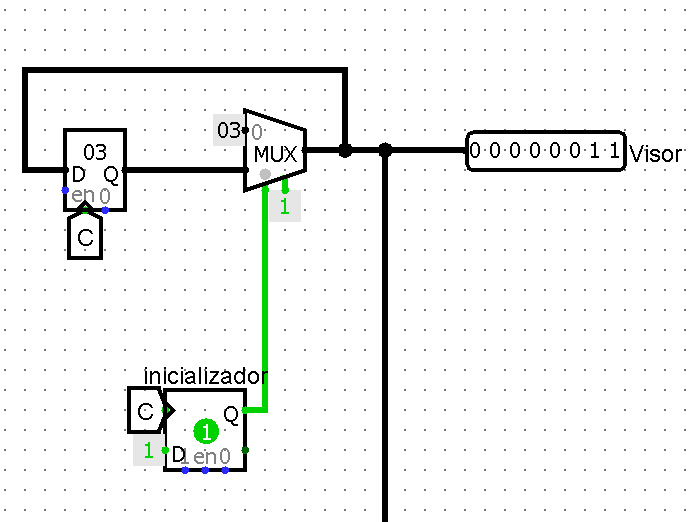<br>
  <em>Figura 19. Inicialización y almacenamiento del saldo de créditos.</em>
</p>

#### Entradas y salidas

Podemos contar con 3 entradas:

| Entrada | Función |
|---|---|
| Jugar | Indica que se aceptó una tirada y debe descontarse un crédito. |
| Premio | Bus de 8 bits con la cantidad de créditos que corresponde sumar. |
| En Victoria | Indica que debe guardarse la suma del premio. |

Jugar debe activarse una vez por tirada aceptada. En cambio, En Victoria puede permanecer en 1 durante varios ticks: un biestable guarda su valor anterior y permite cobrar solo en el primer tick de Victoria. Al salir de ese estado, queda listo para detectar la próxima victoria. Al integrar los módulos corregimos la conexión de `En Victoria`: recibía `Hay Premio` y podía cobrar antes de jugar, o no detectar dos premios consecutivos. La conectamos a `Qa AND Qb` (estado `11`), para cobrar una sola vez por cada entrada en Victoria.

Por otro lado podemos hacer uso de 2 salidas para el circuito, **Hay Créditos** que nos habilita a hacer una nueva jugada y **Saldo Actual** de 8 bits a modo de visor para que el usuario pueda saber cuántos créditos restantes tiene.

#### Lógica de negocio

En este punto sabemos que vamos a tener que decidir entre 2 operaciones para modificar la cantidad de monedas.

##### Suma

Para implementar la suma de la cantidad de monedas actuales + el premio que ganó el usuario, podemos usar el objeto **Adder** de LogiSim en donde podemos calcular saldo_actual + premio, este valor lo debemos guardar en nuestro registro, por lo que podemos hacer uso de un 2do multiplexor en donde decidimos (mediante la entrada cobrar) si guardamos el saldo actual o si calculamos la suma con un premio. [22](#fuente-22)

<p align="center">
  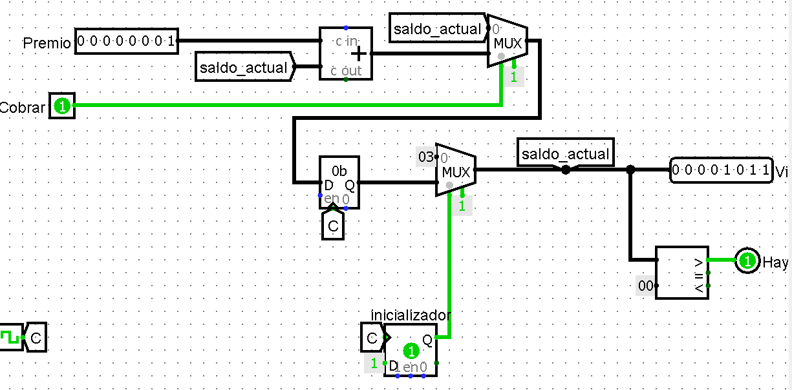<br>
  <em>Figura 20. Lógica para sumar el premio a la cantidad actual de monedas.</em>
</p>

El saldo está limitado a 8 bits. No implementamos saturación: si una suma supera 255, se conserva el resultado módulo 256; por ejemplo, `255 + 1` pasa a `0`. Esta es una limitación de la versión actual.

##### Resta

Para descontar una moneda usamos un Subtractor de 8 bits. Recibe saldo_actual en su entrada superior y una constante 01 en la inferior, por lo que calcula saldo_actual − 1. Un tercer multiplexor selecciona entre conservar el saldo y guardar el resultado de la resta según la entrada Jugar. Su salida alimenta el multiplexor de cobro y, finalmente, la entrada D del registro. [23](#fuente-23)

<p align="center">
  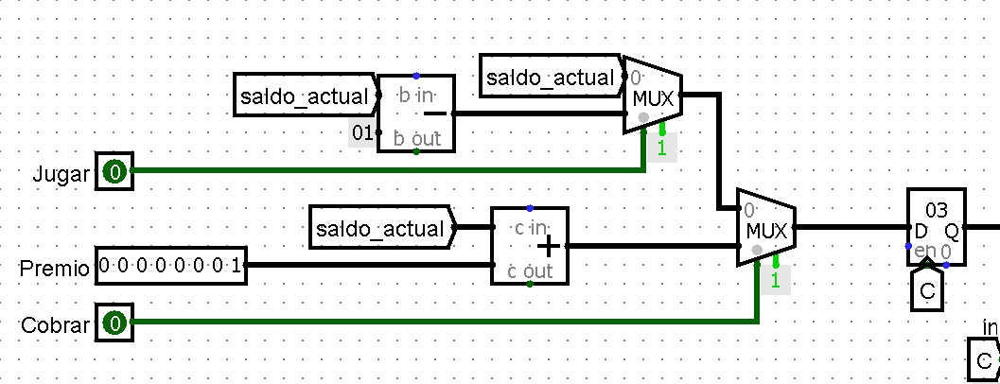<br>
  <em>Figura 21. Lógica para restar el saldo_actual menos 1.</em>
</p>

#### Resultado final del circuito controlador_creditos

<p align="center">
  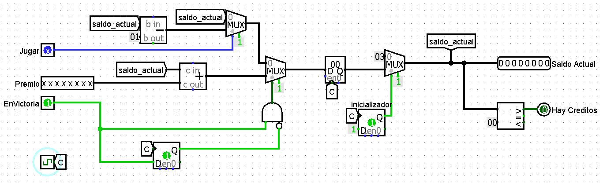<br>
  <em>Figura 22. Lógica final controlador_creditos.</em>
</p>

### Visualizador de créditos

La letra pide mostrar el saldo al mismo tiempo en decimal, con displays de siete segmentos, y en binario, con LEDs. Como controlador_creditos guarda valores de 0 a 255 en 8 bits, necesitamos ocho LEDs y tres cifras decimales.

Creamos **visualizador_creditos** para recibir el saldo y entregar cuatro salidas: una de 8 bits para los LEDs y otras tres para las unidades, decenas y centenas. Conectamos la salida binaria a ocho LEDs en el circuito principal, uno por cada bit del saldo.

Primero estudiamos el display. Tiene un pin por cada segmento y otro para el punto decimal. Los cuatro pines superiores son g, f, a, b; los inferiores son e, d, c, punto, de izquierda a derecha. Esto nos permitió identificar qué señal debía llegar a cada pin. [24](#fuente-24)

Después necesitábamos transformar una cifra en las señales que dibujan esa cifra. Reutilizamos la idea de las ROM empleada para los símbolos del juego y creamos **digito_7_segmentos**. Recibe una cifra de 4 bits y consulta una ROM que devuelve el patrón de 8 bits correspondiente. Por ejemplo, para el número 1 devuelve 06, que enciende las dos barras de la derecha. Usamos tres instancias de este subcircuito. [25](#fuente-25)

<p align="center">
  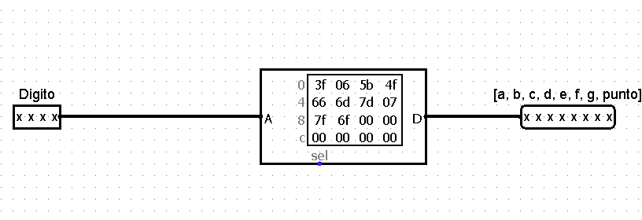<br>
  <em>Figura 23. Subcircuito digito_7_segmentos y sus patrones guardados en ROM.</em>
</p>

Para separar las cifras usamos **Divider**, que divide un número entre otro y entrega el cociente entero y el resto [26](#fuente-26).

Quedaba obtener las tres cifras a partir del saldo. Usamos dos Divider por 10. El resto de la primera da las unidades, dividimos su cociente nuevamente y obtenemos las decenas como resto y las centenas como cociente. [26](#fuente-26)

Un **Bit Selector** extrae de un bus un grupo de bits elegido por su entrada de selección [27](#fuente-27).

Cada cifra sale en 8 bits, así que un Bit Selector toma sus cuatro bits inferiores antes de enviarla a **digito_7_segmentos**. [27](#fuente-27)

<p align="center">
  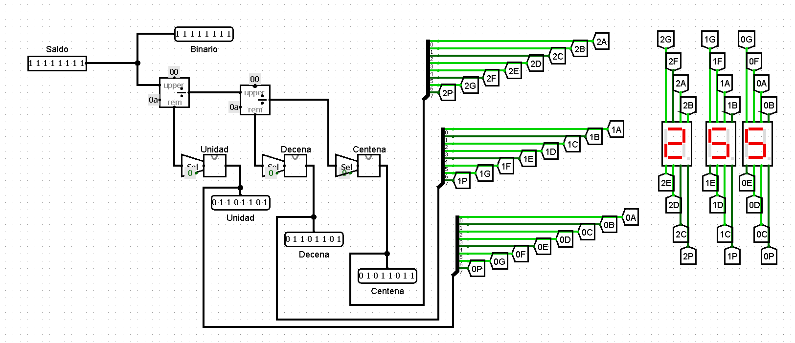<br>
  <em>Figura 24. Visualizador de créditos con el saldo 255 en decimal y binario.</em>
</p>

### Evaluador de premios

Una vez que tenemos los resultados de los tres displays, necesitamos saber si forman una combinación ganadora y cuántos créditos corresponde entregar. Para eso creamos **evaluador_premios**.
Recibe tres entradas (resultados) de 2 bits y tiene dos salidas:

- `Premio`, con la cantidad de créditos ganados (8 bits).
- `Hay Premio`, que indica si la combinación tiene premio.

Primero comparamos, usando Comparator, el resultado 1 con el 2 y el resultado 2 con el 3. Unimos ambas comparaciones con un AND.

Luego usamos un multiplexor para elegir el premio según el símbolo.

- Tres créditos por tres sietes (`00`).
- Dos por tres campanas (`01`).
- Uno por tres rayos (`10`).
- Cero si la entrada es `11` (pantalla apagada, que no participa como símbolo del juego).

Un segundo multiplexor deja pasar el premio únicamente cuando los tres resultados coinciden, si no, entrega cero.
Finalmente, comparamos ese valor con cero para generar Hay Premio.

<p align="center">
  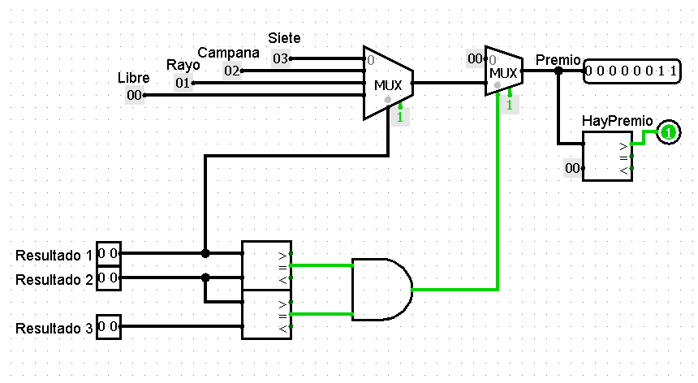<br>
  <em>Figura 25. Evaluador de premios con tres sietes: Premio vale 3 y Hay Premio vale 1.</em>
</p>

### Generación de los resultados

Para elegir los símbolos investigamos **Random Generator**, que entrega una secuencia pseudoaleatoria y avanza con cada flanco activo de su entrada de reloj. Su **semilla** es el valor de partida: una semilla fija permite repetir la secuencia [28](#fuente-28).

Primero probamos un Random de 2 bits y descartábamos `11`, porque corresponde a la pantalla apagada. Si salía ese valor, seguíamos buscando. Funcionó, pero hacía falta lógica para recordar la solicitud y avisar cuándo estaba listo el resultado. Además, existía una pequeña posibilidad de que saliera `11` varias veces seguidas y la animación terminara antes de obtener un resultado válido. Eso no nos gustó, así que preferimos usar un Random de 16 bits y el resto de dividir su salida entre 3:

```text
simbolo = numero_aleatorio MOD 3
```

El **Divider** entrega el cociente y el resto; usamos solamente el resto, que queda entre 0 y 2 [26](#fuente-26). Conectamos el Random como dividendo, una constante 3 como divisor y dejamos los bits altos del dividendo en 0. Un Separador toma los dos bits inferiores del resto y un registro conserva el símbolo durante la jugada [21](#fuente-21). Esta decisión introduce un sesgo pequeño: entre los 65.536 valores de 16 bits hay 21.846 que dan resto 0 y 21.845 para cada uno de los otros dos restos. Por eso las probabilidades no son exactamente iguales.

Conectamos `Generar` al reloj del Random y del registro. Cada subida de la solicitud guarda el candidato disponible y avanza la secuencia para la próxima tirada; el registro toma el valor que había antes del flanco. Esto permite capturar entre ticks del reloj principal y conservar el resultado aunque `Generar` siga en 1.

Empezamos con tres subcircuitos para poder configurar una semilla diferente en cada uno. Después los reunimos en `generador_resultados`, con una entrada `Generar` de 1 bit y tres salidas de 2 bits: `Resultado 1`, `Resultado 2` y `Resultado 3`. En el circuito principal quedó un solo bloque, y cada resultado se conecta a su controlador de display y al evaluador de premios.

<p align="center">
  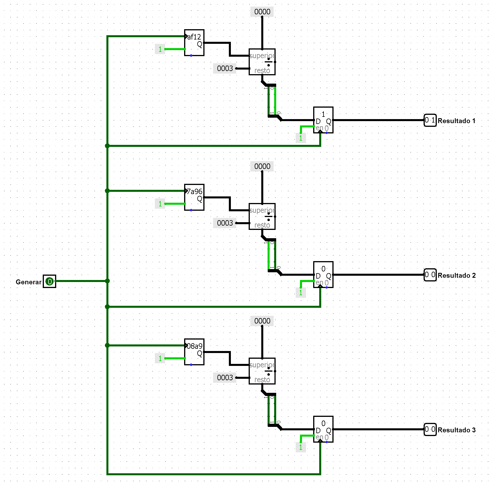<br>
  <em>Figura 26. Generador de los tres resultados mediante módulo 3.</em>
</p>

Elegimos semillas distintas porque usar la misma en los tres bloques, con las mismas solicitudes, produce la misma secuencia. Para facilitar la demostración buscamos semillas que mostraran las tres victorias y también combinaciones perdedoras:

| Bloque de salida | Semilla del Random |
|---|---:|
| `Resultado 1` | 1 |
| `Resultado 2` | 34 |
| `Resultado 3` | 91 |

Después de reiniciar la simulación, con el generador agrupado y 10 créditos iniciales, comprobamos esta secuencia:

| Tirada | Resultado | Premio | Saldo final |
|---|---|---:|---:|
| 1 | Tres campanas | 2 | 11 |
| 2 | Tres sietes | 3 | 13 |
| 3 | Tres rayos | 1 | 13 |
| 4 | Sin coincidencia | 0 | 12 |
| 5 | Sin coincidencia | 0 | 11 |

Al agrupar los bloques dejamos desconectados los relojes de los dos primeros Random y sus registros. Corregimos las conexiones y repetimos nueve tiradas completas. Obtuvimos victorias y derrotas, el saldo fue el esperado y la máquina volvió a Espera. También cambiamos el tiempo de espera entre tiradas y la secuencia se mantuvo. Después ampliamos el ensayo a 1000 resultados para estudiar los símbolos, las victorias y la evolución del saldo.

### Parpadeo y duración de Victoria

Para el parpadeo aprovechamos la dirección `11`, que ya teníamos definida para apagar las pantallas. Agregamos una entrada `Apagar` a `controlador_display` y un segundo multiplexor antes de las ROM: con `Apagar = 0` deja pasar la selección normal; con `Apagar = 1` selecciona `11`. Los tres displays reciben la misma señal.

<p align="center">
  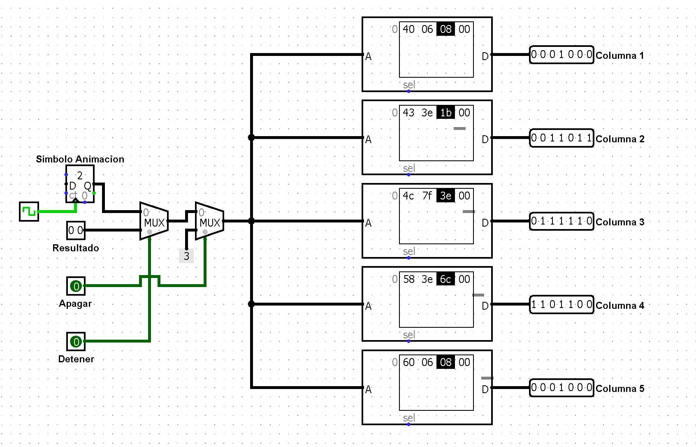<br>
  <em>Figura 27. Entrada Apagar y multiplexor para el parpadeo.</em>
</p>

Después armamos `controlador_victoria`. Una compuerta AND combina `En Victoria` con el reloj para alternar entre el resultado ganador y la pantalla apagada. Fuera de Victoria, `Apagar` queda en 0.

Para terminar el estado usamos un contador de 2 bits, con máximo 3 y detención al llegar a ese valor. Cuenta en los flancos de bajada y se reinicia mediante `NOT En Victoria`. Un comparador activa `Victoria Terminada` cuando llega a 3; esa salida reemplaza el botón de prueba de la máquina de estados.

La duración del parpadeo depende de la frecuencia de simulación [7](#fuente-7). Para que dure **tres segundos**, la simulación debe configurarse en 2 ticks por segundo. Desde que entramos en Victoria, el contador avanza en las tres bajadas y la máquina vuelve a Espera en la siguiente subida: seis ticks en total. Elegimos la bajada para que la señal de finalización esté disponible cuando la máquina lea sus entradas en la subida. Dejamos los relojes internos con la misma configuración, sincronizados por los ticks de Logisim. Al probar las victorias comprobamos que la máquina volvía sola a Espera.

<p align="center">
  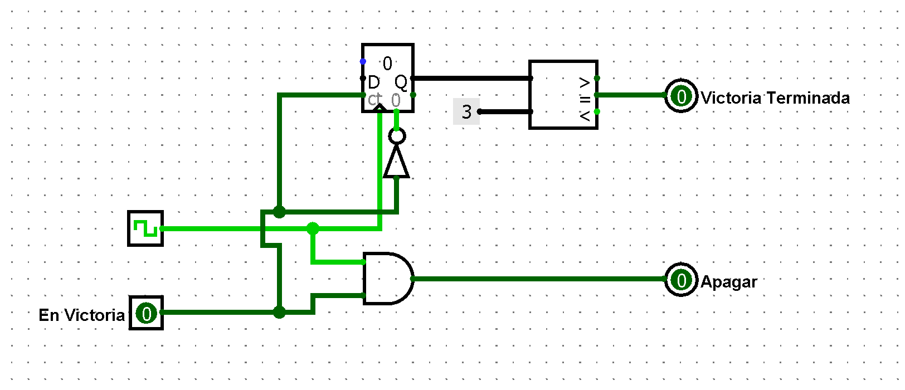<br>
  <em>Figura 28. Control del parpadeo y de la finalización de Victoria.</em>
</p>

### Arranque e integración de las pantallas

Al reiniciar la simulación nos encontramos con que las pantallas empezaban a animarse aunque todavía no hubiéramos jugado. Agregamos `En Juego` a `controlador_animacion`, calculado como `NOT Qa AND Qb`, y una tercera entrada a cada OR de detención:

```text
Detener1 = NOT EnJuego OR tiempo >= 5
Detener2 = NOT EnJuego OR tiempo >= 6
Detener3 = NOT EnJuego OR tiempo >= 7
```

Con ese cambio, las pantallas quedan detenidas en Espera y Victoria, y durante Juego se detienen de forma progresiva. Probamos el arranque: las tres señales quedan en 1 y, como los registros de resultados empiezan en `00`, se ven tres sietes quietos. Durante Victoria, la entrada `Apagar` hace parpadear las pantallas y el resultado sigue guardado.

Al aceptar una tirada guardamos los tres símbolos del resultado. Mientras tanto, las pantallas recorren la secuencia de animación y, al detenerse, muestran el símbolo que ya estaba guardado. Cuando termina la animación, la máquina decide si vuelve a Espera o entra en Victoria. El premio se cobra al entrar en ese estado.

<p align="center">
  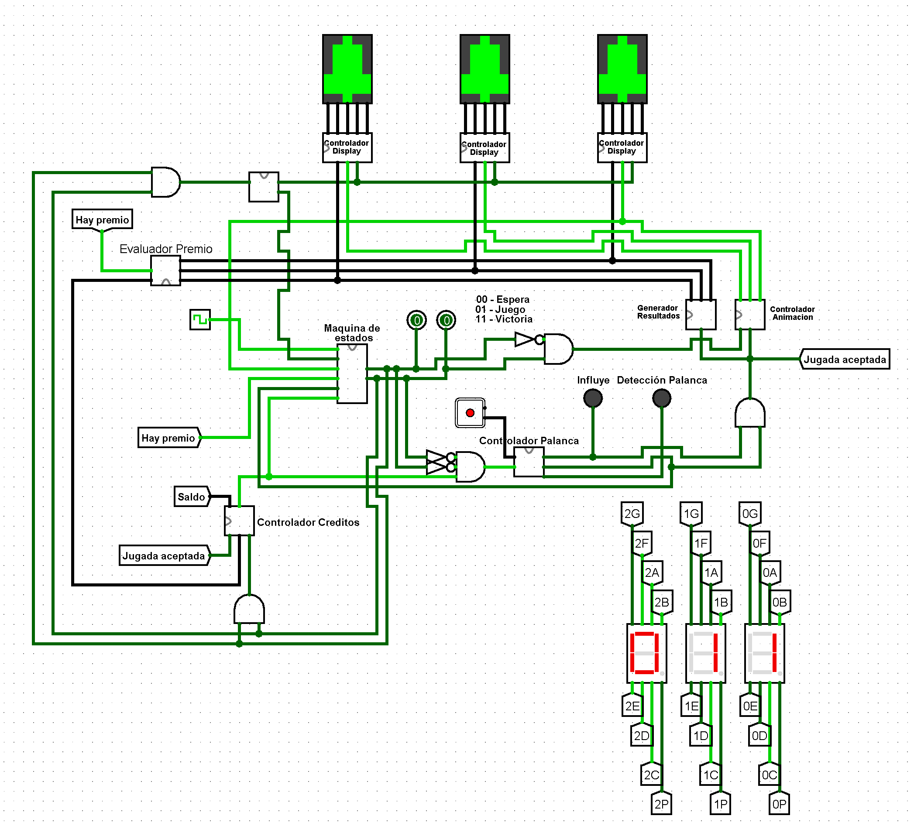<br>
  <em>Figura 29. Integración de los resultados y las animaciones en el circuito principal.</em>
</p>

### Estudio de 1000 resultados

Con la ayuda de herramientas de IA automatizamos las solicitudes con el motor de Logisim para poder estudiar mil tiradas sin accionar la palanca a mano. El ensayo usa nuestro `generador_resultados` y `evaluador_premios`, con las semillas 1, 34 y 91, y guarda cada combinación en un [archivo CSV](analisis-estadistico/resultados-1000.csv). Dejamos el [procedimiento para repetirlo](analisis-estadistico/README.md).

Hicimos el ensayo con estos módulos por separado y conservamos el circuito del juego. Para llegar a las 1000 combinaciones, dejamos que el ensayo siguiera después de agotar los créditos. Calculamos el saldo matemáticamente desde 10, sin el bloqueo en cero ni el límite de 8 bits. El ensayo registra los resultados de los módulos; no reproduce mil partidas completas con su animación.

| Resultado | Cantidad | Frecuencia observada | Referencia ideal |
|---|---:|---:|---:|
| Tres sietes | 38 | 3,8 % | 3,70 % |
| Tres campanas | 38 | 3,8 % | 3,70 % |
| Tres rayos | 35 | 3,5 % | 3,70 % |
| Sin premio | 889 | 88,9 % | 88,89 % |
| **Cualquier victoria** | **111** | **11,1 %** | **11,11 %** |

Comparamos los resultados con un modelo de tres símbolos equiprobables e independientes. En ese modelo hay 27 combinaciones y tres ganadoras, por lo que la probabilidad ideal de victoria es `3/27`, aproximadamente 11,11 %. En el ensayo aparecieron las 27 combinaciones y la frecuencia de victoria quedó cerca de esa referencia. En las 3000 posiciones contamos 977 sietes, 1010 campanas y 1013 rayos. Es una corrida con semillas fijas: estos resultados no prueban que las semillas sean independientes ni eliminan el pequeño sesgo de módulo 3.

En las 1000 tiradas se descontaron 1000 créditos y se entregaron 225 en premios. La pérdida media fue de 0,775 créditos por tirada. Los 10 créditos iniciales se agotaron en la tirada 20, así que en el juego normal habríamos tenido que parar ahí. El saldo matemático final de -765 permite ver qué pasaría al continuar, aunque el registro del juego no pueda mostrarlo. La pérdida media observada quedó cerca de la del modelo ideal: un premio medio de `6/27` créditos y una pérdida media de aproximadamente 0,778 por tirada.

<p align="center">
  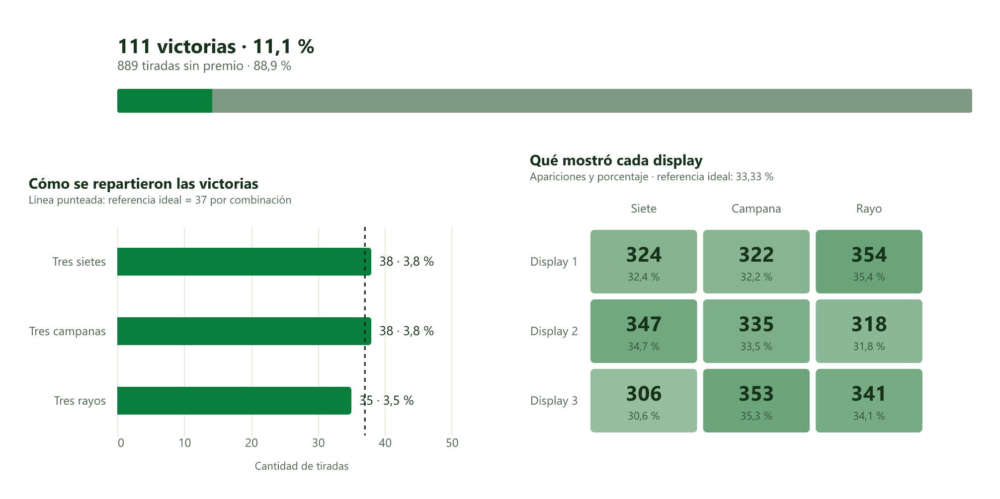<br>
  <em>Figura 30. Distribución de victorias y símbolos en 1000 resultados.</em>
</p>

## Funcionalidad Patricio Nuñez (398434)
Como funcionalidad extra decidí agregar un display que muestre cuántos créditos ganó el jugador en cada tirada. Para implementarlo, busqué reutilizar los circuitos que ya teníamos.

En main contamos con la señal Premio, un cable de 8 bits que lleva el valor desde **evaluador_premios** hasta **controlador_creditos**, donde se suma al saldo. Esa señal ya se usaba para pagar el premio, pero todavía no se mostraba al jugador.

En una primera implementación reutilicé la lógica de **visualizador_creditos**, que separa un número binario en unidades, decenas y centenas. Como los premios posibles son 0, 1, 2 y 3, solo necesitaba la salida de unidades para mostrar el valor en un display.

<p align="center">
  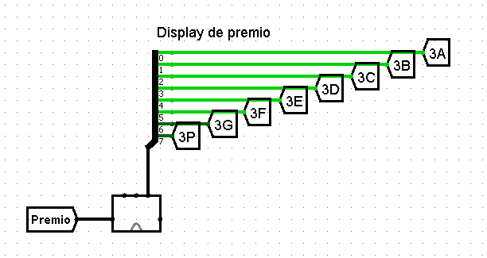<br>
  <em>Figura 31. Primera implementación del visualizador de premio en main.</em>
</p>

<p align="center">
  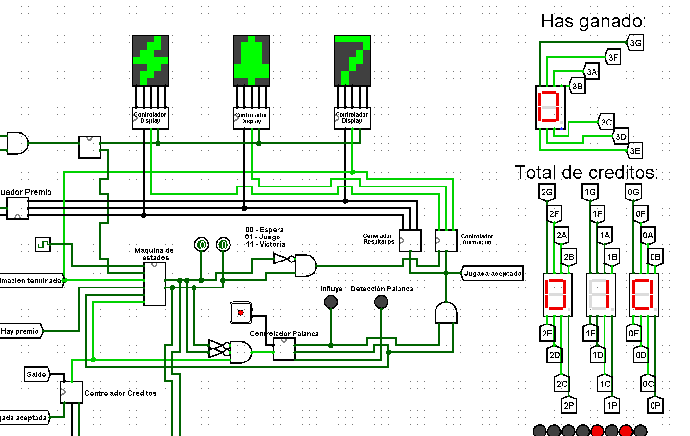<br>
  <em>Figura 32. Premio mostrado junto a los displays del juego y el saldo de créditos.</em>
</p>

El concepto funcionaba, pero habia un problema, el premio se elige antes de que termine la animación. Por lo tanto, el jugador podía ver cuánto iba a ganar antes de conocer el resultado de los tres displays. Eso le quitaba intriga a la jugada.

Para resolverlo creé un nuevo circuito, **visualizador_premio**, con dos entradas, Premio y Mostrar, y una salida de 8 bits con el patrón que se envía al display. Mostrar se conecta a Animacion Terminada, de modo que el premio aparece recién cuando termina la jugada.

Dentro del circuito usé un Random conectado al reloj para generar un nuevo valor de 8 bits en cada tick. Un multiplexor elige qué enviar a la salida: mientras Mostrar = 0, muestra el patrón aleatorio; cuando Mostrar = 1, muestra el premio real.

Así, durante la animación los segmentos del display se encienden de forma cambiante y, al terminar, aparece el valor ganado. Esto agrega un efecto visual que mantiene la intriga hasta el final de la tirada.

<p align="center">
  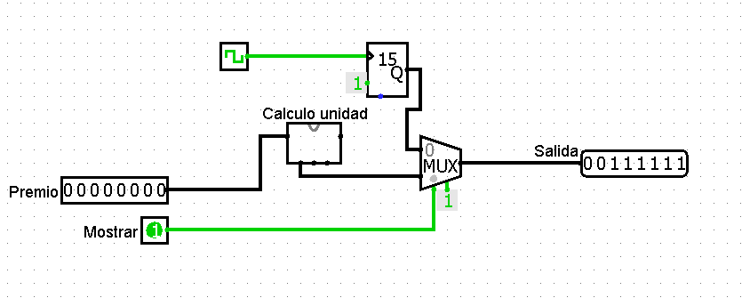<br>
  <em>Figura 33. Visualizador de premio: patrón aleatorio durante la animación y premio al terminar.</em>
</p>

<p align="center">
  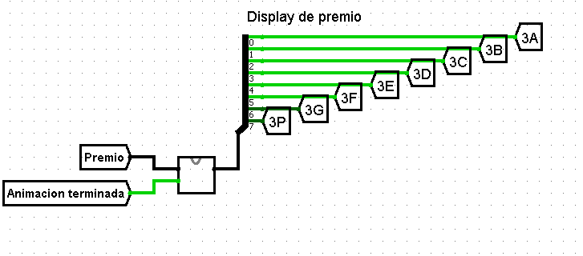<br>
  <em>Figura 34. Visualizador de premio conectado a Premio y Animación terminada en main.</em>
</p>

Utilicé ChatGPT para explorar ideas de funcionalidades extra pero decidi ir por una idea propia, adicionalmente revisar la redacción de esta sección y generar la aliniacion de imagenes .

## Funcionalidad Rafael Menendez (391040)

La idea surgió del estudio estadístico que pide la letra. Después de analizar los resultados, quise mostrar su distribución dentro del juego. Agregué tres barras, una para el siete, otra para la campana y otra para el rayo. Cada una muestra qué porcentaje de los símbolos obtenidos le corresponde. Las barras reflejan lo que salió durante la simulación. No indican las probabilidades exactas del generador.

Al principio quería dos grupos de barras: uno con las últimas diez tiradas y otro con todas las tiradas. Empecé usando detectores y puertas para contar cuántas veces aparecía cada símbolo en una jugada. Cuando intenté mantener las dos estadísticas, el circuito se volvió más complicado de lo que esperaba. Para las últimas diez había que guardar un historial, sumar la jugada nueva y restar la que salía de la ventana. Preferí quedarme con el acumulado desde el inicio de la simulación.

Para hacerlo armé **estadisticas_resultados**, que cuenta y acumula las apariciones, y **barra_estadistica**, que transforma cada cantidad acumulada en las filas encendidas de una matriz LED. Reutilicé el circuito de barra tres veces, una por símbolo.

En **estadisticas_resultados** dejé las siguientes entradas y salidas:

| Señal | Sentido | Ancho | Función |
| --- | --- | --- | --- |
| `Resultado 1`, `Resultado 2`, `Resultado 3` | Entrada | 2 bits cada una | Símbolos finales guardados en **generador_resultados**. |
| `Reloj` | Entrada | 1 bit | Mismo reloj que utiliza **maquina_estados**. |
| `En Juego` | Entrada | 1 bit | Indica que el estado actual es Juego (`01`). |
| `Animacion Terminada` | Entrada | 1 bit | Indica que se detuvo el tercer display. |
| `Siete`, `Campana`, `Rayo` | Salida | 15 bits cada una | Patrón de filas encendidas para la barra de cada símbolo. |

Reemplacé los detectores y las puertas de conteo por una **ROM** con una tabla fija [25](#fuente-25). La configuré con **6 bits de dirección y 6 bits de datos**. Un Separador junta los tres resultados de 2 bits para formar la dirección. Otro divide el dato de salida en tres cantidades de 2 bits, que permiten contar de 0 a 3 apariciones por símbolo.

Mantuve la codificación `00 = siete`, `01 = campana` y `10 = rayo`.

La tabla reúne las 27 combinaciones válidas. Agrupé las direcciones que tienen las mismas cantidades aunque los símbolos aparezcan en otro orden. Escribí las cantidades en decimal y las direcciones y los datos en hexadecimal.

| Direcciones de la ROM | Sietes | Campanas | Rayos | Dato de salida |
| --- | ---: | ---: | ---: | --- |
| `00` | 3 | 0 | 0 | `03` |
| `01`, `04`, `10` | 2 | 1 | 0 | `06` |
| `02`, `08`, `20` | 2 | 0 | 1 | `12` |
| `05`, `11`, `14` | 1 | 2 | 0 | `09` |
| `06`, `09`, `12`, `18`, `21`, `24` | 1 | 1 | 1 | `15` |
| `0A`, `22`, `28` | 1 | 0 | 2 | `21` |
| `15` | 0 | 3 | 0 | `0C` |
| `16`, `19`, `25` | 0 | 2 | 1 | `18` |
| `1A`, `26`, `29` | 0 | 1 | 2 | `24` |
| `2A` | 0 | 0 | 3 | `30` |

Por ejemplo, siete, campana y siete forman la dirección binaria `00 01 00`, que es `04` en hexadecimal. En esa dirección guardé `06`, es decir, `00 01 10`: ningún rayo, una campana y dos sietes. Las otras 37 direcciones incluyen algún resultado `11`, que no se genera como símbolo final de una tirada; ese código se reserva para apagar los displays.

Para conservar los totales entre jugadas usé un **sumador y un registro de 20 bits** por símbolo. El sumador calcula `acumulado + cantidad nueva`, y el registro guarda ese resultado hasta la siguiente actualización [21](#fuente-21), [22](#fuente-22). La ROM entrega cantidades de 2 bits, así que agregué un **Bit Extender** para llevarlas a 20 bits. Este componente adapta el ancho del bus. Lo configuré para completar con ceros y conservar el valor [29](#fuente-29).

Agregué también un contador de 20 bits llamado `Jugadas`, que avanza junto con los tres acumuladores una vez por tirada. Lleva la cuenta de las jugadas: después de `N` tiradas se habrán registrado `3N` símbolos.

La actualización ocurre al terminar la animación. En `main` obtengo `En Juego = NOT Qa AND Qb` y, dentro del subcircuito, genero:

```text
Registrar = En Juego AND Animacion Terminada AND Con capacidad
```

Con `Registrar` habilito los registros y el contador. Comparten el reloj con **maquina_estados**, así que guardan las cantidades e incrementan `Jugadas` en el flanco de salida de Juego. Al entrar en Espera o Victoria, `En Juego` pasa a 0 y bloquea otro conteo de esa tirada. Usar solamente `Animacion Terminada` podía hacer que contara con las pantallas quietas en Espera, porque ahí también puede estar activa.

Fijé un límite de **65.535 jugadas** (`FFFF` hexadecimal) para evitar desbordamientos. El comparador trabaja sin signo y genera `Con capacidad = Jugadas < 65535`. Cuando se alcanza el límite, el contador y los acumuladores conservan sus valores.

<p align="center">
  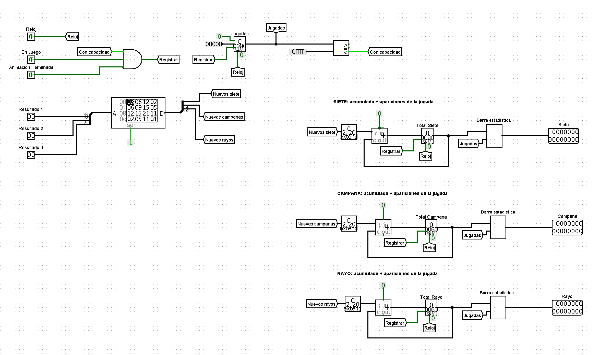<br>
  <em>Figura 35. Conteo y acumulación de símbolos al terminar cada jugada.</em>
</p>

Para las barras usé matrices LED de **2 columnas y 15 filas**. Cada fila representa aproximadamente 6,67 puntos porcentuales: la barra vacía corresponde a 0 % y las quince filas encendidas, a 100 %.

Si `C` es la cantidad acumulada de un símbolo y `N` la cantidad de jugadas:

```text
Proporción del símbolo = C / (3 × N)
Filas encendidas = parte entera de ((15 × C) / (3 × N))
                 = parte entera de ((5 × C) / N)
```

En **barra_estadistica** conecté un **Multiplier**, que multiplica sus dos entradas, para obtener `5 × C` [30](#fuente-30). Después dividí ese resultado entre `N` con un **Divider**, que entrega el cociente entero [26](#fuente-26). Las dos operaciones usan buses de 20 bits. Por ejemplo, diez campanas en diez jugadas son `10/30`, aproximadamente 33,33 %, y encienden cinco filas.

Un Separador toma los cuatro bits inferiores del cociente, cuyo valor válido está entre 0 y 15. Esa altura entra a una segunda ROM, de **4 bits de dirección y 15 bits de datos**, que genera el patrón para encender la barra desde abajo:

| Filas encendidas | Patrón hexadecimal |
| ---: | --- |
| 0 | `0000` |
| 1 | `0001` |
| 2 | `0003` |
| 3 | `0007` |
| 4 | `000F` |
| 5 | `001F` |
| 6 | `003F` |
| 7 | `007F` |
| 8 | `00FF` |
| 9 | `01FF` |
| 10 | `03FF` |
| 11 | `07FF` |
| 12 | `0FFF` |
| 13 | `1FFF` |
| 14 | `3FFF` |
| 15 | `7FFF` |

Cada bit controla una fila y el bit 0 es la inferior. Conecté la salida de 15 bits a las dos columnas de la matriz para que ambas dibujen la misma barra. Al calcular la altura descarto la parte decimal, por lo que cada barra queda por debajo de la proporción real en menos de una fila. Por ese truncado, las tres alturas pueden sumar menos de quince.

<p align="center">
  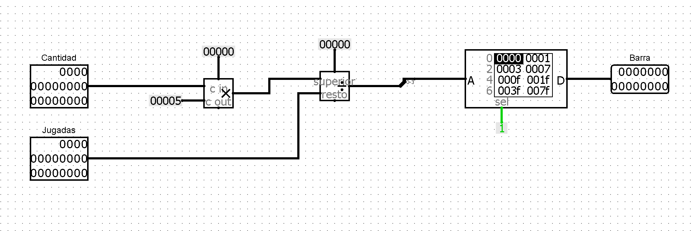<br>
  <em>Figura 36. Conversión de una cantidad acumulada en una barra de quince filas.</em>
</p>

Cuando reinicio la simulación, los acumuladores y `Jugadas` vuelven a cero y las barras se apagan. El divisor de Logisim trata el divisor cero como uno. Como el numerador también es cero, devuelve una altura de cero [26](#fuente-26). Las operaciones de las barras son combinacionales y no necesitan un reloj más rápido ni una secuencia de varios ciclos.

<p align="center">
  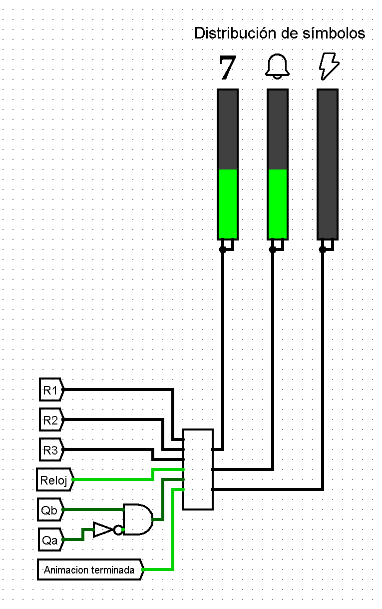<br>
  <em>Figura 37. Integración de las estadísticas acumuladas en el circuito principal.</em>
</p>

## Uso de inteligencia artificial

Utilizamos ChatGPT, Codex y Claude como herramientas de IA para consultar el funcionamiento y la configuración de los componentes de Logisim, comparar alternativas de diseño y simplificar los circuitos. También las usamos para revisar implementaciones de los subcircuitos, conexiones y expresiones lógicas. Nos apoyamos en estas herramientas para preparar y ejecutar pruebas automáticas con el motor de Logisim, tanto sobre módulos aislados como sobre el circuito integrado, y para analizar los datos del estudio estadístico. Además, las usamos para redactar y corregir el informe, organizar el contenido y mejorar la claridad del texto.


## Fuentes consultadas

1. <a id="fuente-1"></a>[Logisim. LED Matrix.](https://baillifard.com/logisim/en/html/libs/io/dotmat.html)

2. <a id="fuente-2"></a>[Logisim. Pin (entrada o salida).](https://www.cburch.com/logisim/docs/2.7/en/html/libs/wiring/pin.html)

3. <a id="fuente-3"></a>[Logisim. Componentes de memoria.](https://www.baillifard.com/logisim/en/html/guide/mem/index.html)

4. <a id="fuente-4"></a>[Logisim 2.7. Editor hexadecimal de memoria.](https://www.cburch.com/logisim/docs/2.7/en/html/guide/mem/hex.html)

5. <a id="fuente-5"></a>[Logisim. Uso de subcircuitos.](https://baillifard.com/logisim/en/html/guide/subcirc/sub-using.html)

6. <a id="fuente-6"></a>[Logisim. Counter (contador).](https://www.cburch.com/logisim/docs/2.7/en/html/libs/mem/counter.html)

7. <a id="fuente-7"></a>[Logisim. Clock (reloj).](https://www.cburch.com/logisim/docs/2.7/en/html/libs/wiring/clock.html)

8. <a id="fuente-8"></a>[Logisim. Multiplexer (multiplexor).](https://www.cburch.com/logisim/docs/2.7/en/html/libs/plexers/mux.html)

9. <a id="fuente-9"></a>[Logisim. Comparator (comparador).](https://www.cburch.com/logisim/docs/2.7/en/html/libs/arith/comparator.html)

10. <a id="fuente-10"></a>[Logisim. Compuertas AND, OR, NAND y NOR.](https://www.cburch.com/logisim/docs/2.7/en/html/libs/gates/basic.html)

11. <a id="fuente-11"></a>[Logisim. Constant (constante).](https://www.cburch.com/logisim/docs/2.7/en/html/libs/wiring/constant.html)

12. <a id="fuente-12"></a>[Unit Electronics. Cómo leer hojas de datos sin morir en el intento.](https://uelectronics.com/como-leer-hojas-de-datos-sin-morir-en-el-intento/)

13. <a id="fuente-13"></a>[Logisim. LED.](https://www.cburch.com/logisim/docs/2.7/en/html/libs/io/led.html)

14. <a id="fuente-14"></a>[Logisim. Joystick.](https://cburch.com/logisim/docs/2.7/en/html/libs/io/joystick.html)

15. <a id="fuente-15"></a>[Logisim. Probe (sonda).](https://www.cburch.com/logisim/docs/2.7/en/html/libs/wiring/probe.html)

16. <a id="fuente-16"></a>[Logisim. Splitter (separador).](https://www.cburch.com/logisim/docs/2.7/en/html/libs/wiring/splitter.html)

17. <a id="fuente-17"></a>[Logisim. NOT Gate (inversor).](https://www.cburch.com/logisim/docs/2.7/en/html/libs/gates/not.html)

18. <a id="fuente-18"></a>[Logisim. Biestables D, T, J-K y S-R.](https://www.cburch.com/logisim/docs/2.7/en/html/libs/mem/flipflops.html)

19. <a id="fuente-19"></a>[Logisim. Edición de la apariencia de subcircuitos.](https://www.cburch.com/logisim/docs/2.7/en/html/guide/subcirc/appear.html)

20. <a id="fuente-20"></a>[Logisim. Tunnel (túnel).](https://www.cburch.com/logisim/docs/2.7/en/html/libs/wiring/tunnel.html)

21. <a id="fuente-21"></a>[Logisim. Register (registro).](https://www.cburch.com/logisim/docs/2.7/en/html/libs/mem/register.html)

22. <a id="fuente-22"></a>[Logisim. Adder (sumador).](https://www.cburch.com/logisim/docs/2.7/en/html/libs/arith/adder.html)

23. <a id="fuente-23"></a>[Logisim. Subtractor (restador).](https://www.cburch.com/logisim/docs/2.7/en/html/libs/arith/subtractor.html)

24. <a id="fuente-24"></a>[Logisim. 7-Segment Display.](https://www.cburch.com/logisim/docs/2.7/en/html/libs/io/7seg.html)

25. <a id="fuente-25"></a>[Logisim. ROM.](https://www.cburch.com/logisim/docs/2.7/en/html/libs/mem/rom.html)

26. <a id="fuente-26"></a>[Logisim. Divider (divisor).](https://www.cburch.com/logisim/docs/2.7/en/html/libs/arith/divider.html)

27. <a id="fuente-27"></a>[Logisim. Bit Selector.](https://www.cburch.com/logisim/docs/2.7/en/html/libs/plexers/selector.html)

28. <a id="fuente-28"></a>[Logisim. Random (generador pseudoaleatorio).](https://www.cburch.com/logisim/docs/2.7/en/html/libs/mem/random.html)

29. <a id="fuente-29"></a>[Logisim. Bit Extender (extensor de bits).](https://www.cburch.com/logisim/docs/2.7/en/html/libs/wiring/extender.html)

30. <a id="fuente-30"></a>[Logisim. Multiplier (multiplicador).](https://www.cburch.com/logisim/docs/2.7/en/html/libs/arith/multiplier.html)

<a id="anexo-hoja-de-especificaciones-del-joystick"></a>

## Anexo. Hoja de especificaciones del joystick

### Descripción del componente

El **Joystick**, también conocido como palanca, es un componente de entrada disponible en la biblioteca *Input/Output* de Logisim que permite simular el funcionamiento de una palanca de control.

El componente permite representar movimientos en dos direcciones: horizontal (izquierda y derecha) y vertical (arriba y abajo). Según la posición de la palanca, genera valores digitales que pueden utilizarse como entradas de otros circuitos.

### Funcionamiento y modo de uso

El joystick se representa gráficamente mediante una palanca que puede desplazarse dentro de un área delimitada.

Para utilizarlo, se debe seleccionar la herramienta *Poke Tool* de Logisim y hacer clic sobre la palanca. Manteniendo presionado el botón del mouse, es posible desplazarla en cualquier dirección.

Mientras se mueve, el componente actualiza sus salidas X e Y para representar la posición actual. Al soltar el botón del mouse, la palanca vuelve automáticamente a su posición central o de reposo.

### Entradas y salidas

El componente no posee pines de entrada, ya que su posición se controla directamente mediante la interacción del usuario.

Dispone de dos pines de salida:

| Pin | Descripción |
|---|---|
| X (superior) | Representa la posición horizontal de la palanca. |
| Y (inferior) | Representa la posición vertical de la palanca. |

Ambas salidas representan valores enteros sin signo, cuyo tamaño depende de la cantidad de bits configurada en el componente.

### Configuración

El joystick permite modificar la cantidad de bits utilizados para representar sus coordenadas mediante la propiedad *Bit Width*.
Esta configuración determina el rango de valores disponibles en cada salida. Por defecto el componente se inicializa en 4 bits, pero para nuestro uso decidimos estudiar el comportamiento del joystick con 2 bits.
Con esta configuración, los valores de salida se encuentran entre `01` y `11`, siendo `00` un valor que el componente no genera.

### Valores de salida esperados

Con la configuración de 2 bits, las salidas presentan los siguientes valores según la posición de la palanca:

| Posición           | Salida X | Salida Y |
|--------------------|----------|----------|
| Centro (reposo)    | `10`     | `10`     |
| Arriba             | `10`     | `01`     |
| Abajo              | `10`     | `11`     |
| Izquierda          | `01`     | `10`     |
| Derecha            | `11`     | `10`     |
| Arriba - Izquierda | `01`     | `01`     |
| Arriba - Derecha   | `11`     | `01`     |
| Abajo - Izquierda  | `01`     | `11`     |
| Abajo - Derecha    | `11`     | `11`     |

La tabla incluye la posición de reposo, los movimientos en cada eje y las combinaciones diagonales.

### Estado de reposo

El estado de reposo corresponde a la posición central de la palanca, a la cual regresa automáticamente cuando el usuario deja de interactuar con ella.

Con una configuración de 2 bits, ambas salidas toman el valor `10`.

Por lo tanto, el estado de reposo del componente es:

- X = `10`
- Y = `10`

Fuente técnica: [14](#fuente-14).
