# Diseño e implementación de un tragamonedas en Logisim

**Integrantes**

- Patricio Nuñez Echeverría — N.º de estudiante: 398434
- Rafael Menendez Lema — N.º de estudiante: 391040

## Introducción

Este proyecto tiene como objetivo diseñar e implementar una máquina tragamonedas digital en Logisim, aplicando los conceptos que trabajamos en clase.

El sistema debe contar con tres displays que muestren los símbolos del juego: un siete, una campana y un rayo. Al accionar una palanca, se inicia una jugada que consume un crédito y muestra una animación en la que los displays se detienen de forma progresiva. Si los tres símbolos coinciden, se da el premio correspondiente y se señala la victoria mediante el parpadeo de las pantallas. Los créditos disponibles deben mostrarse en decimal y en binario.

En este informe documentamos el proceso de desarrollo de los distintos módulos del sistema, desde las primeras pruebas hasta su integración.

## Desarrollo del sistema

### Visualización de los símbolos

Después de leer la letra del obligatorio en clase y siguiendo la recomendación del profesor, decidimos arrancar el proyecto por los displays que muestran los símbolos del tragamonedas.

Mirando las capturas de pantalla de la letra, pudimos identificar que los símbolos se muestran usando el componente LED Matrix de Logisim, configurado con 5 LEDs de ancho y 7 de alto.

Al colocar el componente por primera vez, vimos que tenía cinco pines en la parte de abajo, uno por cada columna. Como no teníamos del todo claro cómo funcionaban, buscamos la [documentación del componente LED Matrix](https://baillifard.com/logisim/en/html/libs/io/dotmat.html).

Leyendo la documentación entendimos que cada uno de estos pines controla una columna del display. Como cada columna tiene 7 LEDs, la entrada correspondiente es de 7 bits, donde cada bit determina si uno de los LEDs de esa columna está prendido o apagado.

Para probarlo, primero colocamos un único pin de entrada de 7 bits y lo conectamos a las cinco columnas. Fuimos cambiando manualmente el valor de cada bit y pudimos ver cómo cambiaban los LEDs encendidos en la matriz. Como todas las columnas estaban conectadas a la misma entrada, el mismo patrón se repetía en las cinco columnas.

  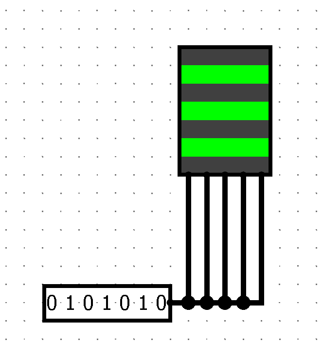 
  <em>Figura 1. Matriz LED con una entrada compartida para las cinco columnas.</em>

Después probamos conectar un pin de 7 bits distinto a cada una de las cinco columnas. De esta forma pudimos darle un valor diferente a cada columna y controlar individualmente todos los LEDs de la matriz.

  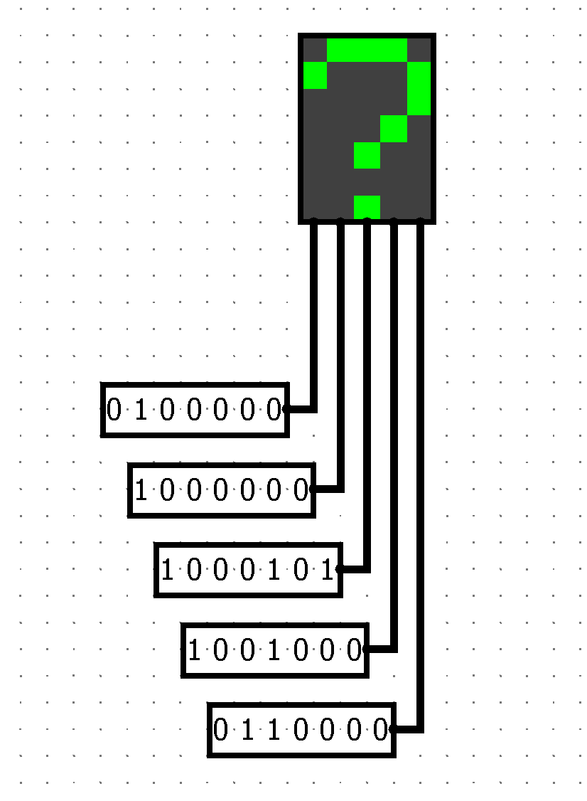 
  <em>Figura 2. Matriz LED con una entrada independiente por columna.</em>

Con esta prueba entendimos cómo controlar el display y vimos que, definiendo los cinco valores de 7 bits correspondientes a las columnas, podíamos empezar a dibujar los distintos símbolos del tragamonedas.

Hasta este punto ya podíamos controlar todos los LEDs de la matriz, pero solamente estábamos mostrando una imagen a la vez, configurando manualmente los valores de las cinco columnas. Para el tragamonedas necesitábamos poder elegir entre cuatro estados distintos: el **7**, la **campana**, el **rayo** y la **pantalla apagada**.

Buscando una forma de guardar los distintos patrones y poder elegir cuál mostrar, consultamos con **ChatGPT y Claude**. A partir de estas consultas investigamos el uso de una **ROM**.

Una ROM (*Read-Only Memory*) es una memoria que permite almacenar valores que luego pueden ser consultados a partir de una dirección. En nuestro caso no necesitamos modificar estos valores mientras el circuito está funcionando, sino guardar previamente los patrones correspondientes a cada símbolo y después seleccionar cuál queremos mostrar. Logisim incluye la ROM dentro de su biblioteca de componentes de memoria y permite configurar tanto la cantidad de bits utilizados para la dirección como el tamaño de los datos almacenados. ([Documentación de componentes de memoria de Logisim](https://www.baillifard.com/logisim/en/html/guide/mem/index.html))

Para nuestro caso configuramos cada ROM con **2 bits de dirección** y **7 bits de datos**. Al tener 2 bits de dirección contamos con cuatro posiciones posibles (`00`, `01`, `10` y `11`), exactamente la cantidad que necesitamos para nuestros cuatro estados. En cada posición guardamos el patrón de una columna para un símbolo determinado. Los 7 bits de datos corresponden a las 7 filas de esa columna: cada bit indica si el LED de su fila debe estar encendido (`1`) o apagado (`0`).

Asignamos las direcciones de la siguiente forma:

| Dirección | Imagen |
|---|---|
| `00` | 7 |
| `01` | Campana |
| `10` | Rayo |
| `11` | Pantalla apagada |

Para cargar las imágenes, primero definimos qué LEDs tenían que estar prendidos en cada columna de cada símbolo y representamos esa columna como un valor binario de 7 bits. Como el editor de contenido de las ROM en Logisim muestra los valores en hexadecimal, convertimos cada valor de binario a hexadecimal y lo cargamos en la dirección correspondiente. Por ejemplo, el patrón binario `1000000` se escribe como `40` en hexadecimal. La conversión cambia solamente la forma de escribir el valor: la ROM sigue almacenando y entregando los mismos 7 bits que controlan los LEDs de la columna. ([Documentación de memoria de Logisim](https://www.baillifard.com/logisim/en/html/guide/mem/mem-v3word.html))

Como cada columna del LED Matrix puede tener un patrón distinto, usamos **cinco ROM**, una para cada columna. Las cinco comparten la misma entrada de dirección de 2 bits, pero cada una guarda los valores correspondientes a su propia columna.

De esta forma, al cambiar únicamente el valor del pin de entrada podemos cambiar la imagen completa que aparece en el display. Por ejemplo, al ingresar `00`, las cinco ROM buscan los valores correspondientes al 7 y cada una manda sus 7 bits a su respectiva columna, formando entre todas la imagen completa.

<table>
  <tr>
    <td align="center" width="50%">
      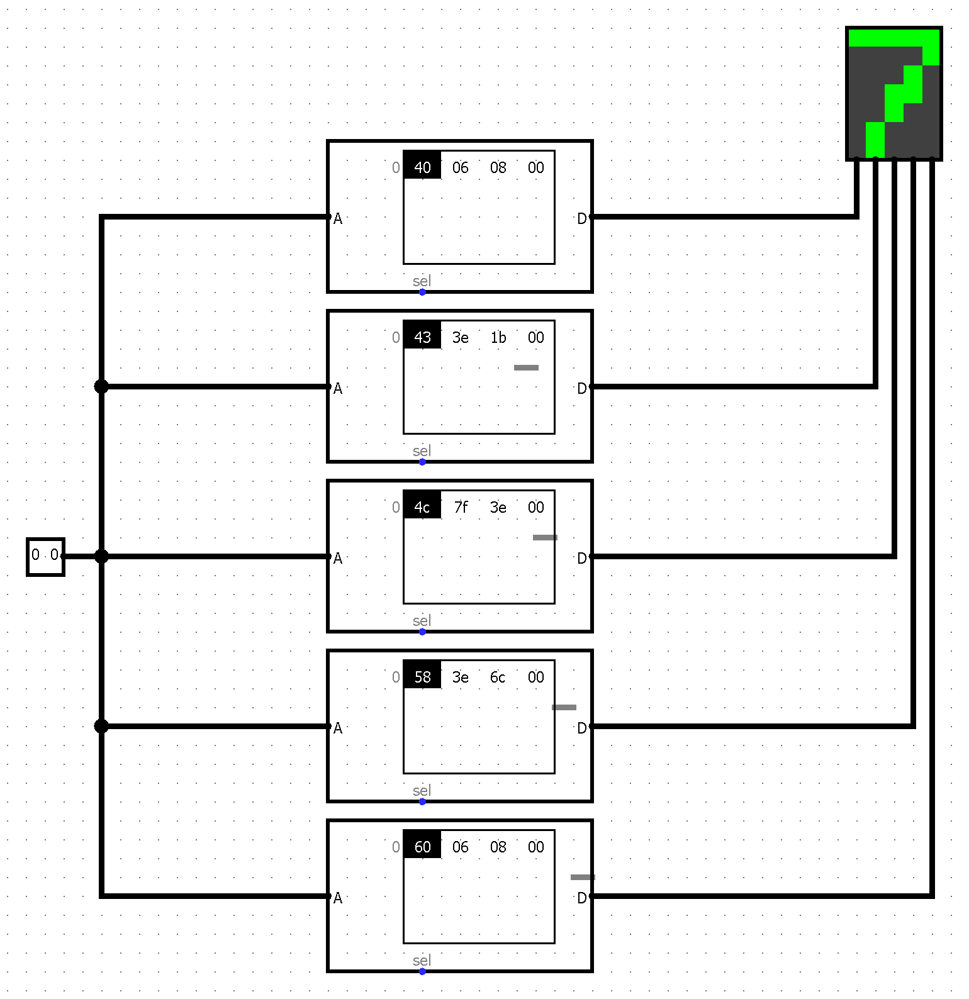 
      <em>Figura 3. Símbolo siete, seleccionado con la dirección <code>00</code>.</em>
    </td>
    <td align="center" width="50%">
      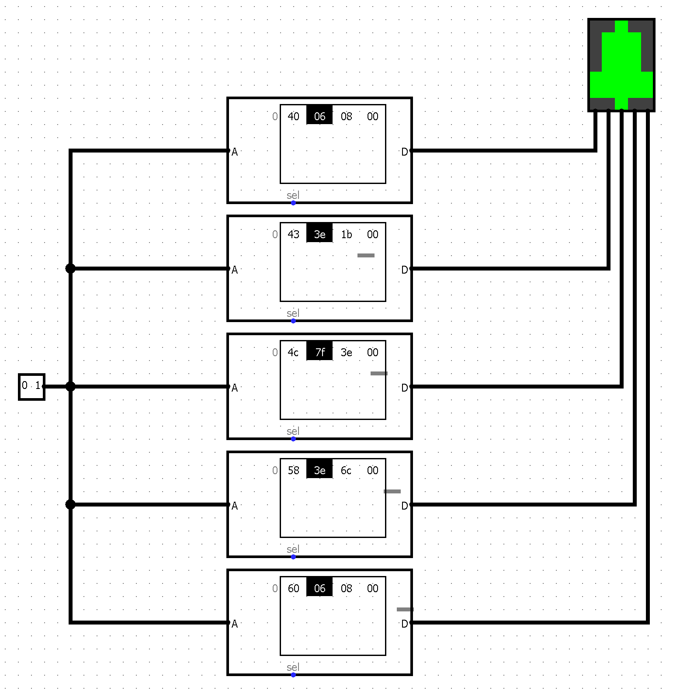 
      <em>Figura 4. Símbolo campana, seleccionado con la dirección <code>01</code>.</em>
    </td>
  </tr>
  <tr>
    <td align="center" width="50%">
      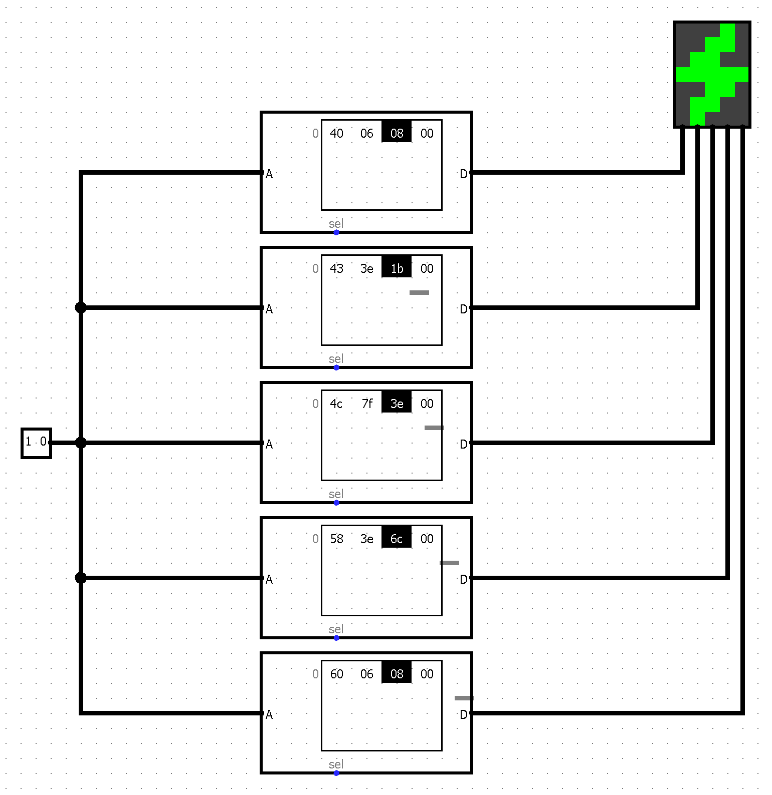 
      <em>Figura 5. Símbolo rayo, seleccionado con la dirección <code>10</code>.</em>
    </td>
    <td align="center" width="50%">
      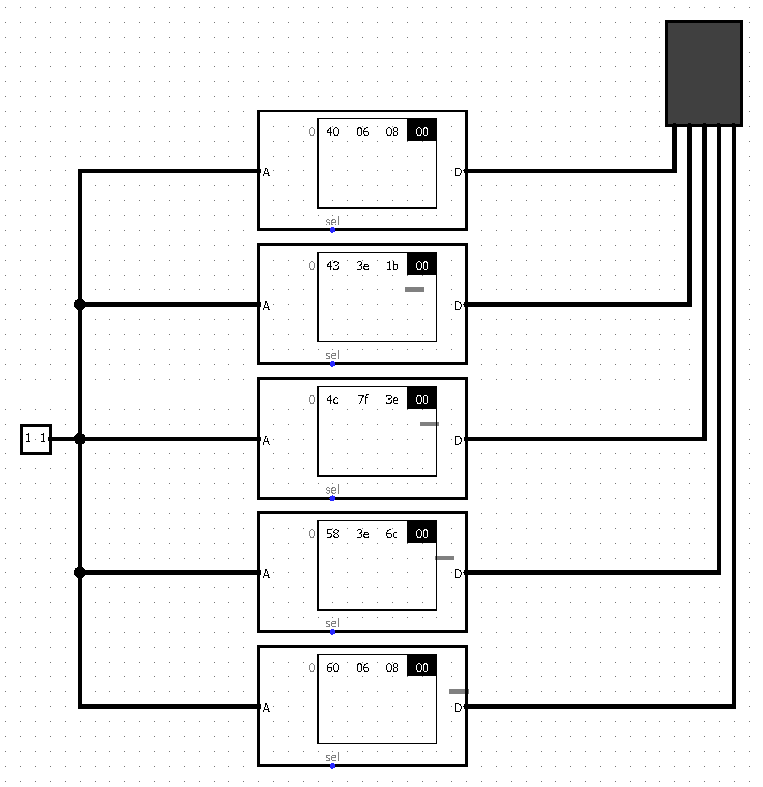 
      <em>Figura 6. Pantalla apagada, seleccionada con la dirección <code>11</code>.</em>
    </td>
  </tr>
</table>

Con esto ya teníamos un circuito capaz de mostrar cualquiera de los tres símbolos, además de apagar completamente el display, utilizando solamente una entrada de 2 bits.

A medida que agregamos las cinco ROM, sus conexiones y el LED Matrix, el circuito empezó a quedar bastante grande y ocupado. Como íbamos a necesitar tres displays iguales en el tragamonedas, repetir todo este circuito tres veces iba a hacer que el circuito principal quedara todavía más difícil de leer.

Consultamos nuevamente con las herramientas de IA buscando una forma de ordenar y reducir el circuito, y a partir de esto investigamos el uso de **subcircuitos** en Logisim.

Logisim permite crear circuitos nuevos dentro de un mismo proyecto y después utilizarlos como componentes dentro de otros circuitos. Los pines de entrada y salida que colocamos dentro de un circuito pasan a formar la interfaz del componente cuando lo usamos como subcircuito. Así podemos separar partes del proyecto y reutilizar el mismo diseño varias veces sin tener que copiar todos sus componentes y conexiones. ([Using subcircuits — Logisim User's Guide](https://baillifard.com/logisim/en/html/guide/subcirc/sub-using.html))

Decidimos entonces crear un subcircuito para encargarse únicamente de transformar el número del símbolo que queremos mostrar en los valores necesarios para las cinco columnas del display.

Este circuito tiene:

- un pin de entrada de **2 bits**, que indica qué imagen queremos mostrar;
- **cinco ROM**, una por cada columna;
- cinco pines de salida de **7 bits**, uno por cada columna del LED Matrix.

Las cinco ROM reciben la misma dirección de 2 bits. Cada una devuelve el patrón de 7 bits correspondiente a su columna y este valor sale por uno de los cinco pines del subcircuito.

  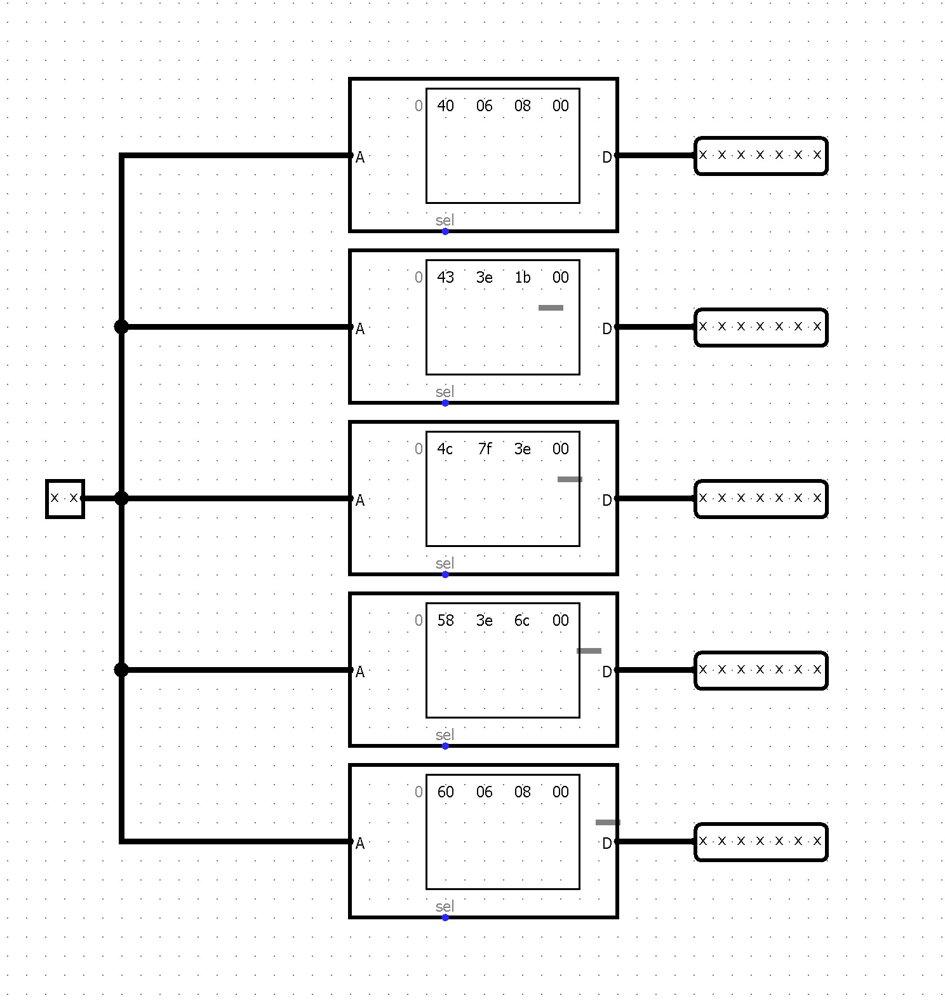 
  <em>Figura 7. Subcircuito de almacenamiento y selección de los símbolos.</em>

Al volver al circuito principal, podemos usar este subcircuito como si fuera un componente más. Solamente tenemos que conectarle la entrada de 2 bits y conectar sus cinco salidas a las cinco columnas del LED Matrix. Los pines definidos dentro de un subcircuito son justamente los que Logisim utiliza para crear su interfaz cuando se lo coloca dentro de otro circuito. ([Documentación del componente Pin de Logisim](https://www.baillifard.com/logisim/en/html/libs/wiring/pin.html))

  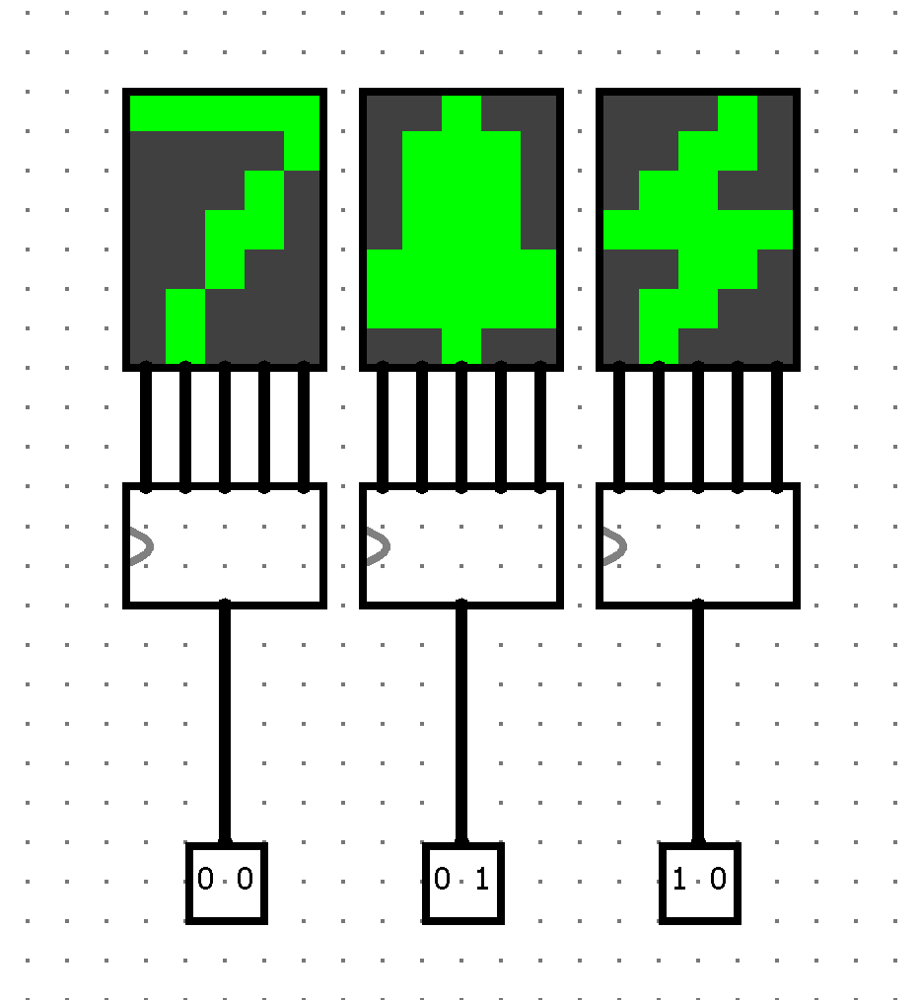 
  <em>Figura 8. Conexión del subcircuito a las cinco columnas de la matriz LED.</em>

De esta forma logramos esconder toda la lógica de las ROM dentro de un único componente y dejar el circuito principal bastante más limpio. Además, como el tragamonedas necesita tres displays, podemos reutilizar exactamente el mismo subcircuito para los tres sin tener que volver a armar toda la lógica de selección de imágenes.

### Palanca: lectura del joystick

La palanca debe iniciar una jugada únicamente cuando se mueve hacia abajo. Además, el circuito debe distinguir entre detectar ese movimiento y permitir que influya en el juego: durante los estados de Juego y Victoria, mover la palanca no debe iniciar otra jugada. La letra pide mostrar ambas condiciones mediante dos LEDs.

Para estudiar la entrada elegimos el componente **Joystick** de Logisim. Según su [documentación](https://cburch.com/logisim/docs/2.7/en/html/libs/io/joystick.html), tiene dos salidas: el pin superior tiene la coordenada horizontal X y el inferior, la coordenada vertical Y. Como nos interesa el movimiento hacia abajo, decidimos utilizar solamente Y. La documentación también indica que el valor de reposo corresponde al centro, que arriba vale 1 y que abajo alcanza el valor máximo permitido por el ancho de bits configurado.

Al colocar el joystick observamos que estaba configurado con 4 bits por coordenada. Para esta primera prueba redujimos el ancho a **2 bits**, suficiente para distinguir arriba, centro y abajo. Necesitábamos ver qué valor producía cada posición, por lo que consultamos a Codex cómo observar la salida en Logisim. A partir de esa consulta conectamos un  Probe  al pin Y y seleccionamos la visualización en binario

| Posición vertical | Salida Y con 2 bits |
| --- | --- |
| Arriba | `01` |
| Centro (reposo) | `10` |
| Abajo | `11` |

El valor `00` no corresponde a una posición del joystick. En la prueba comprobamos que la sonda muestra `10` cuando lo soltamos, `01` al llevarlo arriba y `11` al llevarlo abajo.

  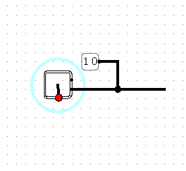 
  <em>Figura 9. Lectura de la salida vertical del joystick en pos inferior.</em>

### Detección de la palanca abajo

La salida Y tiene 2 bits, pero para encender un LED **Detección Palanca** necesitamos una señal de 1 bit que valga 1 solamente cuando Y sea `11`. Separamos Y en sus bits `y1` e `y0` mediante un **Splitter** y los conectamos a una compuerta **AND**:

La expresión vale 1 para `11` y 0 para `01` y `10`. Armamos esta lógica en el subcircuito `controlador_palanca` y conectamos su entrada al eje Y del joystick en el circuito principal. Falta registrar en el informe las pruebas de su salida para las tres posiciones.

  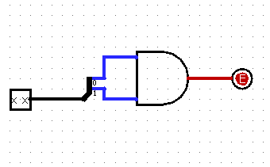 
  <em>Figura 10. Circuito controlador de palanca.</em>

Detectar que la palanca está abajo no equivale a aceptar una jugada nueva, porque la señal permanece en 1 mientras la sostenemos. En una etapa posterior tendremos que detectar un nuevo movimiento hacia abajo y habilitarlo solo si el juego está en Espera. Esa condición controlará el LED **Influye** y el inicio de la jugada.

  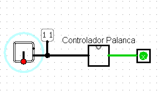 
  <em>Figura 11. Conexión del joystick al controlador de la palanca.</em>

### Implementado el led Influye
Para comprobar cuándo la palanca puede afectar al juego, agregamos al subcircuito *controlador_palanca* una entrada de 2 bits para el estado actual. En esta prueba representamos Espera con 11 e ingresamos ese valor manualmente.

Separamos los bits del estado y usamos una compuerta AND para obtener en_espera. Después combinamos esa señal con palanca_abajo, obtenida anteriormente. Así, la señal combinada se activa cuando la palanca está abajo y el estado indicado es Espera. 

  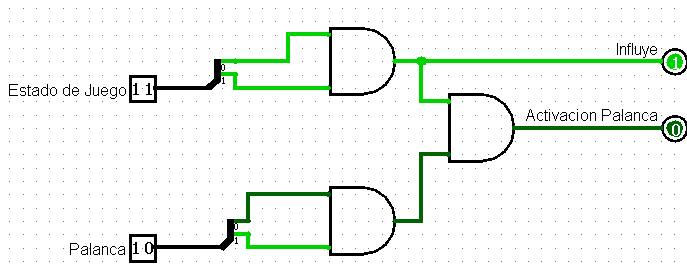 
  <em>Figura 12. Controlador de palanca con led influye.</em>

Del AND de las entradas de estado podemos implementar una 2da salida a modo de flag para saber si tenemos que prender el led Influye.

Todavía falta implementar que una palanca sostenida no inicie otra jugada.

  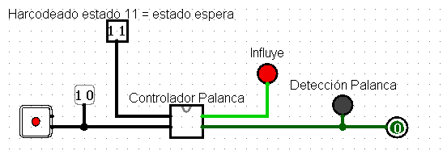 
  <em>Figura 13. Implementacion de palanca con led influye y deteccion de palanca.</em>

