# Diseño e implementación de un tragamonedas en Logisim

**Integrantes**

- Patricio Nuñez Echeverría — N.º de estudiante: 398434
- Rafael Menendez Lema — N.º de estudiante: 391040

## Introducción

Este proyecto tiene como objetivo diseñar e implementar una máquina tragamonedas digital en Logisim, aplicando los conceptos que trabajamos en clase.

El sistema debe contar con tres displays que muestren los símbolos del juego: un siete, una campana y un rayo. Al accionar una palanca, se inicia una jugada que consume un crédito y muestra una animación en la que los displays se detienen de forma progresiva. Si los tres símbolos coinciden, se da el premio correspondiente y se señala la victoria mediante el parpadeo de las pantallas. Los créditos disponibles deben mostrarse en decimal y en binario.

En este informe documentamos el proceso de desarrollo de los distintos módulos del sistema, desde las primeras pruebas hasta su integración.

## Desarrollo del sistema

### Visualización de los símbolos

Después de leer la letra del obligatorio en clase y siguiendo la recomendación del profesor, decidimos arrancar el proyecto por los displays que muestran los símbolos del tragamonedas.

Mirando las capturas de la letra, vimos que se usaba una matriz LED de 5 columnas y 7 filas. Al colocar el componente nos encontramos con cinco pines en la parte de abajo. Como no teníamos claro cómo funcionaban, consultamos la documentación de LED Matrix [1](#fuente-1). Ahí entendimos que cada pin controla una columna con 7 bits, uno por fila.

Para probarlo, conectamos un único pin de entrada de 7 bits a las cinco columnas. Fuimos cambiando los bits a mano para ver qué LEDs se prendían. Como todas recibían el mismo valor, el patrón se repetía en las cinco columnas.

  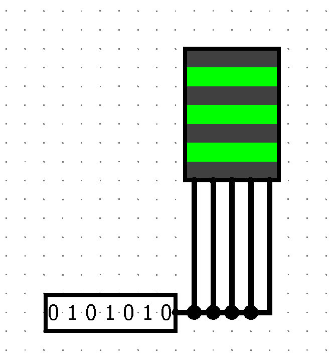 
  <em>Figura 1. Matriz LED con una entrada compartida para las cinco columnas.</em>

Después conectamos un pin de 7 bits distinto a cada columna. Así pudimos darle un valor diferente a cada una y controlar los LEDs por separado.

  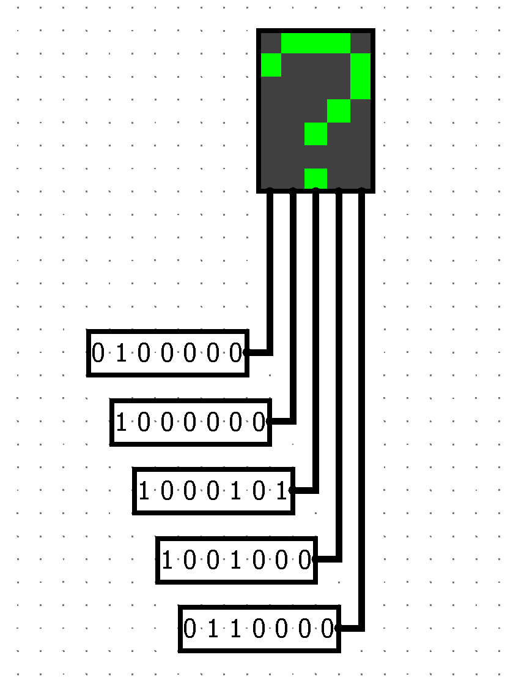 
  <em>Figura 2. Matriz LED con una entrada independiente por columna.</em>

Con eso ya podíamos dibujar los símbolos. Ahora nos faltaba elegir entre el **7**, la **campana**, el **rayo** y la **pantalla apagada** sin tener que cambiar los cinco valores a mano.

Para ver cómo guardar los patrones y elegir cuál mostrar, consultamos con **ChatGPT y Claude**. A partir de esas consultas empezamos a investigar las **ROM**.

Una **ROM** (*Read-Only Memory*) almacena valores que se consultan mediante una dirección. La usamos para guardar los patrones de los símbolos. [2](#fuente-2)

Configuramos cada ROM con **2 bits de dirección** y **7 bits de datos**. Con 2 bits tenemos cuatro posiciones (`00`, `01`, `10` y `11`), justo las que necesitábamos para los tres símbolos y la pantalla apagada. En cada posición guardamos el patrón de una columna. Cada uno de los 7 bits de datos indica si el LED de una fila tiene que estar prendido (`1`) o apagado (`0`).

Repartimos las direcciones así:

| Dirección | Imagen |
|---|---|
| `00` | 7 |
| `01` | Campana |
| `10` | Rayo |
| `11` | Pantalla apagada |

Para cargar los símbolos, primero elegimos qué LEDs debían prenderse en cada columna y escribimos ese patrón en 7 bits. Como el editor de las ROM muestra los valores en hexadecimal, convertimos los patrones antes de cargarlos. Por ejemplo, `1000000` en binario es `40` en hexadecimal. Cambia la forma de escribirlo, pero el valor y los 7 bits que recibe la columna siguen siendo los mismos. [3](#fuente-3)

Usamos **cinco ROM**, una por columna, porque cada columna necesita su propio patrón. Todas reciben la misma dirección de 2 bits, pero cada una guarda los valores de su columna.

Así, con cambiar una sola dirección, las cinco ROM entregan sus patrones y se forma el símbolo completo.

<table>
  <tr>
    <td align="center" width="50%">
      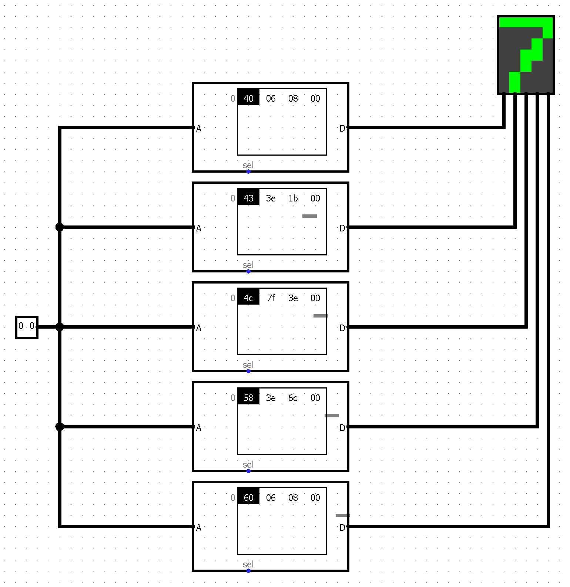 
      <em>Figura 3. Símbolo siete, seleccionado con la dirección <code>00</code>.</em>
    </td>
    <td align="center" width="50%">
      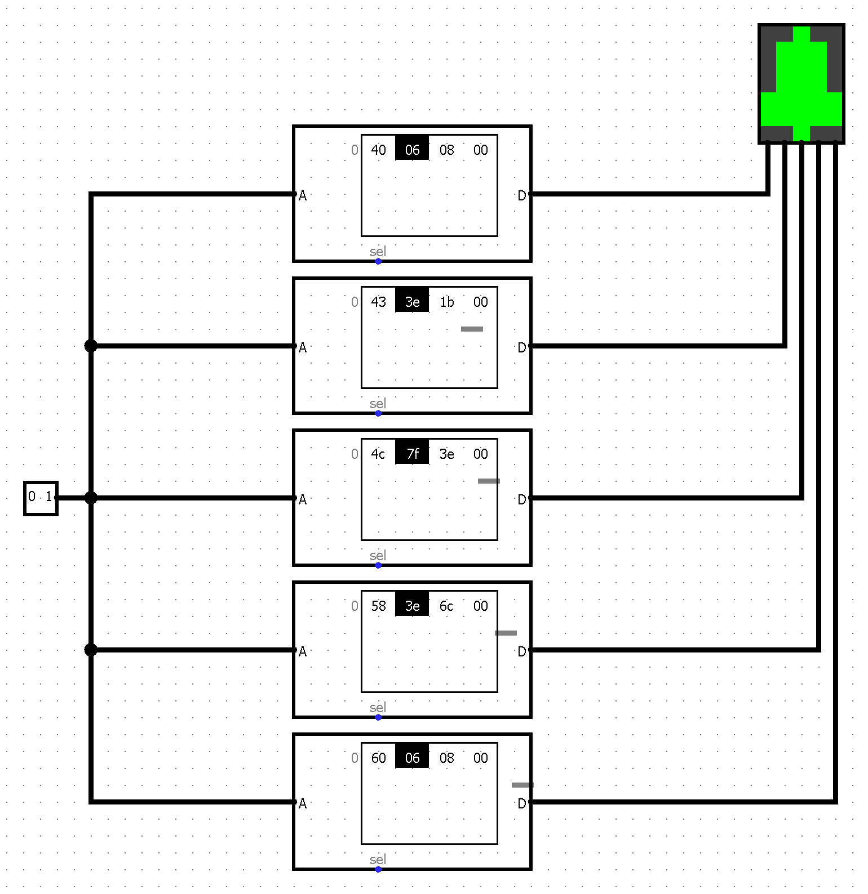 
      <em>Figura 4. Símbolo campana, seleccionado con la dirección <code>01</code>.</em>
    </td>
  </tr>
  <tr>
    <td align="center" width="50%">
      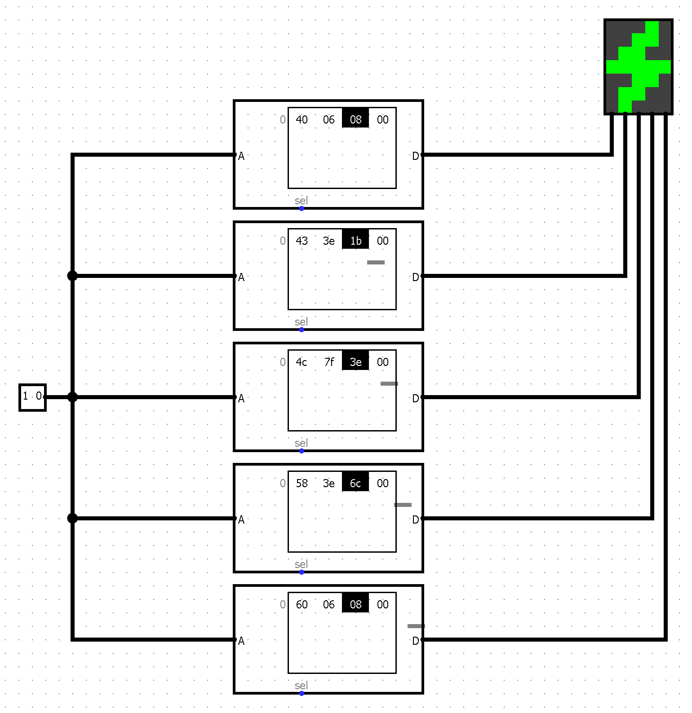 
      <em>Figura 5. Símbolo rayo, seleccionado con la dirección <code>10</code>.</em>
    </td>
    <td align="center" width="50%">
      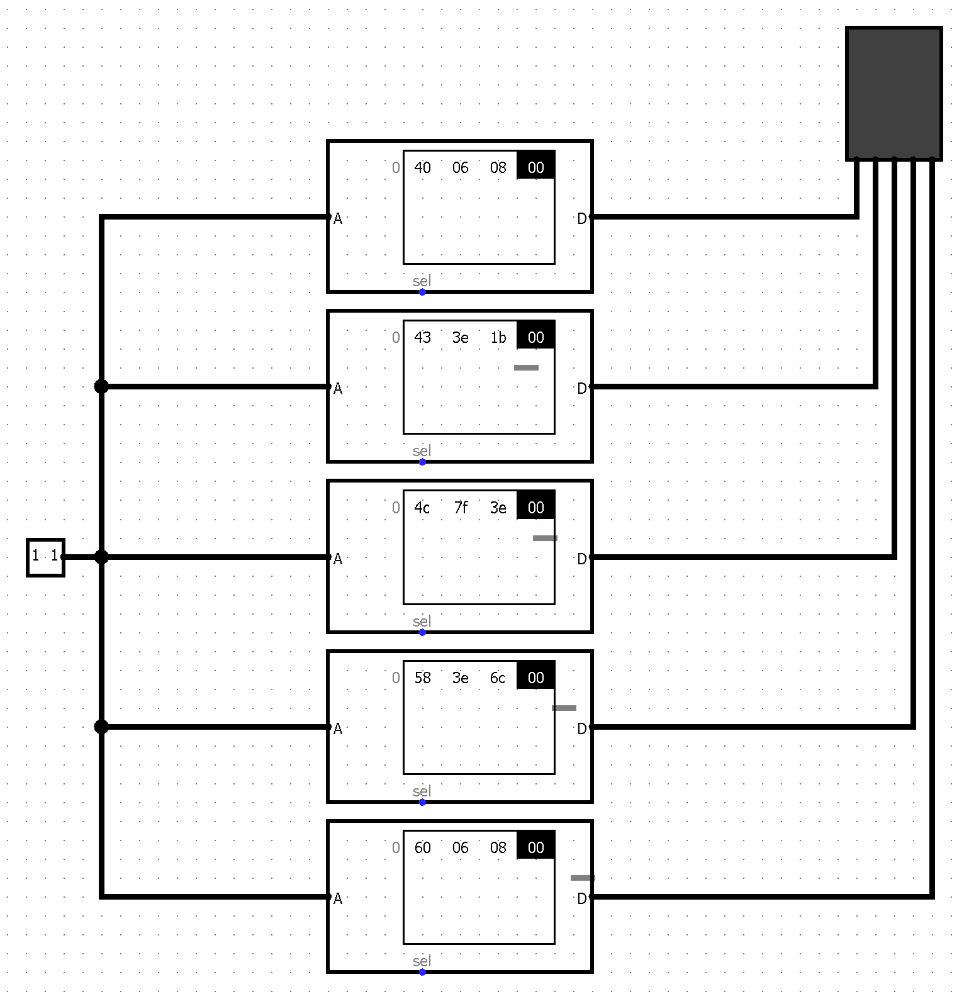 
      <em>Figura 6. Pantalla apagada, seleccionada con la dirección <code>11</code>.</em>
    </td>
  </tr>
</table>

El circuito ya tenía bastantes componentes y cables. Como íbamos a necesitar tres displays, buscamos cómo reutilizarlo sin copiar todo tres veces. Consultamos nuevamente con las herramientas de IA y empezamos a usar **subcircuitos** en Logisim.

Un **subcircuito** agrupa componentes y conexiones para reutilizarlos como un único bloque, con una interfaz definida por sus pines. [4](#fuente-4)

Armamos entonces `controlador_display`, que recibe el número del símbolo y entrega los valores para las cinco columnas del display.

En esta primera versión, el circuito tenía:

- un pin de entrada de **2 bits**, que indica qué imagen queremos mostrar;
- **cinco ROM**, una por cada columna;
- cinco pines de salida de **7 bits**, uno por cada columna del LED Matrix.

  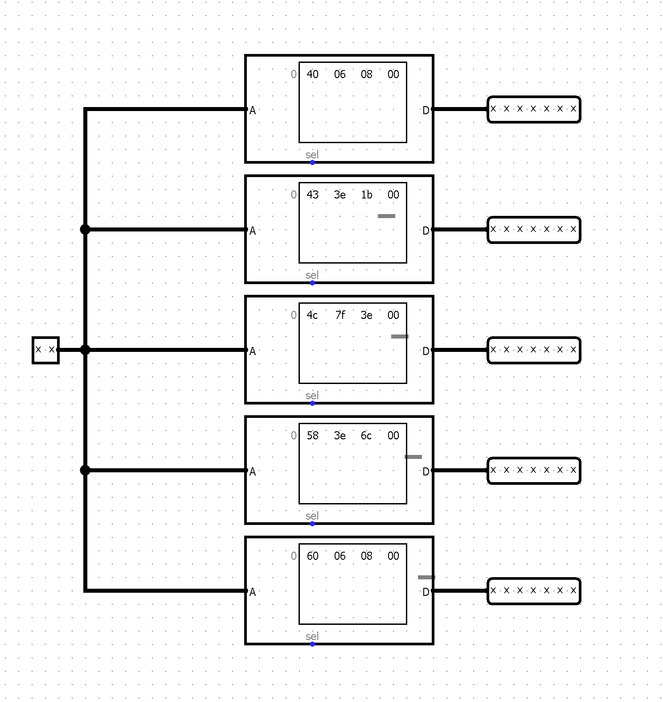 
  <em>Figura 7. Subcircuito de almacenamiento y selección de los símbolos.</em>

En el circuito principal conectamos la entrada de selección y las cinco salidas del subcircuito a las columnas del LED Matrix.

  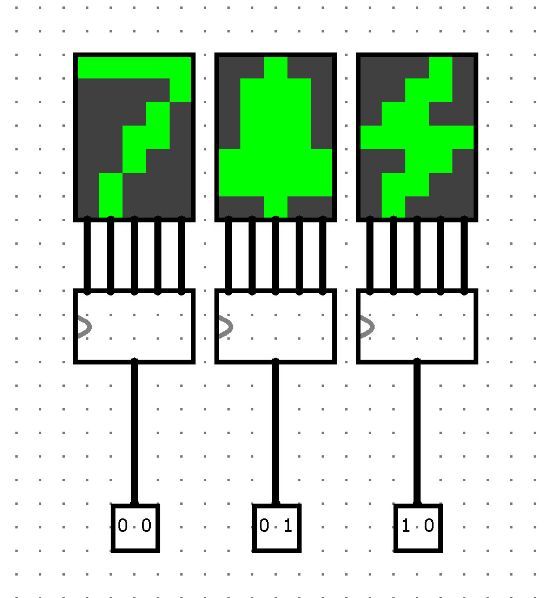 
  <em>Figura 8. Conexión del subcircuito a las cinco columnas de la matriz LED.</em>

Así pudimos usar el mismo diseño en las tres pantallas y dejar más ordenado el circuito principal.

### Animación y detención de los displays

Una vez que pudimos mostrar los símbolos, seguimos con la animación. Nos apoyamos en ChatGPT para elegir los componentes y revisar cómo configurarlos. Usamos un **contador**, que guarda un valor y puede incrementarlo en cada flanco activo del reloj. El **reloj** alterna periódicamente su salida para marcar el avance del circuito. [5](#fuente-5), [6](#fuente-6) Conectamos un contador de 2 bits a `controlador_display`, con un máximo de 2 y vuelta a cero al superarlo. Así conseguimos la secuencia `00 → 01 → 10 → 00`: siete, campana y rayo, sin pasar por `11`, que apaga la pantalla.

Al principio probamos que las pantallas mostraran símbolos distintos durante la animación. Después preferimos simplificar: todas las tiradas arrancan con el mismo símbolo y los tres displays recorren la misma secuencia al mismo tiempo. Cada uno tiene su contador, conectado al reloj común. Esto es solo la animación; el resultado aleatorio de la jugada lo vamos a incorporar más adelante.

Para elegir entre animación y resultado, ampliamos `controlador_display` con dos entradas de 2 bits, `simbolo_animacion` y `resultado`, y una entrada de control de 1 bit, `detener`. Un **multiplexor** copia a su salida una de sus entradas de datos según una señal de selección. [7](#fuente-7) Su salida alimenta la dirección de las cinco ROM. Con la señal `detener` en 0 selecciona el símbolo del contador de animación; con `detener` en 1 selecciona el resultado que debe mostrar esa pantalla. Por ahora elegimos los resultados a mano con pines de 2 bits. Los contadores siguen avanzando, pero cuando activamos `detener` la pantalla muestra el resultado fijo.

  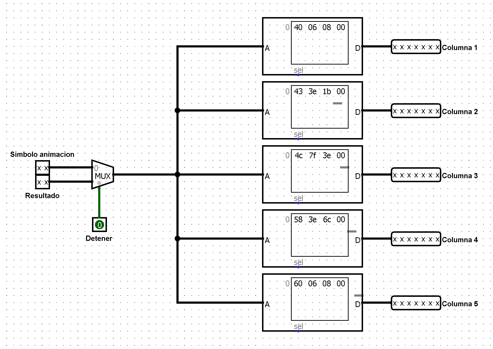 
  <em>Figura 9. Selección entre animación y resultado dentro de controlador_display.</em>

Para que las pantallas se fueran deteniendo de a una, agregamos un contador de tiempo de 3 bits al mismo reloj. Un **comparador** indica si un valor es mayor, igual o menor que otro; una compuerta **OR** entrega 1 si al menos una de sus entradas vale 1. [8](#fuente-8), [9](#fuente-9) Usamos tres comparadores y una OR por pantalla para combinar las salidas de mayor e igual y mantener activa cada señal desde su umbral:

| Valor del contador de tiempo | Display 1 | Display 2 | Display 3 |
|---|---|---|---|
| 0 a 4 | Animación | Animación | Animación |
| 5 | Resultado | Animación | Animación |
| 6 | Resultado | Resultado | Animación |
| 7 | Resultado | Resultado | Resultado |

En la prueba nos pasó que el comparador marcaba 1, 2 y 3 como mayores que `101`, cuando esperábamos que lo leyera como 5. Revisando la configuración vimos que estaba comparando con signo: en 3 bits, `101` es −3. Lo cambiamos a **Unsigned / Sin signo** y la comparación quedó como esperábamos. Dejamos los tres comparadores con esa configuración.

Dejamos el contador de tiempo fijo en 7 al llegar al máximo, para que la animación no vuelva a empezar sola. Primero usamos un botón para reiniciarlo y repetir las pruebas. Después juntamos el contador, los comparadores y las OR en `controlador_animacion`, con entradas de reloj y reinicio y una salida de detención para cada display. Reemplazamos los pines de comparación por componentes **Constante**, que entregan permanentemente el valor configurado en sus propiedades. Los configuramos con 3 bits y valores 5, 6 y 7, conservando los umbrales al reiniciar la simulación. [10](#fuente-10)

  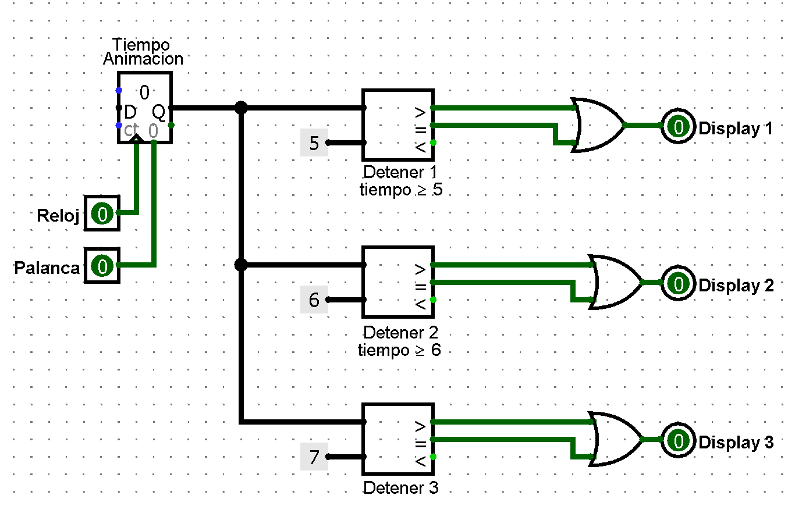 
  <em>Figura 10. Control del tiempo y de la detención progresiva de las pantallas.</em>

  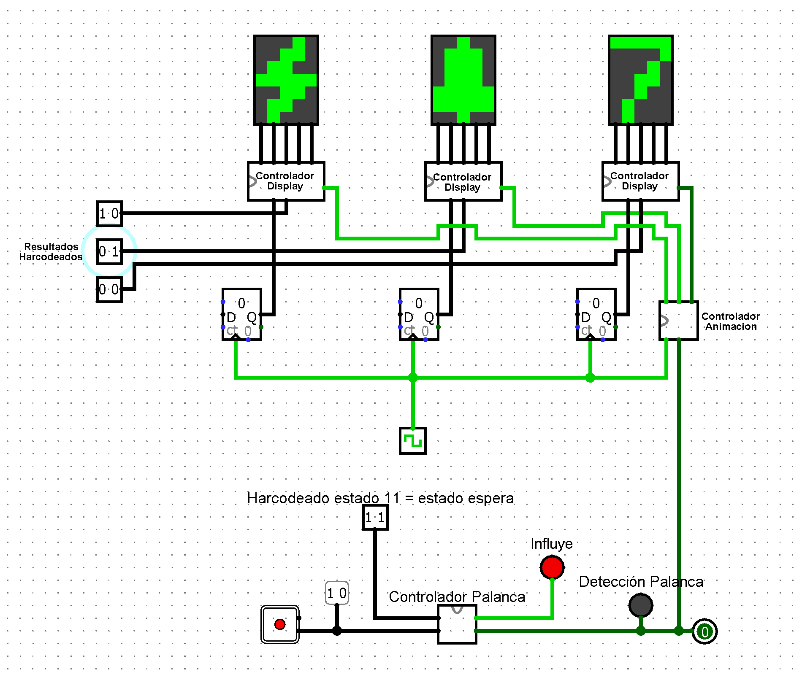 
  <em>Figura 11. Prueba de la selección de resultados y de la detención por etapas.</em>

Probamos con resultados fijos elegidos a mano y la detención funcionó como esperábamos: la primera pantalla mostró su resultado al llegar a 5, la segunda al llegar a 6 y la tercera al llegar a 7. Cada una quedó fija mientras las otras seguían animándose. Con las tres detenidas, al bajar la palanca arranca otra vez la animación. Por ahora, si la volvemos a bajar mientras está en curso, el contador de tiempo vuelve a cero y la secuencia se alarga. Nos falta bloquear esas nuevas activaciones durante la jugada, agregar los resultados aleatorios y hacer el parpadeo de victoria.

## Palanca

### Data sheet

La letra del obligatorio iniciar con la investigacion de que es un data sheet, e implementar una una hoja de especificaciones para la palanca.

#### Que es un data sheet?

Unit electronics [11](#fuente-11) define Data sheet como un documento que recopila información detallada sobre las características, el funcionamiento, el uso y las especificaciones técnicas de un componente electrónico, en este caso aplicado a circuitos y subcircuitos digitales.

Este tipo de documentación suele ser elaborada por el fabricante del componente o por quien diseña e implementa el circuito.

Generalmente, incluye información como:

- Diagramas del circuito.
- Gráficos y tablas de verdad.
- Guías de uso y funcionamiento.
- Especificaciones de entradas y salidas.
- Descripción del comportamiento del circuito.

### Palanca: lectura del joystick

La palanca debe iniciar una jugada únicamente cuando se mueve hacia abajo. Además, el circuito debe distinguir entre detectar ese movimiento y permitir que influya en el juego: durante los estados de Juego y Victoria, mover la palanca no debe iniciar otra jugada. La letra pide mostrar ambas condiciones mediante dos LEDs.

Para estudiar la entrada elegimos el componente **Joystick** de Logisim. Según su documentación [12](#fuente-12), tiene dos salidas: el pin superior tiene la coordenada horizontal X y el inferior, la coordenada vertical Y. Como nos interesa el movimiento hacia abajo, decidimos utilizar solamente Y. La documentación también indica que el valor de reposo corresponde al centro, que arriba vale 1 y que abajo alcanza el valor máximo permitido por el ancho de bits configurado.

Al colocar el joystick observamos que estaba configurado con 4 bits por coordenada. Para esta primera prueba redujimos el ancho a **2 bits**, suficiente para distinguir arriba, centro y abajo. Necesitábamos ver qué valor producía cada posición, por lo que consultamos a Codex cómo observar la salida en Logisim. A partir de esa consulta conectamos un Probe  al pin Y y seleccionamos la visualización en binario. Esto nos permitió estudiar el componente lo que nos permitió escribir la [hoja de especificaciones del joystick](hoja_especificacion_jostick.md).

| Posición vertical | Salida Y con 2 bits |
| --- | --- |
| Arriba | `01` |
| Centro (reposo) | `10` |
| Abajo | `11` |

El valor `00` no corresponde a una posición del joystick. En la prueba comprobamos que la sonda muestra `10` cuando lo soltamos, `01` al llevarlo arriba y `11` al llevarlo abajo.

  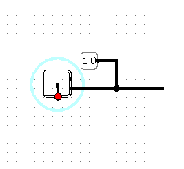 
  <em>Figura 12. Lectura de la salida vertical del joystick en pos inferior.</em>

### Detección de la palanca abajo

La salida Y tiene 2 bits, pero para encender un LED **Detección Palanca** necesitamos una señal de 1 bit que valga 1 solamente cuando Y sea `11`. Separamos Y en sus bits `y1` e `y0` mediante un **Splitter** y los conectamos a una compuerta **AND**:

La expresión vale 1 para `11` y 0 para `01` y `10`. Armamos esta lógica en el subcircuito `controlador_palanca` y conectamos su entrada al eje Y del joystick en el circuito principal. Falta registrar en el informe las pruebas de su salida para las tres posiciones.

  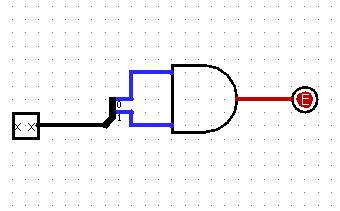 
  <em>Figura 13. Circuito controlador de palanca.</em>

Detectar que la palanca está abajo no equivale a aceptar una jugada nueva, porque la señal permanece en 1 mientras la sostenemos. En una etapa posterior tendremos que detectar un nuevo movimiento hacia abajo y habilitarlo solo si el juego está en Espera. Esa condición controlará el LED **Influye** y el inicio de la jugada.

  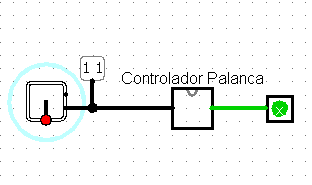 
  <em>Figura 14. Conexión del joystick al controlador de la palanca.</em>

### Implementado el led Influye

Para comprobar cuándo la palanca puede afectar al juego, agregamos al subcircuito *controlador_palanca* una entrada de 2 bits para el estado actual. En esta prueba representamos Espera con 11 e ingresamos ese valor manualmente.

Separamos los bits del estado y usamos una compuerta AND para obtener en_espera. Después combinamos esa señal con palanca_abajo, obtenida anteriormente. Así, la señal combinada se activa cuando la palanca está abajo y el estado indicado es Espera. 

  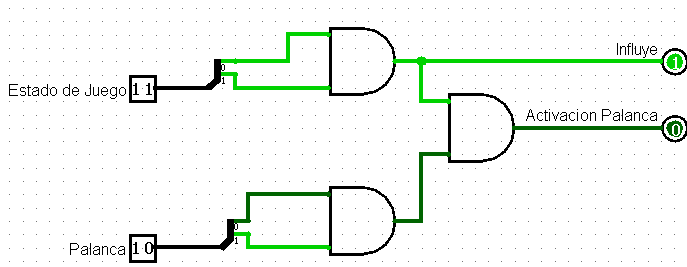 
  <em>Figura 15. Controlador de palanca con led influye.</em>

Del AND de las entradas de estado podemos implementar una 2da salida a modo de flag para saber si tenemos que prender el led Influye.

Todavía falta implementar que una palanca sostenida no inicie otra jugada.

  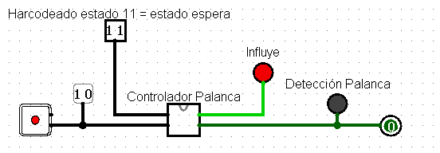 
  <em>Figura 16. Implementacion de palanca con led influye y deteccion de palanca.</em>

### Implementar deteccion de palanca sostenida

La idea que queremos implementar aqui es que cuando la palanca toma el valor 11 y se mantiene, no debemos actual instantaneamente, sino que debemos actuar cuando toma el valor 11 y vuelve al valor de reposo 10. 
Para cumplir esto podemos modificar la implementacion de *controlador_palanca* e incluir un filtro en la salida de actuacicon.
Idea 1: Podemos implementar un circuito que tome un 1 (cuando la palanca baja del todo) y lo guarde en memoria hasta que una entrada de control marque que se volvio a la possicon 10 (reposo de la palanca). Cuando esto ocurra, manda el 1 por la salida. Que debe pasar despues? vuelve a ser la salida 0? o sea se envia un pulso de 1? o se debe mantener el 1? no estoy seguro, preguntarle a rafa/profe

## Fuentes consultadas

1. [Logisim. LED Matrix.](https://baillifard.com/logisim/en/html/libs/io/dotmat.html)

2. [Logisim. Componentes de memoria.](https://www.baillifard.com/logisim/en/html/guide/mem/index.html)

3. [Logisim. Representación y edición del contenido de memoria.](https://www.baillifard.com/logisim/en/html/guide/mem/mem-v3word.html)

4. [Logisim. Uso de subcircuitos.](https://baillifard.com/logisim/en/html/guide/subcirc/sub-using.html)

5. [Logisim. Counter (contador).](https://www.cburch.com/logisim/docs/2.7/en/html/libs/mem/counter.html)

6. [Logisim. Clock (reloj).](https://www.cburch.com/logisim/docs/2.7/en/html/libs/wiring/clock.html)

7. [Logisim. Multiplexer (multiplexor).](https://www.cburch.com/logisim/docs/2.7/en/html/libs/plexers/mux.html)

8. [Logisim. Comparator (comparador).](https://www.cburch.com/logisim/docs/2.7/en/html/libs/arith/comparator.html)

9. [Logisim. Compuertas AND, OR, NAND y NOR.](https://www.cburch.com/logisim/docs/2.7/en/html/libs/gates/basic.html)

10. [Logisim. Constant (constante).](https://www.cburch.com/logisim/docs/2.7/en/html/libs/wiring/constant.html)

11. [Unit Electronics. Cómo leer hojas de datos sin morir en el intento.](https://uelectronics.com/como-leer-hojas-de-datos-sin-morir-en-el-intento/)

12. [Logisim. Joystick.](https://cburch.com/logisim/docs/2.7/en/html/libs/io/joystick.html)
