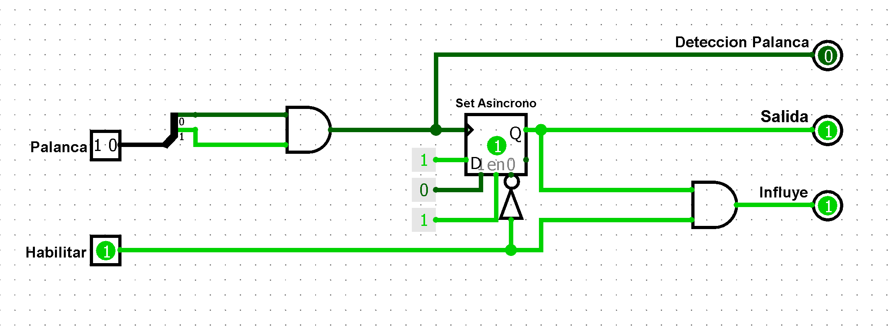
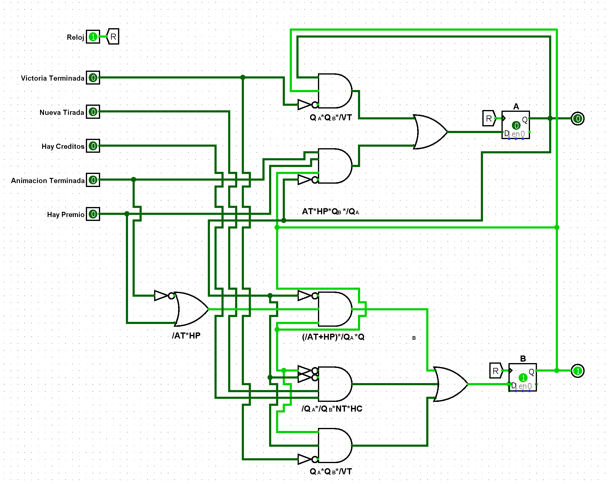
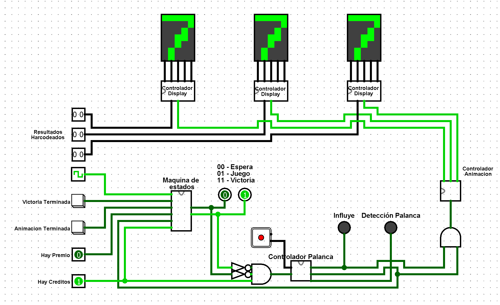

# Diseño e implementación de un tragamonedas en Logisim

**Integrantes**

- Patricio Nuñez Echeverría — N.º de estudiante: 398434
- Rafael Menendez Lema — N.º de estudiante: 391040

## Introducción

Este proyecto tiene como objetivo diseñar e implementar una máquina tragamonedas digital en Logisim, aplicando los conceptos que trabajamos en clase.

El sistema debe contar con tres displays que muestren los símbolos del juego: un siete, una campana y un rayo. Al accionar una palanca, se inicia una jugada que consume un crédito y muestra una animación en la que los displays se detienen de forma progresiva. Si los tres símbolos coinciden, se da el premio correspondiente y se señala la victoria mediante el parpadeo de las pantallas. Los créditos disponibles deben mostrarse en decimal y en binario.

En este informe documentamos el proceso de desarrollo de los distintos módulos del sistema, desde las primeras pruebas hasta su integración.

## Desarrollo del sistema

Organizamos el desarrollo en cuatro partes: la representación de los símbolos, la animación de las pantallas, la lectura de la palanca y la máquina de estados que coordina el juego. En cada parte contamos las primeras pruebas y cómo quedó la implementación actual. La máquina distingue tres estados: Espera, Juego y Victoria; su codificación y sus transiciones se detallan al final.

### Visualización de los símbolos

Después de leer la letra del obligatorio en clase y siguiendo la recomendación del profesor, decidimos arrancar el proyecto por los displays que muestran los símbolos del tragamonedas.

Mirando las capturas de la letra, vimos que se usaba una matriz LED de 5 columnas y 7 filas. Al colocar el componente nos encontramos con cinco pines en la parte de abajo. Como no teníamos claro cómo funcionaban, consultamos la documentación de LED Matrix [1](#fuente-1). Ahí entendimos que cada pin controla una columna con 7 bits, uno por fila.

Para probarlo, conectamos un único pin de entrada de 7 bits a las cinco columnas. Fuimos cambiando los bits a mano para ver qué LEDs se prendían. Como todas recibían el mismo valor, el patrón se repetía en las cinco columnas.

<p align="center">
  <br>
  <em>Figura 1. Matriz LED con una entrada compartida para las cinco columnas.</em>
</p>

Después conectamos un pin de 7 bits distinto a cada columna. Así pudimos darle un valor diferente a cada una y controlar los LEDs por separado.

<p align="center">
  <br>
  <em>Figura 2. Matriz LED con una entrada independiente por columna.</em>
</p>

Con eso ya podíamos dibujar los símbolos. Ahora nos faltaba elegir entre el **7**, la **campana**, el **rayo** y la **pantalla apagada** sin tener que cambiar los cinco valores a mano.

Para ver cómo guardar los patrones y elegir cuál mostrar, consultamos con **ChatGPT y Claude**. A partir de esas consultas empezamos a investigar las **ROM**.

Una **ROM** (*Read-Only Memory*) almacena valores que se consultan mediante una dirección. La usamos para guardar los patrones de los símbolos. [2](#fuente-2)

Configuramos cada ROM con **2 bits de dirección** y **7 bits de datos**. Con 2 bits tenemos cuatro posiciones (`00`, `01`, `10` y `11`), justo las que necesitábamos para los tres símbolos y la pantalla apagada. En cada posición guardamos el patrón de una columna. Cada uno de los 7 bits de datos indica si el LED de una fila tiene que estar prendido (`1`) o apagado (`0`).

Repartimos las direcciones así:

| Dirección | Imagen |
|---|---|
| `00` | 7 |
| `01` | Campana |
| `10` | Rayo |
| `11` | Pantalla apagada |

Para cargar los símbolos, primero elegimos qué LEDs debían prenderse en cada columna y escribimos ese patrón en 7 bits. Como el editor de las ROM muestra los valores en hexadecimal, convertimos los patrones antes de cargarlos. Por ejemplo, `1000000` en binario es `40` en hexadecimal. Cambia la forma de escribirlo, pero el valor y los 7 bits que recibe la columna siguen siendo los mismos. [3](#fuente-3)

Usamos **cinco ROM**, una por columna, porque cada columna necesita su propio patrón. Todas reciben la misma dirección de 2 bits, pero cada una guarda los valores de su columna.

Así, con cambiar una sola dirección, las cinco ROM entregan sus patrones y se forma el símbolo completo.

<table align="center" style="margin-left: auto; margin-right: auto;">
  <tr>
    <td align="center" width="50%">
      <br>
      <em>Figura 3. Símbolo siete, seleccionado con la dirección <code>00</code>.</em>
    </td>
    <td align="center" width="50%">
      <br>
      <em>Figura 4. Símbolo campana, seleccionado con la dirección <code>01</code>.</em>
    </td>
  </tr>
  <tr>
    <td align="center" width="50%">
      <br>
      <em>Figura 5. Símbolo rayo, seleccionado con la dirección <code>10</code>.</em>
    </td>
    <td align="center" width="50%">
      <br>
      <em>Figura 6. Pantalla apagada, seleccionada con la dirección <code>11</code>.</em>
    </td>
  </tr>
</table>

El circuito ya tenía bastantes componentes y cables. Como íbamos a necesitar tres displays, buscamos cómo reutilizarlo sin copiar todo tres veces. Consultamos nuevamente con las herramientas de IA y empezamos a usar **subcircuitos** en Logisim.

Un **subcircuito** agrupa componentes y conexiones para reutilizarlos como un único bloque, con una interfaz definida por sus pines. [4](#fuente-4)

Armamos entonces `controlador_display`, que recibe el número del símbolo y entrega los valores para las cinco columnas del display.

En esta primera versión, el circuito tenía:

- un pin de entrada de **2 bits**, que indica qué imagen queremos mostrar;
- **cinco ROM**, una por cada columna;
- cinco pines de salida de **7 bits**, uno por cada columna del LED Matrix.

<p align="center">
  <br>
  <em>Figura 7. Subcircuito de almacenamiento y selección de los símbolos.</em>
</p>

En el circuito principal conectamos la entrada de selección y las cinco salidas del subcircuito a las columnas del LED Matrix.

<p align="center">
  <br>
  <em>Figura 8. Conexión del subcircuito a las cinco columnas de la matriz LED.</em>
</p>

Así pudimos usar el mismo diseño en las tres pantallas y dejar más ordenado el circuito principal.

### Animación y detención de los displays

Una vez que pudimos mostrar los símbolos, seguimos con la animación. Nos apoyamos en ChatGPT para elegir los componentes y revisar cómo configurarlos. Usamos un **contador**, que guarda un valor y puede incrementarlo en cada flanco activo del reloj. El **reloj** alterna periódicamente su salida para marcar el avance del circuito. [5](#fuente-5), [6](#fuente-6) Conectamos un contador de 2 bits a `controlador_display`, con un máximo de 2 y vuelta a cero al superarlo. Así conseguimos la secuencia `00 → 01 → 10 → 00`: siete, campana y rayo, sin pasar por `11`, que apaga la pantalla.

Al principio probamos que las pantallas mostraran símbolos distintos durante la animación. Después preferimos simplificar: los tres displays recorren la misma secuencia al mismo tiempo. Cada uno tiene su contador, inicialmente conectado al reloj común. Esto es solo la animación; el resultado aleatorio de la jugada lo vamos a incorporar más adelante.

Para elegir entre animación y resultado, ampliamos `controlador_display` con dos entradas de 2 bits, `simbolo_animacion` y `resultado`, y una entrada de control de 1 bit, `detener`. Un **multiplexor** copia a su salida una de sus entradas de datos según una señal de selección. [7](#fuente-7) Su salida alimenta la dirección de las cinco ROM. Con la señal `detener` en 0 selecciona el símbolo del contador de animación; con `detener` en 1 selecciona el resultado que debe mostrar esa pantalla. Por ahora elegimos los resultados a mano con pines de 2 bits. Los contadores siguen avanzando, pero cuando activamos `detener` la pantalla muestra el resultado fijo.

<p align="center">
  <br>
  <em>Figura 9. Selección entre animación y resultado dentro de controlador_display.</em>
</p>

Para que las pantallas se fueran deteniendo de a una, agregamos un contador de tiempo de 3 bits al mismo reloj. Un **comparador** indica si un valor es mayor, igual o menor que otro; una compuerta **OR** entrega 1 si al menos una de sus entradas vale 1. [8](#fuente-8), [9](#fuente-9) Usamos tres comparadores y una OR por pantalla para combinar las salidas de mayor e igual y mantener activa cada señal desde su umbral:

| Valor del contador de tiempo | Display 1 | Display 2 | Display 3 |
|---|---|---|---|
| 0 a 4 | Animación | Animación | Animación |
| 5 | Resultado | Animación | Animación |
| 6 | Resultado | Resultado | Animación |
| 7 | Resultado | Resultado | Resultado |

En la prueba nos pasó que el comparador marcaba 1, 2 y 3 como mayores que `101`, cuando esperábamos que lo leyera como 5. Revisando la configuración vimos que estaba comparando con signo, en complemento a dos: en 3 bits, `101` es −3. Lo cambiamos a **Unsigned / Sin signo** y la comparación quedó como esperábamos. Dejamos los tres comparadores con esa configuración.

Dejamos el contador de tiempo fijo en 7 al llegar al máximo, para que la animación no vuelva a empezar sola. Primero usamos un botón para reiniciarlo y repetir las pruebas. Después juntamos el contador, los comparadores y las OR en `controlador_animacion`, con entradas de reloj y reinicio y una salida de detención para cada display. Reemplazamos los pines de comparación por componentes **Constante**, que entregan permanentemente el valor configurado en sus propiedades. Los configuramos con 3 bits y valores 5, 6 y 7, conservando los umbrales al reiniciar la simulación. [10](#fuente-10)

<p align="center">
  <br>
  <em>Figura 10. Control del tiempo y de la detención progresiva de las pantallas.</em>
</p>

<p align="center">
  <br>
  <em>Figura 11. Prueba de la selección de resultados y de la detención por etapas.</em>
</p>

Probamos con resultados fijos elegidos a mano y la detención funcionó como esperábamos: la primera pantalla mostró su resultado al llegar a 5, la segunda al llegar a 6 y la tercera al llegar a 7. Cada una quedó fija mientras las otras seguían animándose. En esa primera prueba, al bajar la palanca con las tres detenidas volvía a empezar la animación, pero hacerlo durante la jugada también reiniciaba el contador de tiempo. Más adelante conectamos la palanca a la máquina de estados para controlar cuándo aceptar una jugada.

Después ordenamos un poco más el circuito: movimos el contador de símbolos y su reloj dentro de `controlador_display`. La entrada externa `simbolo_animacion` dejó de ser necesaria; cada instancia genera su propia secuencia y recibe solamente `resultado` y `detener`. También movimos el reloj de tiempo al interior de `controlador_animacion`. Los relojes tienen la misma configuración y, en Logisim, avanzan con los ticks de la simulación [6](#fuente-6). Con estos cambios quitamos los tres contadores y el reloj de animación del circuito principal. Al iniciar otra jugada reiniciamos el contador de tiempo, pero los contadores de símbolos siguen avanzando: las pantallas retoman la secuencia en el símbolo que corresponda en ese momento. El resultado aleatorio y el parpadeo siguen pendientes.

### Lectura y control de la palanca

La letra del obligatorio pide iniciar con la investigación de qué es un datasheet y elaborar una hoja de especificaciones para la palanca.

#### ¿Qué es un datasheet?

Unit Electronics [11](#fuente-11) define datasheet como un documento que recopila información detallada sobre las características, el funcionamiento, el uso y las especificaciones técnicas de un componente electrónico, en este caso aplicado a circuitos y subcircuitos digitales.

Este tipo de documentación suele ser elaborada por el fabricante del componente o por quien diseña e implementa el circuito.

Generalmente, incluye información como:

- Diagramas del circuito.
- Gráficos y tablas de verdad.
- Guías de uso y funcionamiento.
- Especificaciones de entradas y salidas.
- Descripción del comportamiento del circuito.

#### Lectura del joystick

La palanca debe iniciar una jugada únicamente cuando se mueve hacia abajo. Además, el circuito debe distinguir entre detectar ese movimiento y permitir que influya en el juego: durante los estados de Juego y Victoria, mover la palanca no debe iniciar otra jugada. La letra pide mostrar ambas condiciones mediante dos LEDs.

Para estudiar la entrada elegimos el componente **Joystick** de Logisim. Según su documentación [12](#fuente-12), tiene dos salidas: el pin superior tiene la coordenada horizontal X y el inferior, la coordenada vertical Y. Como nos interesa el movimiento hacia abajo, decidimos utilizar solamente Y. La documentación también indica que el valor de reposo corresponde al centro, que arriba vale 1 y que abajo alcanza el valor máximo permitido por el ancho de bits configurado.

Al colocar el joystick observamos que estaba configurado con 4 bits por coordenada. Para esta primera prueba redujimos el ancho a **2 bits**, suficiente para distinguir arriba, centro y abajo. Necesitábamos ver qué valor producía cada posición, por lo que consultamos a Codex cómo observar la salida en Logisim. A partir de esa consulta conectamos una sonda (Probe) al pin Y y seleccionamos la visualización en binario. La sonda muestra el valor de la señal sin modificarla [13](#fuente-13). Esto nos permitió estudiar el componente y escribir la [hoja de especificaciones del joystick](hoja_especificacion_jostick.md).

| Posición vertical | Salida Y con 2 bits |
| --- | --- |
| Arriba | `01` |
| Centro (reposo) | `10` |
| Abajo | `11` |

El valor `00` no corresponde a una posición del joystick. En la prueba comprobamos que la sonda muestra `10` cuando lo soltamos, `01` al llevarlo arriba y `11` al llevarlo abajo.

<p align="center">
  <br>
  <em>Figura 12. Prueba de lectura de la salida vertical del joystick.</em>
</p>

#### Detección de la palanca abajo

La salida Y tiene 2 bits, pero para encender un LED **Detección Palanca** necesitamos una señal de 1 bit que valga 1 solamente cuando Y sea `11`. Separamos Y en sus bits `y1` e `y0` mediante un **Splitter** y los conectamos a una compuerta **AND**:

```text
palanca_abajo = y1 AND y0
```

El Separador permite dividir un bus en sus bits o reunirlos [14](#fuente-14), y la AND entrega 1 cuando todas sus entradas valen 1 [9](#fuente-9). La expresión vale 1 para `11` y 0 para `01` y `10`. Armamos esta lógica en el subcircuito `controlador_palanca` y conectamos su entrada al eje Y del joystick en el circuito principal. Esta detección de posición es la base del controlador; más adelante documentamos las pruebas de su versión integrada.

<p align="center">
  <br>
  <em>Figura 13. Circuito controlador de palanca.</em>
</p>

Detectar que la palanca está abajo no equivale a aceptar una jugada nueva, porque la señal permanece en 1 mientras la sostenemos. En los siguientes pasos agregamos la captura de una nueva bajada y la habilitación de la jugada en Espera y con créditos. Esa lógica controla el LED **Influye** y la solicitud de inicio de la jugada.

<p align="center">
  <br>
  <em>Figura 14. Conexión del joystick al controlador de la palanca.</em>
</p>

#### Implementación del LED Influye

En el primer prototipo agregamos al *controlador_palanca* una entrada para el estado del juego. En ese momento representábamos Espera con `11` y el LED **Influye** indicaba solamente que estábamos en ese estado. Después corregimos esa lógica para que el indicador mostrara una solicitud de tirada habilitada, como pide la letra.

<p align="center">
  <br>
  <em>Figura 15. Primer prototipo del controlador de palanca con habilitación por estado.</em>
</p>

<p align="center">
  <br>
  <em>Figura 16. Primer prototipo de palanca con LEDs de habilitación y detección.</em>
</p>

En la versión actual, Espera se representa con `00` (`Qa = 0` y `Qb = 0`, los bits de estado de la máquina) y el controlador ya no interpreta el estado del juego. Recibe la coordenada Y de la palanca y una entrada de 1 bit, `Habilitar`. En el circuito principal calculamos:

```text
habilitar_palanca = NOT Qa AND NOT Qb AND hay_creditos
```

Así dejamos la decisión de permitir jugar en el circuito principal, y el controlador se encarga de detectar y guardar la bajada. Para reconocer Espera usamos NOT, que invierte cada bit [15](#fuente-15), y una AND [9](#fuente-9).

Separamos las señales para que cada indicador cumpla una función distinta:

| Salida | Qué representa |
|:---|:---|
| `Deteccion Palanca` | La palanca está abajo (`y1 AND y0`), independientemente del estado o los créditos |
| `Salida` | Hay una bajada guardada, pendiente de que la máquina la lea |
| `Influye` | `Habilitar AND Salida`: hay una solicitud pendiente y está permitido jugar |

El LED **Detección Palanca** sigue la posición física y se apaga al soltarla. **Influye** se prende cuando guardamos una bajada estando en Espera y con créditos; al entrar en Juego se apaga. La solicitud puede quedar guardada aunque ya hayamos soltado la palanca, como explicamos a continuación.

#### Captura de la bajada y detección de la palanca sostenida

La jugada se solicita al **bajar la palanca**, no al soltarla. Además, mantenerla abajo debe generar una sola solicitud. Para conservar una bajada que ocurra entre dos flancos del reloj de la máquina, agregamos un **biestable D**, que guarda un bit. Copia D a Q en el flanco activo de su reloj y tiene entradas asíncronas que permiten forzar el valor sin esperar ese flanco [16](#fuente-16).

Primero intentamos guardar la solicitud mediante Set y borrarla con el reloj conectado a Reset. Lo descartamos porque, mientras el reloj estaba alto, no podíamos guardar una bajada. Borrarla al entrar en Juego tampoco alcanzaba si manteníamos Set activo con la palanca sostenida: al volver a Espera podía aparecer otra solicitud.

Lo resolvimos usando el **flanco de subida de `palanca_abajo`** como reloj del biestable de captura. Un flanco de subida es el cambio de una señal de 0 a 1; en este caso ocurre al llegar a la posición `11` y es independiente del reloj de la máquina de estados. Las conexiones quedaron así:

| Pin del biestable de captura | Conexión |
|:---|:---|
| D | Constante `1` |
| Reloj | `palanca_abajo = y1 AND y0` |
| Set asíncrono | Constante `0` |
| Enable | Constante `1` |
| Reset asíncrono | `NOT habilitar_palanca` |
| Q | Solicitud pendiente, salida `Salida` |

Cuando bajamos la palanca con la entrada habilitada, Q guarda 1 sin esperar al próximo flanco del reloj de la máquina. Soltarla no borra la solicitud. La máquina la lee en el próximo flanco de subida de su reloj y, al entrar en Juego, desactiva la habilitación; eso activa el Reset y borra la solicitud.

Si mantenemos la palanca abajo durante la jugada, volver a Espera no genera otro flanco y no inicia una nueva tirada. Hace falta soltarla y volver a bajarla. Sin créditos, el Reset mantiene la solicitud en 0; agregar créditos con la palanca sostenida tampoco produce una nueva bajada. Así evitamos que una solicitud no permitida quede pendiente o reinicie la animación. Probamos la bajada breve entre ticks, la palanca sostenida y la bajada sin créditos con esta versión integrada; los tres casos funcionaron como esperábamos.

<p align="center">
  <br>
  <em>Figura 17. Captura de una bajada entre ticks y conservación de la solicitud hasta su procesamiento.</em>
</p>

También personalizamos la apariencia del subcircuito para ordenar sus dos entradas y tres salidas. Logisim permite modificar el símbolo y la ubicación de sus puertos sin cambiar la lógica interna [17](#fuente-17).

### Máquina de estados e integración

Para coordinar el juego armamos `maquina_estados`. La idea es guardar en qué etapa estamos y decidir el próximo estado según las entradas. Usamos dos biestables D, A y B: sus salidas `Qa` y `Qb` guardan el estado actual, y sus entradas D reciben los bits del próximo estado. Ambos se actualizan con el mismo flanco de subida del reloj [16](#fuente-16). Si no corresponde cambiar, vuelven a guardar el mismo código.

| Estado | Código `Qa Qb` |
|:---|:---:|
| Espera | `00` |
| Juego | `01` |
| Victoria | `11` |
| No utilizado | `10` |

Para expresar las transiciones usamos estas abreviaturas:

| Señal | Significado |
|:---|:---|
| `nt` | Nueva tirada |
| `hc` | Hay créditos |
| `at` | Animación terminada |
| `hp` | Hay premio |
| `vt` | Parpadeo de victoria terminado |

La tabla incluye tanto los cambios como las permanencias en un estado. Una `X` indica que esa entrada puede valer 0 o 1 sin cambiar la transición de esa fila; no significa que los bits del próximo estado estén indefinidos.

| Estado actual | `nt` | `hc` | `at` | `hp` | `vt` | Próximo estado |
|:---|:---:|:---:|:---:|:---:|:---:|:---|
| Espera `00` | 0 | X | X | X | X | Espera `00` |
| Espera `00` | 1 | 0 | X | X | X | Espera `00` |
| Espera `00` | 1 | 1 | X | X | X | Juego `01` |
| Juego `01` | X | X | 0 | X | X | Juego `01` |
| Juego `01` | X | X | 1 | 0 | X | Espera `00` |
| Juego `01` | X | X | 1 | 1 | X | Victoria `11` |
| Victoria `11` | X | X | X | X | 0 | Victoria `11` |
| Victoria `11` | X | X | X | X | 1 | Espera `00` |
| No utilizado `10` | X | X | X | X | X | Espera `00` |

Simplificamos cada bit del próximo estado por separado, mirando qué entradas importan en cada estado. Por ejemplo, desde Espera el primer bit siempre queda en 0; desde Juego pasa a 1 solo con `at AND hp`; y en Victoria se mantiene en 1 mientras `vt` sea 0. Con ese criterio obtuvimos:

```text
D_A = (NOT Qa AND Qb AND at AND hp)
      OR (Qa AND Qb AND NOT vt)

D_B = (NOT Qa AND NOT Qb AND nt AND hc)
      OR (NOT Qa AND Qb AND (NOT at OR hp))
      OR (Qa AND Qb AND NOT vt)
```

Implementamos las expresiones con AND, OR y NOT, y conectamos cada salida a D de su biestable. El reloj ahora entra desde el circuito principal por el pin `Reloj`, en lugar de generarse dentro de la máquina. Lo repartimos a ambos biestables mediante los **túneles** `R`, que conectan puntos con la misma etiqueta dentro de ese subcircuito [18](#fuente-18). Las salidas Q vuelven a la lógica para calcular el siguiente estado. Durante el armado corregimos el término de Victoria en B, donde faltaba negar `vt`. Sin esa negación, los dos bits no conservaban juntos el estado `11` hasta terminar la victoria.

<p align="center">
  <br>
  <em>Figura 18. Implementación de la lógica de próximo estado con dos biestables D.</em>
</p>

Probamos las transiciones de la máquina con entradas manuales y funcionaron según la tabla. Después la colocamos en el circuito principal y conectamos la solicitud pendiente (`Salida`) a `nt`. En una primera integración reunimos A y B con un Separador para llevar el estado completo al controlador de palanca. Al simplificar su interfaz, quitamos ese bus: ahora usamos las salidas de A y B directamente para calcular `habilitar_palanca` junto con `hay_creditos`. También agregamos puntos de observación de ambos bits y ordenamos los bloques y sus conexiones en el circuito principal.

<p align="center">
  <br>
  <em>Figura 19. Integración de la máquina de estados con la palanca y los displays.</em>
</p>

Por ahora `hc` y `hp` se prueban con pines manuales, y `at` y `vt` con botones. El reinicio de la animación ahora recibe `Habilitar AND Salida` mediante una AND. Como `Habilitar` reúne Espera y créditos, la animación se reinicia solamente cuando hay una solicitud pendiente y está permitido jugar. Con esto quedan integradas la captura de la palanca, la habilitación de la tirada y el reinicio de la animación. Falta obtener las señales de fin de animación, premio y fin de victoria desde los módulos correspondientes y completar la coordinación de la animación con Juego. El estado Victoria ya está contemplado en la lógica, pero todavía no están implementados el temporizador de victoria ni el parpadeo.

## Fuentes consultadas

1. <a id="fuente-1"></a>[Logisim. LED Matrix.](https://baillifard.com/logisim/en/html/libs/io/dotmat.html)

2. <a id="fuente-2"></a>[Logisim. Componentes de memoria.](https://www.baillifard.com/logisim/en/html/guide/mem/index.html)

3. <a id="fuente-3"></a>[Logisim. Representación y edición del contenido de memoria.](https://www.baillifard.com/logisim/en/html/guide/mem/mem-v3word.html)

4. <a id="fuente-4"></a>[Logisim. Uso de subcircuitos.](https://baillifard.com/logisim/en/html/guide/subcirc/sub-using.html)

5. <a id="fuente-5"></a>[Logisim. Counter (contador).](https://www.cburch.com/logisim/docs/2.7/en/html/libs/mem/counter.html)

6. <a id="fuente-6"></a>[Logisim. Clock (reloj).](https://www.cburch.com/logisim/docs/2.7/en/html/libs/wiring/clock.html)

7. <a id="fuente-7"></a>[Logisim. Multiplexer (multiplexor).](https://www.cburch.com/logisim/docs/2.7/en/html/libs/plexers/mux.html)

8. <a id="fuente-8"></a>[Logisim. Comparator (comparador).](https://www.cburch.com/logisim/docs/2.7/en/html/libs/arith/comparator.html)

9. <a id="fuente-9"></a>[Logisim. Compuertas AND, OR, NAND y NOR.](https://www.cburch.com/logisim/docs/2.7/en/html/libs/gates/basic.html)

10. <a id="fuente-10"></a>[Logisim. Constant (constante).](https://www.cburch.com/logisim/docs/2.7/en/html/libs/wiring/constant.html)

11. <a id="fuente-11"></a>[Unit Electronics. Cómo leer hojas de datos sin morir en el intento.](https://uelectronics.com/como-leer-hojas-de-datos-sin-morir-en-el-intento/)

12. <a id="fuente-12"></a>[Logisim. Joystick.](https://cburch.com/logisim/docs/2.7/en/html/libs/io/joystick.html)

13. <a id="fuente-13"></a>[Logisim. Probe (sonda).](https://www.cburch.com/logisim/docs/2.7/en/html/libs/wiring/probe.html)

14. <a id="fuente-14"></a>[Logisim. Splitter (separador).](https://www.cburch.com/logisim/docs/2.7/en/html/libs/wiring/splitter.html)

15. <a id="fuente-15"></a>[Logisim. NOT Gate (inversor).](https://www.cburch.com/logisim/docs/2.7/en/html/libs/gates/not.html)

16. <a id="fuente-16"></a>[Logisim. Biestables D, T, J-K y S-R.](https://www.cburch.com/logisim/docs/2.7/en/html/libs/mem/flipflops.html)

17. <a id="fuente-17"></a>[Logisim. Edición de la apariencia de subcircuitos.](https://www.cburch.com/logisim/docs/2.7/en/html/guide/subcirc/appear.html)

18. <a id="fuente-18"></a>[Logisim. Tunnel (túnel).](https://www.cburch.com/logisim/docs/2.7/en/html/libs/wiring/tunnel.html)
