# Diseño e implementación de un tragamonedas en Logisim

**Integrantes**

- Patricio Nuñez Echeverría — N.º de estudiante: 398434
- Rafael Menendez Lema — N.º de estudiante: 391040

## Introducción

Este proyecto tiene como objetivo diseñar e implementar una máquina tragamonedas digital en Logisim, aplicando los conceptos que trabajamos en clase.

El sistema debe contar con tres displays que muestren los símbolos del juego: un siete, una campana y un rayo. Al accionar una palanca, se inicia una jugada que consume un crédito y muestra una animación en la que los displays se detienen de forma progresiva. Si los tres símbolos coinciden, se da el premio correspondiente y se señala la victoria mediante el parpadeo de las pantallas. Los créditos disponibles deben mostrarse en decimal y en binario.

En este informe documentamos el proceso de desarrollo de los distintos módulos del sistema, desde las primeras pruebas hasta su integración.

## Desarrollo del sistema

Organizamos el informe siguiendo el desarrollo de los módulos: símbolos, animación, palanca, máquina de estados, créditos y premios. Después contamos cómo generamos los resultados, incorporamos el parpadeo e integramos las pantallas, y cerramos con el estudio de 1000 resultados. En cada parte distinguimos las primeras pruebas de la implementación actual. La máquina coordina tres estados: Espera, Juego y Victoria.

### Visualización de los símbolos

Después de leer la letra del obligatorio en clase y siguiendo la recomendación del profesor, decidimos arrancar el proyecto por los displays que muestran los símbolos del tragamonedas.

Mirando las capturas de la letra, vimos que se usaba una matriz LED de 5 columnas y 7 filas. Al colocar el componente nos encontramos con cinco pines en la parte de abajo. Como no teníamos claro cómo funcionaban, consultamos la documentación de LED Matrix [1](#fuente-1). Ahí entendimos que cada pin controla una columna con 7 bits, uno por fila.

Para probarlo, conectamos un único pin de entrada de 7 bits a las cinco columnas. Fuimos cambiando los bits a mano para ver qué LEDs se prendían. Como todas recibían el mismo valor, el patrón se repetía en las cinco columnas.

<p align="center">
  <br>
  <em>Figura 1. Matriz LED con una entrada compartida para las cinco columnas.</em>
</p>

Después conectamos un pin de 7 bits distinto a cada columna. Así pudimos darle un valor diferente a cada una y controlar los LEDs por separado.

<p align="center">
  <br>
  <em>Figura 2. Matriz LED con una entrada independiente por columna.</em>
</p>

Con eso ya podíamos dibujar los símbolos. Ahora nos faltaba elegir entre el **7**, la **campana**, el **rayo** y la **pantalla apagada** sin tener que cambiar los cinco valores a mano.

Para ver cómo guardar los patrones y elegir cuál mostrar, consultamos con **ChatGPT y Claude**. A partir de esas consultas empezamos a investigar las **ROM**.

Una **ROM** (*Read-Only Memory*) almacena valores que se consultan mediante una dirección. La usamos para guardar los patrones de los símbolos. [2](#fuente-2)

Configuramos cada ROM con **2 bits de dirección** y **7 bits de datos**. Con 2 bits tenemos cuatro posiciones (`00`, `01`, `10` y `11`), justo las que necesitábamos para los tres símbolos y la pantalla apagada. En cada posición guardamos el patrón de una columna. Cada uno de los 7 bits de datos indica si el LED de una fila tiene que estar prendido (`1`) o apagado (`0`).

Repartimos las direcciones así:

| Dirección | Imagen |
|---|---|
| `00` | 7 |
| `01` | Campana |
| `10` | Rayo |
| `11` | Pantalla apagada |

Para cargar los símbolos, primero elegimos qué LEDs debían prenderse en cada columna y escribimos ese patrón en 7 bits. Como el editor de las ROM muestra los valores en hexadecimal, convertimos los patrones antes de cargarlos. Por ejemplo, `1000000` en binario es `40` en hexadecimal. Cambia la forma de escribirlo, pero el valor y los 7 bits que recibe la columna siguen siendo los mismos. [3](#fuente-3)

Usamos **cinco ROM**, una por columna, porque cada columna necesita su propio patrón. Todas reciben la misma dirección de 2 bits, pero cada una guarda los valores de su columna.

Así, con cambiar una sola dirección, las cinco ROM entregan sus patrones y se forma el símbolo completo.

<table align="center" style="margin-left: auto; margin-right: auto;">
  <tr>
    <td align="center" width="50%">
      <br>
      <em>Figura 3. Símbolo siete, seleccionado con la dirección <code>00</code>.</em>
    </td>
    <td align="center" width="50%">
      <br>
      <em>Figura 4. Símbolo campana, seleccionado con la dirección <code>01</code>.</em>
    </td>
  </tr>
  <tr>
    <td align="center" width="50%">
      <br>
      <em>Figura 5. Símbolo rayo, seleccionado con la dirección <code>10</code>.</em>
    </td>
    <td align="center" width="50%">
      <br>
      <em>Figura 6. Pantalla apagada, seleccionada con la dirección <code>11</code>.</em>
    </td>
  </tr>
</table>

El circuito ya tenía bastantes componentes y cables. Como íbamos a necesitar tres displays, buscamos cómo reutilizarlo sin copiar todo tres veces. Consultamos nuevamente con las herramientas de IA y empezamos a usar **subcircuitos** en Logisim.

Un **subcircuito** agrupa componentes y conexiones para reutilizarlos como un único bloque, con una interfaz definida por sus pines. [4](#fuente-4)

Armamos entonces `controlador_display`, que recibe el número del símbolo y entrega los valores para las cinco columnas del display.

En esta primera versión, el circuito tenía:

- un pin de entrada de **2 bits**, que indica qué imagen queremos mostrar;
- **cinco ROM**, una por cada columna;
- cinco pines de salida de **7 bits**, uno por cada columna del LED Matrix.

<p align="center">
  <br>
  <em>Figura 7. Subcircuito de almacenamiento y selección de los símbolos.</em>
</p>

En el circuito principal conectamos la entrada de selección y las cinco salidas del subcircuito a las columnas del LED Matrix.

<p align="center">
  <br>
  <em>Figura 8. Conexión del subcircuito a las cinco columnas de la matriz LED.</em>
</p>

Así pudimos usar el mismo diseño en las tres pantallas y dejar más ordenado el circuito principal.

### Animación y detención de los displays

Una vez que pudimos mostrar los símbolos, seguimos con la animación. Nos apoyamos en ChatGPT para elegir los componentes y revisar cómo configurarlos. Usamos un **contador**, que guarda un valor y puede incrementarlo en cada flanco activo del reloj. El **reloj** alterna periódicamente su salida para marcar el avance del circuito. [5](#fuente-5), [6](#fuente-6) Conectamos un contador de 2 bits a `controlador_display`, con un máximo de 2 y vuelta a cero al superarlo. Así conseguimos la secuencia `00 → 01 → 10 → 00`: siete, campana y rayo, sin pasar por `11`, que apaga la pantalla.

Al principio probamos que las pantallas mostraran símbolos distintos durante la animación. Después preferimos simplificar: los tres displays recorren la misma secuencia al mismo tiempo. Cada uno tiene su contador, inicialmente conectado al reloj común. Esto corresponde a la animación; incorporamos los resultados de la jugada en la sección de generación.

Para elegir entre animación y resultado, ampliamos `controlador_display` con dos entradas de 2 bits, `simbolo_animacion` y `resultado`, y una entrada de control de 1 bit, `detener`. Un **multiplexor** copia a su salida una de sus entradas de datos según una señal de selección. [7](#fuente-7) Su salida alimenta la dirección de las cinco ROM. Con la señal `detener` en 0 selecciona el símbolo del contador de animación; con `detener` en 1 selecciona el resultado que debe mostrar esa pantalla. En esa primera prueba elegimos los resultados a mano con pines de 2 bits. Los contadores siguen avanzando, pero cuando activamos `detener` la pantalla muestra el resultado fijo.

<p align="center">
  <br>
  <em>Figura 9. Selección entre animación y resultado dentro de controlador_display.</em>
</p>

Para que las pantallas se fueran deteniendo de a una, agregamos un contador de tiempo de 3 bits al mismo reloj. Un **comparador** indica si un valor es mayor, igual o menor que otro; una compuerta **OR** entrega 1 si al menos una de sus entradas vale 1. [8](#fuente-8), [9](#fuente-9) Usamos tres comparadores y una OR por pantalla para combinar las salidas de mayor e igual y mantener activa cada señal desde su umbral:

| Valor del contador de tiempo | Display 1 | Display 2 | Display 3 |
|---|---|---|---|
| 0 a 4 | Animación | Animación | Animación |
| 5 | Resultado | Animación | Animación |
| 6 | Resultado | Resultado | Animación |
| 7 | Resultado | Resultado | Resultado |

En la prueba nos pasó que el comparador marcaba 1, 2 y 3 como mayores que `101`, cuando esperábamos que lo leyera como 5. Revisando la configuración vimos que estaba comparando con signo, en complemento a dos: en 3 bits, `101` es −3. Lo cambiamos a **Unsigned / Sin signo** y la comparación quedó como esperábamos. Dejamos los tres comparadores con esa configuración.

Dejamos el contador de tiempo fijo en 7 al llegar al máximo, para que la animación no vuelva a empezar sola. Primero usamos un botón para reiniciarlo y repetir las pruebas. Después juntamos el contador, los comparadores y las OR en `controlador_animacion`, con entradas de reloj y reinicio y una salida de detención para cada display. Reemplazamos los pines de comparación por componentes **Constante**, que entregan permanentemente el valor configurado en sus propiedades. Los configuramos con 3 bits y valores 5, 6 y 7, conservando los umbrales al reiniciar la simulación. [10](#fuente-10)

<p align="center">
  <br>
  <em>Figura 10. Control del tiempo y de la detención progresiva de las pantallas.</em>
</p>

<p align="center">
  <br>
  <em>Figura 11. Prueba de la selección de resultados y de la detención por etapas.</em>
</p>

Probamos con resultados fijos elegidos a mano y la detención funcionó como esperábamos: la primera pantalla mostró su resultado al llegar a 5, la segunda al llegar a 6 y la tercera al llegar a 7. Cada una quedó fija mientras las otras seguían animándose. En esa primera prueba, al bajar la palanca con las tres detenidas volvía a empezar la animación, pero hacerlo durante la jugada también reiniciaba el contador de tiempo. Más adelante conectamos la palanca a la máquina de estados para controlar cuándo aceptar una jugada.

Después ordenamos un poco más el circuito: movimos el contador de símbolos y su reloj dentro de `controlador_display`. La entrada externa `simbolo_animacion` dejó de ser necesaria; cada instancia genera su propia secuencia y, en esa etapa, recibe solamente `resultado` y `detener`. También movimos el reloj de tiempo al interior de `controlador_animacion`. Los relojes tienen la misma configuración y, en Logisim, avanzan con los ticks de la simulación [6](#fuente-6). Con estos cambios quitamos los tres contadores y el reloj de animación del circuito principal. Al iniciar otra jugada reiniciamos el contador de tiempo, pero los contadores de símbolos siguen avanzando: las pantallas retoman la secuencia en el símbolo que corresponda en ese momento. Más adelante incorporamos el generador de resultados y el parpadeo de Victoria, que describimos en las secciones siguientes.

### Lectura y control de la palanca

La letra del obligatorio pide iniciar con la investigación de qué es un datasheet y elaborar una hoja de especificaciones para la palanca.

#### ¿Qué es un datasheet?

Unit Electronics [11](#fuente-11) define datasheet como un documento que recopila información detallada sobre las características, el funcionamiento, el uso y las especificaciones técnicas de un componente electrónico, en este caso aplicado a circuitos y subcircuitos digitales.

Este tipo de documentación suele ser elaborada por el fabricante del componente o por quien diseña e implementa el circuito.

Generalmente, incluye información como:

- Diagramas del circuito.
- Gráficos y tablas de verdad.
- Guías de uso y funcionamiento.
- Especificaciones de entradas y salidas.
- Descripción del comportamiento del circuito.

#### Lectura del joystick

La palanca debe iniciar una jugada únicamente cuando se mueve hacia abajo. Además, el circuito debe distinguir entre detectar ese movimiento y permitir que influya en el juego: durante los estados de Juego y Victoria, mover la palanca no debe iniciar otra jugada. La letra pide mostrar ambas condiciones mediante dos LEDs.

Para estudiar la entrada elegimos el componente **Joystick** de Logisim. Según su documentación [12](#fuente-12), tiene dos salidas: el pin superior tiene la coordenada horizontal X y el inferior, la coordenada vertical Y. Como nos interesa el movimiento hacia abajo, decidimos utilizar solamente Y. La documentación también indica que el valor de reposo corresponde al centro, que arriba vale 1 y que abajo alcanza el valor máximo permitido por el ancho de bits configurado.

Al colocar el joystick observamos que estaba configurado con 4 bits por coordenada. Para esta primera prueba redujimos el ancho a **2 bits**, suficiente para distinguir arriba, centro y abajo. Necesitábamos ver qué valor producía cada posición, por lo que consultamos a Codex cómo observar la salida en Logisim. A partir de esa consulta conectamos una sonda (Probe) al pin Y y seleccionamos la visualización en binario. La sonda muestra el valor de la señal sin modificarla [13](#fuente-13). Esto nos permitió estudiar el componente y escribir la [hoja de especificaciones del joystick](#anexo-hoja-de-especificaciones-del-joystick).

| Posición vertical | Salida Y con 2 bits |
| --- | --- |
| Arriba | `01` |
| Centro (reposo) | `10` |
| Abajo | `11` |

El valor `00` no corresponde a una posición del joystick. En la prueba comprobamos que la sonda muestra `10` cuando lo soltamos, `01` al llevarlo arriba y `11` al llevarlo abajo.

<p align="center">
  <br>
  <em>Figura 12. Prueba de lectura de la salida vertical del joystick.</em>
</p>

#### Detección de la palanca abajo

La salida Y tiene 2 bits, pero para encender un LED **Detección Palanca** necesitamos una señal de 1 bit que valga 1 solamente cuando Y sea `11`. Separamos Y en sus bits `y1` e `y0` mediante un **Splitter** y los conectamos a una compuerta **AND**:

```text
palanca_abajo = y1 AND y0
```

El Separador permite dividir un bus en sus bits o reunirlos [14](#fuente-14), y la AND entrega 1 cuando todas sus entradas valen 1 [9](#fuente-9). La expresión vale 1 para `11` y 0 para `01` y `10`. Armamos esta lógica en el subcircuito `controlador_palanca` y conectamos su entrada al eje Y del joystick en el circuito principal. Esta detección de posición es la base del controlador; más adelante documentamos las pruebas de su versión integrada.

<p align="center">
  <br>
  <em>Figura 13. Circuito controlador de palanca.</em>
</p>

Detectar que la palanca está abajo no equivale a aceptar una jugada nueva, porque la señal permanece en 1 mientras la sostenemos. En los siguientes pasos agregamos la captura de una nueva bajada y la habilitación de la jugada en Espera y con créditos. Esa lógica controla el LED **Influye** y la solicitud de inicio de la jugada.

<p align="center">
  <br>
  <em>Figura 14. Conexión del joystick al controlador de la palanca.</em>
</p>

#### Implementación del LED Influye

En el primer prototipo agregamos al *controlador_palanca* una entrada para el estado del juego. En ese momento representábamos Espera con `11` y el LED **Influye** indicaba solamente que estábamos en ese estado. Después corregimos esa lógica para que el indicador mostrara una solicitud de tirada habilitada, como pide la letra.

<p align="center">
  <br>
  <em>Figura 15. Primer prototipo del controlador de palanca con habilitación por estado.</em>
</p>

<p align="center">
  <br>
  <em>Figura 16. Primer prototipo de palanca con LEDs de habilitación y detección.</em>
</p>

En la versión actual, Espera se representa con `00` (`Qa = 0` y `Qb = 0`, los bits de estado de la máquina) y el controlador ya no interpreta el estado del juego. Recibe la coordenada Y de la palanca y una entrada de 1 bit, `Habilitar`. En el circuito principal calculamos:

```text
habilitar_palanca = NOT Qa AND NOT Qb AND hay_creditos
```

Así dejamos la decisión de permitir jugar en el circuito principal, y el controlador se encarga de detectar y guardar la bajada. Para reconocer Espera usamos NOT, que invierte cada bit [15](#fuente-15), y una AND [9](#fuente-9).

Separamos las señales para que cada indicador cumpla una función distinta:

| Salida | Qué representa |
|:---|:---|
| `Deteccion Palanca` | La palanca está abajo (`y1 AND y0`), independientemente del estado o los créditos |
| `Salida` | Hay una bajada guardada, pendiente de que la máquina la lea |
| `Influye` | `Habilitar AND Salida`: hay una solicitud pendiente y está permitido jugar |

El LED **Detección Palanca** sigue la posición física y se apaga al soltarla. **Influye** se prende cuando guardamos una bajada estando en Espera y con créditos; al entrar en Juego se apaga. La solicitud puede quedar guardada aunque ya hayamos soltado la palanca, como explicamos a continuación.

#### Captura de la bajada y detección de la palanca sostenida

La jugada se solicita al **bajar la palanca**, no al soltarla. Además, mantenerla abajo debe generar una sola solicitud. Para conservar una bajada que ocurra entre dos flancos del reloj de la máquina, agregamos un **biestable D**, que guarda un bit. Copia D a Q en el flanco activo de su reloj y tiene entradas asíncronas que permiten forzar el valor sin esperar ese flanco [16](#fuente-16).

Primero intentamos guardar la solicitud mediante Set y borrarla con el reloj conectado a Reset. Lo descartamos porque, mientras el reloj estaba alto, no podíamos guardar una bajada. Borrarla al entrar en Juego tampoco alcanzaba si manteníamos Set activo con la palanca sostenida: al volver a Espera podía aparecer otra solicitud.

Lo resolvimos usando el **flanco de subida de `palanca_abajo`** como reloj del biestable de captura. Un flanco de subida es el cambio de una señal de 0 a 1; en este caso ocurre al llegar a la posición `11` y es independiente del reloj de la máquina de estados. Las conexiones quedaron así:

| Pin del biestable de captura | Conexión |
|:---|:---|
| D | Constante `1` |
| Reloj | `palanca_abajo = y1 AND y0` |
| Set asíncrono | Constante `0` |
| Enable | Constante `1` |
| Reset asíncrono | `NOT habilitar_palanca` |
| Q | Solicitud pendiente, salida `Salida` |

Cuando bajamos la palanca con la entrada habilitada, Q guarda 1 sin esperar al próximo flanco del reloj de la máquina. Soltarla no borra la solicitud. La máquina la lee en el próximo flanco de subida de su reloj y, al entrar en Juego, desactiva la habilitación; eso activa el Reset y borra la solicitud.

Si mantenemos la palanca abajo durante la jugada, volver a Espera no genera otro flanco y no inicia una nueva tirada. Hace falta soltarla y volver a bajarla. Sin créditos, el Reset mantiene la solicitud en 0; agregar créditos con la palanca sostenida tampoco produce una nueva bajada. Así evitamos que una solicitud no permitida quede pendiente o reinicie la animación. Probamos la bajada breve entre ticks, la palanca sostenida y la bajada sin créditos con esta versión integrada; los tres casos funcionaron como esperábamos.

<p align="center">
  <br>
  <em>Figura 17. Captura de una bajada entre ticks y conservación de la solicitud hasta su procesamiento.</em>
</p>

También personalizamos la apariencia del subcircuito para ordenar sus dos entradas y tres salidas. Logisim permite modificar el símbolo y la ubicación de sus puertos sin cambiar la lógica interna [17](#fuente-17).

### Máquina de estados e integración

Para coordinar el juego armamos `maquina_estados`. La idea es guardar en qué etapa estamos y decidir el próximo estado según las entradas. Usamos dos biestables D, A y B: sus salidas `Qa` y `Qb` guardan el estado actual, y sus entradas D reciben los bits del próximo estado. Ambos se actualizan con el mismo flanco de subida del reloj [16](#fuente-16). Si no corresponde cambiar, vuelven a guardar el mismo código.

| Estado | Código `Qa Qb` |
|:---|:---:|
| Espera | `00` |
| Juego | `01` |
| Victoria | `11` |
| No utilizado | `10` |

El siguiente diagrama resume las transiciones. La máquina permanece en su estado mientras no se cumpla la condición de salida; si aparece el código no utilizado `10`, vuelve a Espera en el próximo flanco.

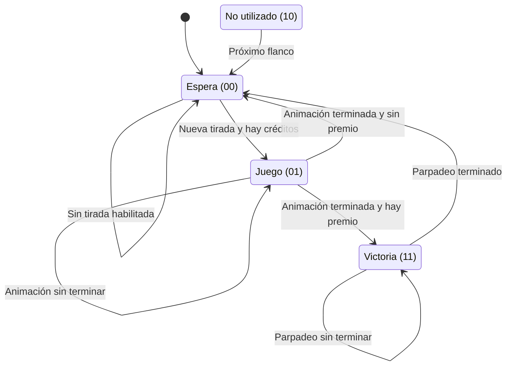

Para expresar las transiciones usamos estas abreviaturas:

| Señal | Significado |
|:---|:---|
| `nt` | Nueva tirada |
| `hc` | Hay créditos |
| `at` | Animación terminada |
| `hp` | Hay premio |
| `vt` | Parpadeo de victoria terminado |

La tabla incluye tanto los cambios como las permanencias en un estado. Una `X` indica que esa entrada puede valer 0 o 1 sin cambiar la transición de esa fila; no significa que los bits del próximo estado estén indefinidos.

| Estado actual | `nt` | `hc` | `at` | `hp` | `vt` | Próximo estado |
|:---|:---:|:---:|:---:|:---:|:---:|:---|
| Espera `00` | 0 | X | X | X | X | Espera `00` |
| Espera `00` | 1 | 0 | X | X | X | Espera `00` |
| Espera `00` | 1 | 1 | X | X | X | Juego `01` |
| Juego `01` | X | X | 0 | X | X | Juego `01` |
| Juego `01` | X | X | 1 | 0 | X | Espera `00` |
| Juego `01` | X | X | 1 | 1 | X | Victoria `11` |
| Victoria `11` | X | X | X | X | 0 | Victoria `11` |
| Victoria `11` | X | X | X | X | 1 | Espera `00` |
| No utilizado `10` | X | X | X | X | X | Espera `00` |

Simplificamos cada bit del próximo estado por separado, mirando qué entradas importan en cada estado. Por ejemplo, desde Espera el primer bit siempre queda en 0; desde Juego pasa a 1 solo con `at AND hp`; y en Victoria se mantiene en 1 mientras `vt` sea 0. Con ese criterio obtuvimos:

```text
D_A = (NOT Qa AND Qb AND at AND hp)
      OR (Qa AND Qb AND NOT vt)

D_B = (NOT Qa AND NOT Qb AND nt AND hc)
      OR (NOT Qa AND Qb AND (NOT at OR hp))
      OR (Qa AND Qb AND NOT vt)
```

Implementamos las expresiones con AND, OR y NOT, y conectamos cada salida a D de su biestable. El reloj ahora entra desde el circuito principal por el pin `Reloj`, en lugar de generarse dentro de la máquina. Lo repartimos a ambos biestables mediante los **túneles** `R`, que conectan puntos con la misma etiqueta dentro de ese subcircuito [18](#fuente-18). Las salidas Q vuelven a la lógica para calcular el siguiente estado. Durante el armado corregimos el término de Victoria en B, donde faltaba negar `vt`. Sin esa negación, los dos bits no conservaban juntos el estado `11` hasta terminar la victoria.

<p align="center">
  <br>
  <em>Figura 18. Implementación de la lógica de próximo estado con dos biestables D.</em>
</p>

Probamos las transiciones de la máquina con entradas manuales y funcionaron según la tabla. Después la colocamos en el circuito principal y conectamos la solicitud pendiente (`Salida`) a `nt`. En una primera integración reunimos A y B con un Separador para llevar el estado completo al controlador de palanca. Al simplificar su interfaz, quitamos ese bus: ahora usamos las salidas de A y B directamente para calcular `habilitar_palanca` junto con `hay_creditos`. También agregamos puntos de observación de ambos bits y ordenamos los bloques y sus conexiones en el circuito principal.

<p align="center">
  <br>
  <em>Figura 19. Integración de la máquina de estados con la palanca y los displays.</em>
</p>

En la primera integración probamos las condiciones de transición con entradas manuales. Después conectamos `hc` al controlador de créditos, `hp` al evaluador de premios, `at` a la detención del tercer display y `vt` al controlador de Victoria. La señal `Habilitar AND Salida`, que llamamos `Jugada aceptada`, reinicia el tiempo de animación, solicita los resultados y habilita el descuento del crédito. Así una bajada durante Juego o Victoria no inicia otra tirada. Los ajustes finales de animación y generación se describen a continuación.

### Manejo de créditos

Para administrar las monedas del juego creamos el subcircuito **controlador_creditos**. Partimos de cuatro reglas: el juego debe comenzar con un saldo distinto de cero, cada tirada aceptada consume una moneda, una combinación ganadora suma su premio y, cuando el saldo llega a cero, no se puede iniciar otra jugada. Elegimos inicialmente 3 créditos para facilitar las pruebas; después aumentamos el saldo inicial a 10 para probar varias tiradas seguidas.

El saldo se puede representar con 8 bits, por lo que puede tomar valores entre 0 y 255. Además de actualizarlo, el subcircuito entrega dos salidas: Saldo Actual, con el valor disponible, y Hay Creditos, que vale 1 cuando el saldo es mayor que cero. Esta última señal se puede usar para habilitar la palanca únicamente cuando sea posible jugar.

#### Banco de monedas

Para guardar el saldo usamos un **Register** de 8 bits: un registro que conserva el valor y lo actualiza en el flanco activo del reloj. Permite representar de 0 a 255 créditos [19](#fuente-19).

El Register inicia con valor 0 lo cual no nos sirve para nuestro juego, donde en esta primera versión iniciamos en 3 créditos.
Entonces podemos usar un multiplexor para decidir que al iniciar el programa tengamos el valor 3 hardcodeado, y luego consumiremos el valor desde el Register.
En el multiplexor la entrada de control (gris) decide que valor de entrada toma el multiplexor, al iniciar el programa nos interesa que esa entrada sea 0 para que tome el valor hardcodeado de 3 créditos iniciales, luego con el primer tick de reloj, nos interesa que la entrada que el multiplexor toma, sea la entrada conectada al Register.
Entonces para cumplir la lógica de 0 para iniciar y 1 luego del primer tick, podemos guardar un 1 en un biestable D para que se active con el primer tick y quede el 1 guardado para el resto del programa.

<p align="center">
  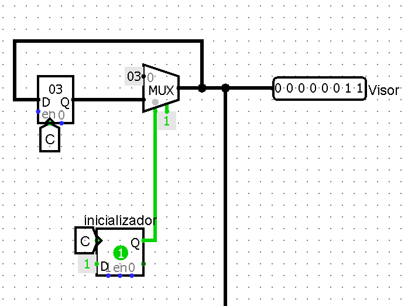<br>
  <em>Figura 20. Inicialización y almacenamiento del saldo de créditos.</em>
</p>

#### Entradas y salidas

Podemos contar con 3 entradas:

| Entrada | Función |
|---|---|
| Jugar | Indica que se aceptó una tirada y debe descontarse un crédito. |
| Premio | Bus de 8 bits con la cantidad de créditos que corresponde sumar. |
| EnVictoria | Indica que debe guardarse la suma del premio. |

Jugar debe activarse una vez por tirada aceptada. En cambio, EnVictoria puede permanecer en 1 durante varios ticks: un biestable guarda su valor anterior y permite cobrar solo en el primer tick de Victoria. Al salir de ese estado, queda listo para detectar la próxima victoria. Al integrar los módulos corregimos la conexión de `EnVictoria`: recibía `HayPremio` y podía cobrar antes de jugar, o no detectar dos premios consecutivos. La conectamos a `Qa AND Qb` (estado `11`), para cobrar una sola vez por cada entrada en Victoria.

Por otro lado podemos hacer uso de 2 salidas para el circuito, **Hay créditos** que nos habilita a hacer una nueva jugada y **Saldo Actual** de 8 bits a modo de visor para que el usuario pueda saber cuántos créditos restantes tiene.

#### Lógica de negocio

En este punto sabemos que vamos a tener que decidir entre 2 operaciones para modificar la cantidad de monedas.

##### Suma

Para implementar la suma de la cantidad de monedas actuales + el premio que ganó el usuario, podemos usar el objeto **Adder** de LogiSim en donde podemos calcular saldo_actual + premio, este valor lo debemos guardar en nuestro registro, por lo que podemos hacer uso de un 2do multiplexor en donde decidimos (mediante la entrada cobrar) si guardamos el saldo actual o si calculamos la suma con un premio. [20](#fuente-20)

<p align="center">
  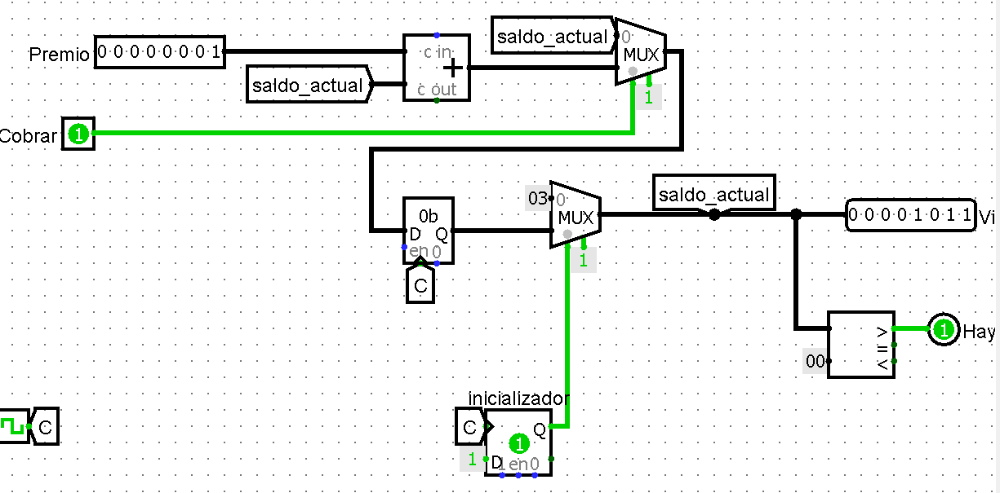<br>
  <em>Figura 21. Lógica para sumar el premio a la cantidad actual de monedas.</em>
</p>

El saldo está limitado a 8 bits. No implementamos saturación: si una suma supera 255, se conserva el resultado módulo 256; por ejemplo, `255 + 1` pasa a `0`. Esta es una limitación de la versión actual.

##### Resta

Para descontar una moneda usamos un Subtractor de 8 bits. Recibe saldo_actual en su entrada superior y una constante 01 en la inferior, por lo que calcula saldo_actual − 1. Un tercer multiplexor selecciona entre conservar el saldo y guardar el resultado de la resta según la entrada Jugar. Su salida alimenta el multiplexor de cobro y, finalmente, la entrada D del registro. [21](#fuente-21)

<p align="center">
  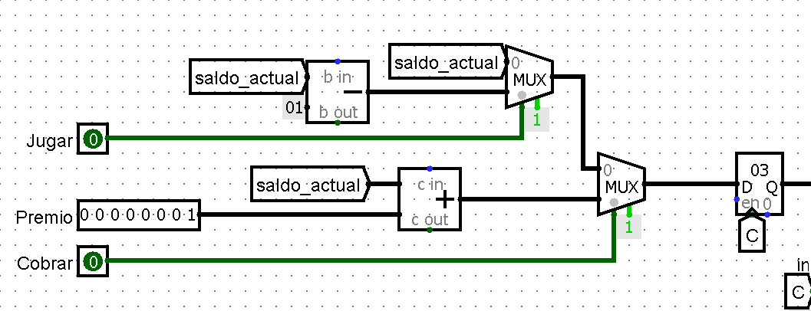<br>
  <em>Figura 22. Lógica para restar el saldo_actual menos 1.</em>
</p>

#### Resultado final del circuito controlador_creditos

<p align="center">
  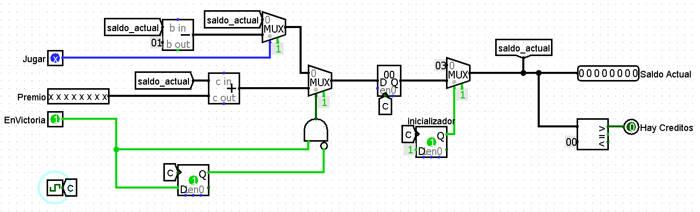<br>
  <em>Figura 23. Lógica final controlador_creditos.</em>
</p>

### Visualizador de créditos

La letra pide mostrar el saldo al mismo tiempo en decimal, con displays de siete segmentos, y en binario, con LEDs. Como controlador_creditos guarda valores de 0 a 255 en 8 bits, necesitamos ocho LEDs y tres cifras decimales.

Creamos **visualizador_creditos** para recibir el saldo y entregar cuatro salidas: una de 8 bits para los LEDs y otras tres para las unidades, decenas y centenas. Por ahora mostramos los bits con ocho pines de salida en el circuito principal; falta reemplazarlos por LEDs.

Primero estudiamos el display. Tiene un pin por cada segmento y otro para el punto decimal. Los cuatro pines superiores son g, f, a, b; los inferiores son e, d, c, punto, de izquierda a derecha. Esto nos permitió identificar qué señal debía llegar a cada pin. [22](#fuente-22)

Después necesitábamos transformar una cifra en las señales que dibujan esa cifra. Reutilizamos la idea de las ROM empleada para los símbolos del juego y creamos **digito_7_segmentos**. Recibe una cifra de 4 bits y consulta una ROM que devuelve el patrón de 8 bits correspondiente. Por ejemplo, para el número 1 devuelve 06, que enciende las dos barras de la derecha. Usamos tres instancias de este subcircuito. [23](#fuente-23)

<p align="center">
  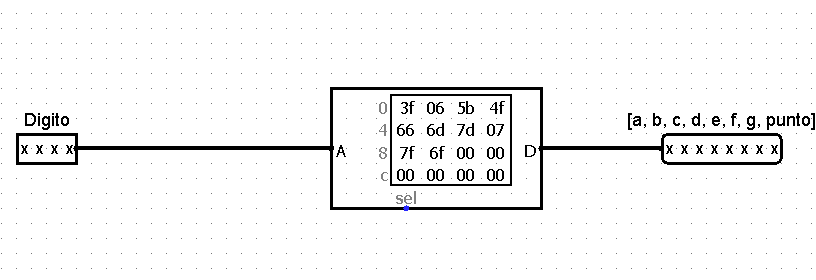<br>
  <em>Figura 24. Subcircuito digito_7_segmentos y sus patrones guardados en ROM.</em>
</p>

Quedaba obtener las tres cifras a partir del saldo. Usamos dos Divider por 10. El resto de la primera da las unidades, dividimos su cociente nuevamente y obtenemos las decenas como resto y las centenas como cociente. [24](#fuente-24)

Cada cifra sale en 8 bits, así que un Bit Selector toma sus cuatro bits inferiores antes de enviarla a **digito_7_segmentos**. [25](#fuente-25)

<p align="center">
  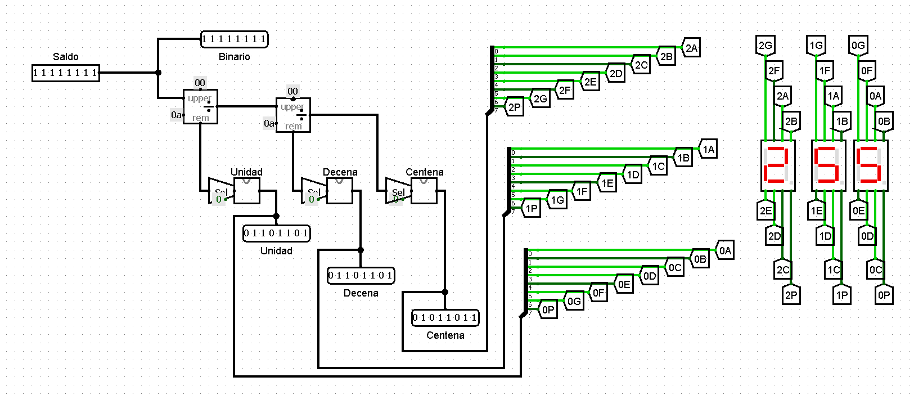<br>
  <em>Figura 25. Visualizador de créditos con el saldo 255 en decimal y binario.</em>
</p>

### Evaluador de premios

Una vez que tenemos los resultados de los tres displays, necesitamos saber si forman una combinación ganadora y cuántos créditos corresponde entregar. Para eso creamos **evaluador_premios**.
Recibe tres entradas (resultados) de 2 bits y tiene dos salidas:

- `Premio`, con la cantidad de créditos ganados (8 bits).
- `HayPremio`, que indica si la combinación tiene premio.

Primero comparamos, usando Comparator, el resultado 1 con el 2 y el resultado 2 con el 3. Unimos ambas comparaciones con un AND.

Luego usamos un multiplexor para elegir el premio según el símbolo.

- Tres créditos por tres sietes (`00`).
- Dos por tres campanas (`01`).
- Uno por tres rayos (`10`).
- Cero si la entrada es `11` (pantalla apagada, que no participa como símbolo del juego).

Un segundo multiplexor deja pasar el premio únicamente cuando los tres resultados coinciden, si no, entrega cero.
Finalmente, comparamos ese valor con cero para generar HayPremio.

<p align="center">
  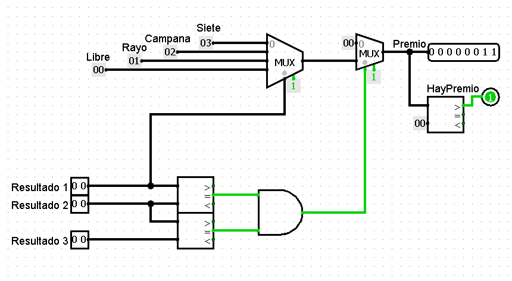<br>
  <em>Figura 26. Evaluador de premios con tres sietes: Premio vale 3 y HayPremio vale 1.</em>
</p>

### Generación de los resultados

Para elegir los símbolos investigamos **Random Generator**, que entrega una secuencia pseudoaleatoria y avanza con cada flanco activo de su entrada de reloj. Su **semilla** es el valor de partida: una semilla fija permite repetir la secuencia [26](#fuente-26).

Primero probamos un Random de 2 bits. Como podía entregar `11`, que corresponde a pantalla apagada, descartábamos ese valor y seguíamos buscando. Funcionó, pero necesitábamos recordar la solicitud y avisar cuándo estaba listo el resultado. Decidimos simplificar esa lógica usando un Random de 16 bits y el resto de dividir su salida entre 3:

```text
simbolo = numero_aleatorio MOD 3
```

El **Divider** entrega el cociente y el resto; usamos solamente el resto, que queda entre 0 y 2 [24](#fuente-24). Conectamos el Random como dividendo, una constante 3 como divisor y dejamos los bits altos del dividendo en 0. Un Separador toma los dos bits inferiores del resto y un registro conserva el símbolo durante la jugada [19](#fuente-19). Esta decisión introduce un sesgo pequeño: entre los 65.536 valores de 16 bits hay 21.846 que dan resto 0 y 21.845 para cada uno de los otros dos restos. Por eso las probabilidades no son exactamente iguales.

Probamos primero con el Random avanzando con el reloj de simulación. Después conectamos `Generar` al reloj del Random y del registro: cada subida de la solicitud guarda el candidato disponible y avanza la secuencia para la próxima tirada. El registro toma el valor anterior al flanco. Así podemos capturar entre ticks del reloj principal y mantener el resultado aunque `Generar` siga en 1.

Al principio armamos tres subcircuitos para configurar semillas diferentes. Después reunimos los tres bloques en un único `generador_resultados`, con una entrada `Generar` de 1 bit y tres salidas de 2 bits: `Resultado 1`, `Resultado 2` y `Resultado 3`. Así dejamos un solo bloque en el circuito principal y cada resultado va a su controlador de display y al evaluador de premios. Al terminar, retiramos el reloj interno que había quedado sin uso: la generación avanza solamente con las solicitudes aceptadas.

<p align="center">
  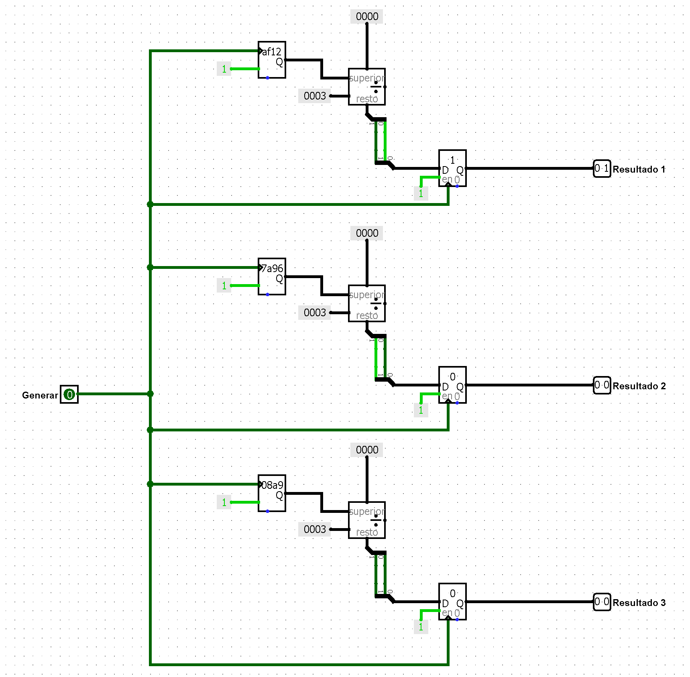<br>
  <em>Figura 27. Generador de los tres resultados mediante módulo 3.</em>
</p>

Elegimos semillas distintas porque usar la misma en los tres bloques, con las mismas solicitudes, produce la misma secuencia. Para facilitar la demostración buscamos semillas que mostraran las tres victorias y también combinaciones perdedoras:

| Bloque de salida | Semilla del Random |
|---|---:|
| `Resultado 1` | 1 |
| `Resultado 2` | 34 |
| `Resultado 3` | 91 |

Después de reiniciar la simulación, con el generador agrupado y 10 créditos iniciales, comprobamos esta secuencia:

| Tirada | Resultado | Premio | Saldo final |
|---|---|---:|---:|
| 1 | Tres campanas | 2 | 11 |
| 2 | Tres sietes | 3 | 13 |
| 3 | Tres rayos | 1 | 13 |
| 4 | Sin coincidencia | 0 | 12 |
| 5 | Sin coincidencia | 0 | 11 |

Al agrupar los bloques nos quedaron desconectados los relojes de los dos primeros Random y sus registros. Corregimos las conexiones y repetimos nueve tiradas completas: obtuvimos victorias y derrotas, con el saldo esperado y el regreso a Espera. También variamos la espera entre tiradas y la secuencia se mantuvo. Después ampliamos el ensayo a 1000 resultados para estudiar la distribución de símbolos, las victorias y la evolución del saldo.

### Parpadeo y duración de Victoria

Para el parpadeo aprovechamos la dirección `11`, que ya teníamos definida para apagar las pantallas. Agregamos una entrada `Apagar` a `controlador_display` y un segundo multiplexor antes de las ROM: con `Apagar = 0` deja pasar la selección normal; con `Apagar = 1` selecciona `11`. Los tres displays reciben la misma señal.

<p align="center">
  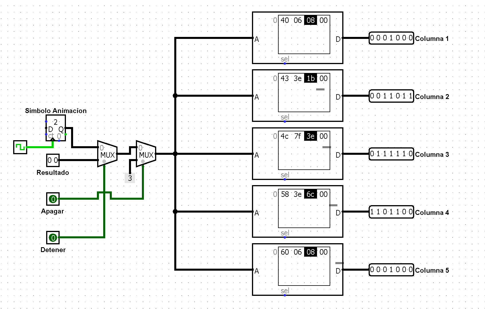<br>
  <em>Figura 28. Entrada Apagar y multiplexor para el parpadeo.</em>
</p>

Después armamos `controlador_victoria`. Una AND combina `En Victoria` con el reloj para alternar entre el resultado ganador y la pantalla apagada. Fuera de Victoria, `Apagar` queda en 0.

Para terminar el estado usamos un contador de 2 bits, con máximo 3 y detención al llegar a ese valor. Cuenta en los flancos de bajada y se reinicia mediante `NOT EnVictoria`. Un comparador activa `Victoria Terminada` cuando llega a 3; esa salida reemplaza el botón de prueba de la máquina de estados.

La duración depende de la frecuencia de simulación [6](#fuente-6). Para que el parpadeo dure **tres segundos**, la simulación debe configurarse en **2 ticks por segundo**, con duración alta y baja de un tick en los relojes. Desde la entrada en Victoria, el contador avanza en las tres bajadas y la máquina vuelve a Espera en la siguiente subida: seis ticks en total. Usamos la bajada para que la señal de finalización ya esté disponible cuando la máquina lea sus entradas en la subida. Conservamos relojes internos con la misma configuración, sincronizados por los ticks de Logisim. Al probar las victorias comprobamos el retorno automático a Espera.

<p align="center">
  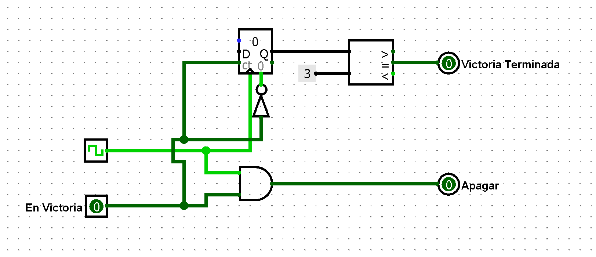<br>
  <em>Figura 29. Control del parpadeo y de la finalización de Victoria.</em>
</p>

### Arranque e integración de las pantallas

Al reiniciar la simulación nos encontramos con que las pantallas empezaban a animarse aunque todavía no hubiéramos jugado. Agregamos `En Juego` a `controlador_animacion`, calculado como `NOT Qa AND Qb`, y una tercera entrada a cada OR de detención:

```text
Detener1 = NOT EnJuego OR tiempo >= 5
Detener2 = NOT EnJuego OR tiempo >= 6
Detener3 = NOT EnJuego OR tiempo >= 7
```

Así quedan detenidas en Espera y Victoria, y durante Juego conservan la detención progresiva. Probamos el arranque y las tres señales quedan en 1; como los registros de resultados empiezan en `00`, inicialmente se ven tres sietes quietos. Durante Victoria, la entrada `Apagar` produce el parpadeo sin cambiar el resultado guardado.

La animación y el resultado cumplen funciones distintas: al aceptar la tirada guardamos los tres símbolos, mientras las pantallas recorren su secuencia. Al detenerse, cada una muestra el resultado que ya estaba guardado. La máquina espera a que termine la animación para decidir si vuelve a Espera o entra en Victoria; el premio se cobra al entrar en ese estado.

<p align="center">
  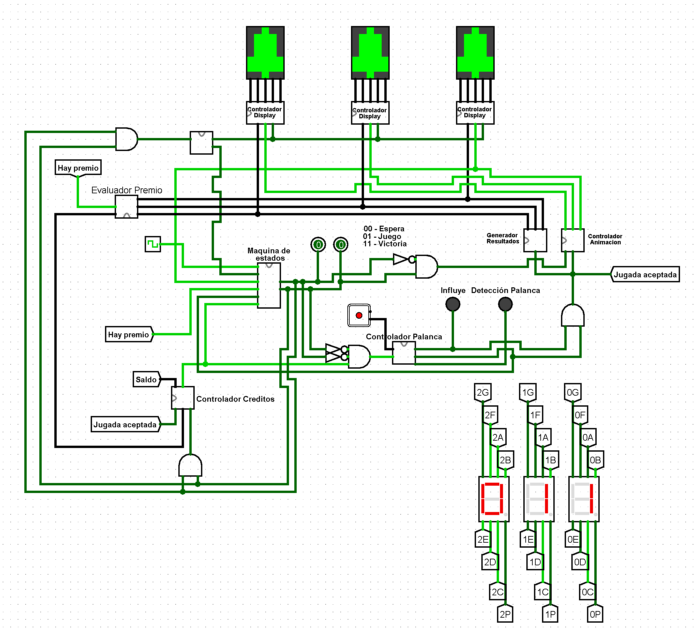<br>
  <em>Figura 30. Integración de los resultados y las animaciones en el circuito principal.</em>
</p>

### Estudio de 1000 resultados

Para no accionar la palanca mil veces, automatizamos las solicitudes usando el motor de Logisim 2.7.1. El ensayo usa nuestro `generador_resultados` y `evaluador_premios`, con las semillas 1, 34 y 91, y registra cada combinación en un [archivo CSV](analisis-estadistico/resultados-1000.csv). Dejamos también el [procedimiento para repetirlo](analisis-estadistico/README.md).

Probamos estos módulos por separado, sin modificar el circuito del juego. Para poder estudiar las 1000 combinaciones, el ensayo continúa aunque se agoten los créditos: el saldo se calcula matemáticamente desde 10, sin el bloqueo en cero ni el límite de 8 bits. No simulamos mil partidas completas con animación.

| Resultado | Cantidad | Frecuencia observada | Referencia ideal |
|---|---:|---:|---:|
| Tres sietes | 38 | 3,8 % | 3,70 % |
| Tres campanas | 38 | 3,8 % | 3,70 % |
| Tres rayos | 35 | 3,5 % | 3,70 % |
| Sin premio | 889 | 88,9 % | 88,89 % |
| **Cualquier victoria** | **111** | **11,1 %** | **11,11 %** |

Para tener una referencia, con tres símbolos equiprobables e independientes hay 27 combinaciones y tres ganadoras: la probabilidad ideal de victoria es `3/27`, aproximadamente 11,11 %. Observamos las 27 combinaciones y una frecuencia de victoria cercana a esa referencia. En las 3000 posiciones aparecieron 977 sietes, 1010 campanas y 1013 rayos. Esto no demuestra que las semillas sean independientes ni elimina el pequeño sesgo de módulo 3; son resultados de una corrida con semillas fijas.

Se descontaron 1000 créditos y se entregaron 225 en premios, una pérdida media de 0,775 créditos por tirada. Los 10 créditos iniciales se agotaron en la tirada 20: en el juego normal no habríamos podido seguir. El saldo matemático final de -765 muestra la tendencia si se permitiera continuar, no un valor que pueda mostrar el registro del juego. La pérdida media observada es cercana a la del modelo ideal, donde el premio medio es `6/27` créditos y la pérdida media es aproximadamente 0,778 por tirada.

<p align="center">
  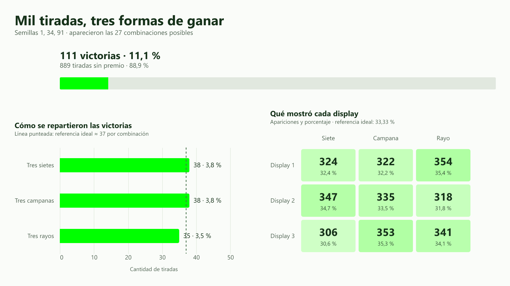<br>
  <em>Figura 31. Distribución de victorias y símbolos en 1000 resultados.</em>
</p>

## Anexo. Hoja de especificaciones del joystick

### Descripción del componente

El **Joystick**, también conocido como palanca, es un componente de entrada disponible en la biblioteca *Input/Output* de Logisim que permite simular el funcionamiento de una palanca de control.

El componente permite representar movimientos en dos direcciones: horizontal (izquierda y derecha) y vertical (arriba y abajo). Según la posición de la palanca, genera valores digitales que pueden utilizarse como entradas de otros circuitos.

### Funcionamiento y modo de uso

El joystick se representa gráficamente mediante una palanca que puede desplazarse dentro de un área delimitada.

Para utilizarlo, se debe seleccionar la herramienta *Poke Tool* de Logisim y hacer clic sobre la palanca. Manteniendo presionado el botón del mouse, es posible desplazarla en cualquier dirección.

Mientras se mueve, el componente actualiza sus salidas X e Y para representar la posición actual. Al soltar el botón del mouse, la palanca vuelve automáticamente a su posición central o de reposo.

### Entradas y salidas

El componente no posee pines de entrada, ya que su posición se controla directamente mediante la interacción del usuario.

Dispone de dos pines de salida:

| Pin | Descripción |
|---|---|
| X (superior) | Representa la posición horizontal de la palanca. |
| Y (inferior) | Representa la posición vertical de la palanca. |

Ambas salidas representan valores enteros sin signo, cuyo tamaño depende de la cantidad de bits configurada en el componente.

### Configuración

El joystick permite modificar la cantidad de bits utilizados para representar sus coordenadas mediante la propiedad *Bit Width*.
Esta configuración determina el rango de valores disponibles en cada salida. Por defecto el componente se inicializa en 4 bits, pero para nuestro uso decidimos estudiar el comportamiento del joystick con 2 bits.
Con esta configuración, los valores de salida se encuentran entre `01` y `11`, siendo `00` un valor que el componente no genera.

### Valores de salida esperados

Con la configuración de 2 bits, las salidas presentan los siguientes valores según la posición de la palanca:

| Posición           | Salida X | Salida Y |
|--------------------|----------|----------|
| Centro (reposo)    | `10`     | `10`     |
| Arriba             | `10`     | `01`     |
| Abajo              | `10`     | `11`     |
| Izquierda          | `01`     | `10`     |
| Derecha            | `11`     | `10`     |
| Arriba - Izquierda | `01`     | `01`     |
| Arriba - Derecha   | `11`     | `01`     |
| Abajo - Izquierda  | `01`     | `11`     |
| Abajo - Derecha    | `11`     | `11`     |

La tabla representa el centro, los extremos de cada eje y las posiciones diagonales extremas.

### Estado de reposo

El estado de reposo corresponde a la posición central de la palanca, a la cual regresa automáticamente cuando el usuario deja de interactuar con ella.

Con una configuración de 2 bits, ambas salidas toman el valor `10`.

Por lo tanto, el estado de reposo del componente es:

- X = `10`
- Y = `10`

## Fuentes consultadas

1. <a id="fuente-1"></a>[Logisim. LED Matrix.](https://baillifard.com/logisim/en/html/libs/io/dotmat.html)

2. <a id="fuente-2"></a>[Logisim. Componentes de memoria.](https://www.baillifard.com/logisim/en/html/guide/mem/index.html)

3. <a id="fuente-3"></a>[Logisim. Representación y edición del contenido de memoria.](https://www.baillifard.com/logisim/en/html/guide/mem/mem-v3word.html)

4. <a id="fuente-4"></a>[Logisim. Uso de subcircuitos.](https://baillifard.com/logisim/en/html/guide/subcirc/sub-using.html)

5. <a id="fuente-5"></a>[Logisim. Counter (contador).](https://www.cburch.com/logisim/docs/2.7/en/html/libs/mem/counter.html)

6. <a id="fuente-6"></a>[Logisim. Clock (reloj).](https://www.cburch.com/logisim/docs/2.7/en/html/libs/wiring/clock.html)

7. <a id="fuente-7"></a>[Logisim. Multiplexer (multiplexor).](https://www.cburch.com/logisim/docs/2.7/en/html/libs/plexers/mux.html)

8. <a id="fuente-8"></a>[Logisim. Comparator (comparador).](https://www.cburch.com/logisim/docs/2.7/en/html/libs/arith/comparator.html)

9. <a id="fuente-9"></a>[Logisim. Compuertas AND, OR, NAND y NOR.](https://www.cburch.com/logisim/docs/2.7/en/html/libs/gates/basic.html)

10. <a id="fuente-10"></a>[Logisim. Constant (constante).](https://www.cburch.com/logisim/docs/2.7/en/html/libs/wiring/constant.html)

11. <a id="fuente-11"></a>[Unit Electronics. Cómo leer hojas de datos sin morir en el intento.](https://uelectronics.com/como-leer-hojas-de-datos-sin-morir-en-el-intento/)

12. <a id="fuente-12"></a>[Logisim. Joystick.](https://cburch.com/logisim/docs/2.7/en/html/libs/io/joystick.html)

13. <a id="fuente-13"></a>[Logisim. Probe (sonda).](https://www.cburch.com/logisim/docs/2.7/en/html/libs/wiring/probe.html)

14. <a id="fuente-14"></a>[Logisim. Splitter (separador).](https://www.cburch.com/logisim/docs/2.7/en/html/libs/wiring/splitter.html)

15. <a id="fuente-15"></a>[Logisim. NOT Gate (inversor).](https://www.cburch.com/logisim/docs/2.7/en/html/libs/gates/not.html)

16. <a id="fuente-16"></a>[Logisim. Biestables D, T, J-K y S-R.](https://www.cburch.com/logisim/docs/2.7/en/html/libs/mem/flipflops.html)

17. <a id="fuente-17"></a>[Logisim. Edición de la apariencia de subcircuitos.](https://www.cburch.com/logisim/docs/2.7/en/html/guide/subcirc/appear.html)

18. <a id="fuente-18"></a>[Logisim. Tunnel (túnel).](https://www.cburch.com/logisim/docs/2.7/en/html/libs/wiring/tunnel.html)

19. <a id="fuente-19"></a>[Logisim. Register (registro).](https://www.cburch.com/logisim/docs/2.7/en/html/libs/mem/register.html)

20. <a id="fuente-20"></a>[Logisim. Adder (sumador).](https://www.cburch.com/logisim/docs/2.7/en/html/libs/arith/adder.html)

21. <a id="fuente-21"></a>[Logisim. Subtractor (restador).](https://www.cburch.com/logisim/docs/2.7/en/html/libs/arith/subtractor.html)

22. <a id="fuente-22"></a>[Logisim. 7-Segment Display.](https://www.cburch.com/logisim/docs/2.7/en/html/libs/io/7seg.html)

23. <a id="fuente-23"></a>[Logisim. ROM.](https://www.cburch.com/logisim/docs/2.7/en/html/libs/mem/rom.html)

24. <a id="fuente-24"></a>[Logisim. Divider (divisor).](https://www.cburch.com/logisim/docs/2.7/en/html/libs/arith/divider.html)

25. <a id="fuente-25"></a>[Logisim. Bit Selector.](https://www.cburch.com/logisim/docs/2.7/en/html/libs/plexers/selector.html)

26. <a id="fuente-26"></a>[Logisim. Random (generador pseudoaleatorio).](https://www.cburch.com/logisim/docs/2.7/en/html/libs/mem/random.html)
