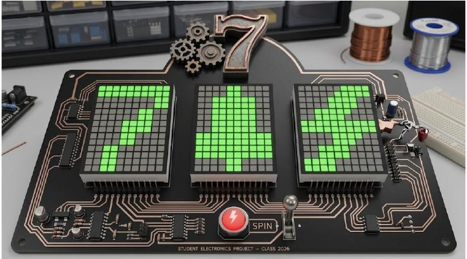
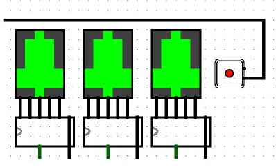
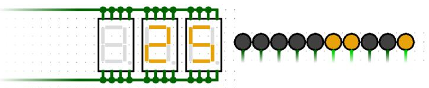
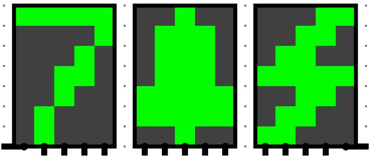
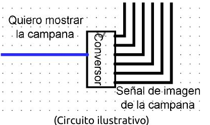
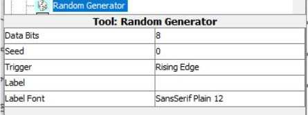
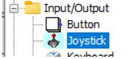
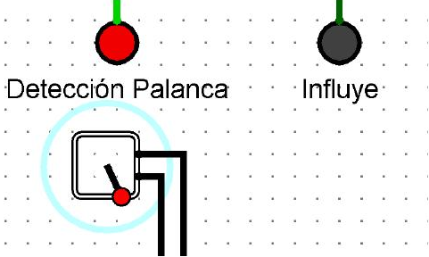
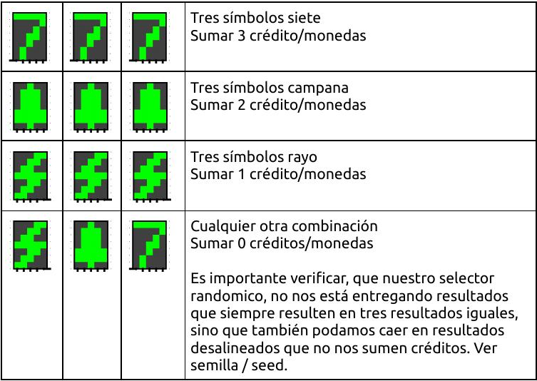
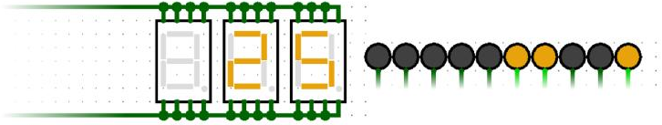

# Obligatorio

Escuela de Ingeniería, Facultad de Ingeniería Bernard Wand-Polak, Universidad ORT Uruguay. Cuareim 1451, 11.100 Montevideo, Uruguay. Tel. 2902 15 05; fax 2908 13 70. www.ort.edu.uy.

<!-- Página 1 -->

| EVALUACIÓN | Obligatorio | GRUPO |  | FECHA |  |
| --- | --- | --- | --- | --- | --- |
| MATERIA |  |  |  |  |  |
| CARRERA |  |  |  |  |  |

## Condiciones

- Puntaje máximo: 35 puntos.
- Puntaje mínimo: 1 puntos.
- Fecha de entrega: 26/11/26 hasta las 21:00 horas en gestion.ort.edu.uy (máx. 40 Mb en formato zip, rar o pdf).

### Uso de material de apoyo y/o consulta: Inteligencia Artificial Generativa

- Seguir las pautas de los docentes: se deben seguir las instrucciones específicas de los docentes sobre cómo utilizar la IA en cada curso.
- Citar correctamente las fuentes y usos de IA: siempre que se utilice una herramienta de IA para generar contenido, se debe citar adecuadamente la fuente y la forma en que se utilizó.
- Se debe indicar:
  - a. La/las herramientas utilizadas.
  - b. El contexto de uso: por ejemplo, generación de ideas, redacción inicial, análisis de datos, corrección de estilo, etc.
- Todo contenido producido por IAG debe ser revisado y verificado; cualquier error presente será responsabilidad del estudiante.
- Ser responsables con el uso de la IA: conocer los riesgos y desafíos, como la creación de “alucinaciones”, los peligros para la privacidad, las cuestiones de propiedad intelectual, los sesgos inherentes y la producción de contenido falso.
- El uso de herramientas de Inteligencia Artificial Generativa (IAG) puede emplearse como apoyo en el proceso de aprendizaje. Sin embargo, no sustituye el razonamiento crítico ni la elaboración personal. El estudiante es responsable de que el trabajo presentado refleje su propia comprensión, análisis y proceso cognitivo sobre el tema.
- La defensa es obligatoria y eliminatoria.
- La defensa será presencial salvo en casos en que se habilite la defensa oral sincrónica en forma remota.
- En caso de existir dudas sobre la autoría, plagio o uso no atribuido de IAG, el docente tendrá la opción de convocar al equipo de obligatorio a una defensa específica e individual sobre el tema.

### Defensa

Fecha de defensa: a definir con el docente.

La defensa es obligatoria y eliminatoria. El docente es quien definirá y comunicará la modalidad y mecánica de defensa. La no presentación a la misma implica la pérdida de la totalidad de los puntos del Obligatorio.

**IMPORTANTE:**

1. Inscribirse.
2. Formar grupos de hasta 3 personas del mismo dictado.
3. Subir el trabajo a Gestión antes de la hora indicada (ver hoja al final del documento: “RECORDATORIO”).

Aquellos de ustedes que presenten alguna dificultad con su inscripción o tengan inconvenientes técnicos, por favor contactarse con la Coordinadora de cursos o Coordinación Adjunta antes de las 20:00 h del día de la entrega, a través del mail: adjuntos_ei@ort.edu.uy.

Aquellos de ustedes que presenten alguna dificultad con su inscripción o tengan inconvenientes técnicos, por favor contactarse con la Coordinadora de cursos o Coordinación Adjunta antes de las 20:00 h del día de la entrega, a través del mail: adjuntos_ei@ort.edu.uy.

<!-- Página 2 -->



Caminando de vuelta a casa te encuentras tirada en la vereda una placa de circuito media polvorienta, metida en un sobre con unos diagramas viejos y la guía de un prototipo que alguien dejó olvidado. Al mirar los esquemas, te llama la atención que es el diseño de una máquina tragamonedas digital pensada para armar en Logisim. Con toda la intriga, al día siguiente le llevas la placa y los papeles a tu profe de Arquitectura; se ponen a revisarla juntos, les copa la idea y deciden ponerse manos a la obra para recrearla desde cero.

Vamos a diseñar una máquina tragamonedas en Logisim donde el usuario puede presionar tirar de una palanca para activar la rotación de tres símbolos (un siete, una campana y un rayo). El objetivo es que se alineen tres símbolos iguales para obtener combinaciones ganadoras y acumular puntos. Cada intento resta una moneda, y cada combinación ganadora, suma otra cierta cantidad. Recomendamos ir implementando y probando cada módulo de a poco.

## Documentación

<!-- Página 3 -->

Se espera una documentación en formato PDF, que debe incluir el proceso de creación y resolución de cada uno de los componentes de este obligatorio. Por proceso, nos referimos a una redacción que describa los pasos que el estudiante o el grupo tomó, para resolver dicho elemento, incluyendo prototipos, circuitos fallidos y como fueron iterando hasta conseguir el resultado entregado. Por lo que probar, y fallar es importante para esta entrega. Es por esto que el alumno debe tomar notas y capturas de su proceso desde el día uno.

A diferencia de las entregas anteriores, se valora más un documento sobre el proceso, investigaciones y sus resultados. Que la explicación detallada de cada componente en formato redactado, salvo donde se le indique como en la investigación del uso de la palanca.

## Área de trabajo

El circuito debe contar con tres displays suficientemente grandes para mostrar los distintos símbolos representados y ofrecer un feedback visual al jugador, de las variables internas del sistema. Para accionar el juego se debe utilizar el componente Joystick, el cual, al ser “tirado” hacia abajo, consume uno de nuestros créditos digitales, y acciona el movimiento de las pantallas. Nuestros crédito/monedas, se ven en displays de 7-segmentos formando el número en decimal y en simultáneo con LEDs en binario.





<!-- Página 4 -->

## Estados

El juego a recrear cuenta con los siguientes estados:

- Espera.
- Juego.
- Victoria.

**Espera:** Este estado es el estado inicial del juego, cada pantalla muestra un símbolo cualquiera, como del inicio del juego, o como del resultado anterior del mismo jugador, o de otro que abandonó su partida y que vino otro a retomarla. En este estado, no hay nada en movimiento, y sin interacción debe quedarse quieto.

**Juego:** Este estado es accionado cuando el usuario utiliza la palanca para jugar. Es un estado transitorio, y con un tiempo determinado, el cual transcurre solo. Durante este estado, las pantallas cambian entre los diversos símbolos mostrando las posibilidades en las cuales estos pueden caer. Y el cual lentamente se irá congelando y revelando uno a uno su estado de reposo.

**Victoria:** Este estado al igual que el de juego es temporal, será únicamente utilizado cuando el jugador gané, considerando ganar como conseguir los mismos tres símbolos de resultado y sumar créditos/monedas al contador decimal y binario. Durante este breve estado, el display debe parpadear unos instantes para luego ir al estado de espera.

Debe, utilizando un diagrama de estados, ubicar estos tres estados, y modelar que interacciones u eventos activan sus transiciones de uno a otro. Este diagrama debe ser entregado y explicado en la documentación.

<!-- Página 5 -->

## Displays y símbolos



El sistema debe contar con tres displays separados, que deben mostrar los distintos símbolos del juego. Es crucial para el proyecto hacer un único chip reutilizable (uno por display) que reciba de entrada una señal de control para seleccionar el símbolo, y que dé por salida las señales necesarias para mostrar los símbolos. Puede sumar además un modo que vaya rotando automáticamente entre ellos sin necesariamente marcar uno estático o un modo para apagar el display.



<!-- Página 6 -->

## Random

Durante el modo de Juego, ocurrirá la siguiente secuencia:

1. Se seleccionan los tres símbolos de resultado y se guardarán.
2. Todos los displays van rotando entre los símbolos rápidamente.
3. Se detiene el primer display, los otros dos siguen rotando.
4. Se detiene el segundo display, el último sigue rotando.
5. Se detienen todos los displays.
6. Se evalúa si pasar al estado de espera o de victoria.

Cada vez que se detiene un display, esté realmente no se detiene en el símbolo que muestra, sino que mostrará el símbolo, previamente seleccionado de forma randómica al entrar en el estado de juego (o haber pulsado la palanca). Por lo que el juego mientras va mostrando la animación de detenerse en cada pantalla, en realidad previamente ya seleccionó el resultado y es solo cuestión de presentarlo al jugador de una forma divertida.

Para hacer esta selección previa debe hacer uso del componente Random Generator. Investigue cómo usarlo, y que es el “Seed/Semilla” cuando se habla de un elemento randomico y que nos afecta a nosotros en nuestro circuito.



## Controles

Para activar el circuito y pasar del estado de Espera a Juego debe hacer uso de una palanca (Joystick). Palanca que solo activará el modo de juego cuando se tire hacia abajo, por lo que tirar hacia arriba no tendrá efecto.



<!-- Página 7 -->

Es importante y no debe saltearse, que mientras se esté en el modo de Juego o Victoria, estos controles no afecten el estado. Es decir, mientras se están mostrando los elementos en pantalla, o parpadeando, tocar la palanca no tendrá efecto alguno. Por lo que para saber cuando la palanca está siendo detectada y esta influye en el cambio de comportamiento se deben sumar dos LEDs que funcionan como banderas para saber si la palanca está en correcto funcionamiento.

- **Bandera Detección Palanca:** Esta bandera se prende cuando detecta que la palanca se encuentra en la posición baja, o de que la palanca fue accionada.
- **Bandera Influye:** Esta bandera se prende cuando estando en el modo de espera, esta fue accionada y hace iniciar el estado de juego. Esta bandera no deberá prenderse mientras se esté en el estado de juego o victoria.



Antes de empezar a utilizar la palanca debe incluir en su informe, una hoja de especificaciones del mismo que debe escribir usted. Investigar que es un “data sheet” de un componente. Describir qué es el componente, como se usa, qué resultados esperados podemos obtener del mismo cuando lo utilizamos, cual es su estado de reposo, etc.

¿Qué pasa si mantengo la palanca hacia abajo durante todo el ciclo de espera y juego? El juego debería esperar a que nuevamente mi palanca se tire, es decir, no vale solo mantener la palanca hacia abajo para que siga jugando en bucle. La palanca debe volver a su posición inicial previo a ser utilizada nuevamente.

<!-- Página 8 -->

## Puntaje / Victoria

Cada jugada, cuando usamos la palanca y pasamos de Espera a Jugar, nos reduce nuestros créditos / monedas.

| Combinación | Premio |
| --- | --- |
| Tres símbolos siete | Sumar 3 crédito/monedas |
| Tres símbolos campana | Sumar 2 crédito/monedas |
| Tres símbolos rayo | Sumar 1 crédito/monedas |
| Cualquier otra combinación | Sumar 0 créditos/monedas |



Es importante verificar, que nuestro selector randomico, no nos está entregando resultados que siempre resulten en tres resultados iguales, sino que también podamos caer en resultados desalineados que no nos sumen créditos. Ver semilla / seed.

## Parpadeo

Durante el estado de victoria, es decir, cuando se obtiene de resultado el mismo símbolo en los tres displays. Brevemente por tres segundos este debe parpadear. En una secuencia de prendido, apagado, prendido, apagado, de las pantallas para simular una animación de victoria.

<!-- Página 9 -->

## Créditos / Monedas



Los créditos iniciales del juego al reiniciar la simulación en logisim no pueden ser cero, pero tampoco hay uno definido. El estudiante debe elegir uno por defecto, cargarlo a los contadores cuando inicia la simulación y de ahí empezar a reducir o aumentar los créditos a medida que se utilicen o ganen. Tener cero crédito no debe permitir accionar la palanca ni entrar en modo de juego.

## Estudio de resultados

Utiliza el circuito actual que tengas en esta última etapa para correr una simulación donde puedas recolectar datos de cómo es la distribución de los símbolos, resultados de victoria y créditos a largo plazo. Puedes modificar temporalmente el circuito para cumplir con esta tarea para no tener que accionar la palanca manualmente, pero no debes entregar estas modificaciones. Analiza un cierto conjunto de tiradas y vea la tendencia a largo plazo del mismo. Puede usar el componente de contador para recolectar estos datos.

<!-- Página 10 -->

## Funcionalidad extra por integrante

Debe implementar una funcionalidad extra, no mencionada en este documento, que debe ser detallada, explicada y llevada a cabo en el circuito a total elección y discreción del alumno. Esta funcionalidad puede sumar o intervenir cualquiera de los elementos anteriores (pero no restar, ni eliminar).

En el informe final debe incluirse una sección dedicada por cada funcionalidad extra, titulada con el nombre y apellido del alumno responsable, donde se explique, documente y detalle la implementación llevada a cabo; como también el porqué esta funcionalidad agrega valor al obligatorio entregado.

```text
1 Estudiante  -> 1 Funcionalidad
2 Estudiantes -> 2 Funcionalidades
3 Estudiantes -> 3 Funcionalidades
```

**Todo el obligatorio debe hacerse en conjunto excepto esta sección individual. En el video, cada estudiante debe presentar su sección de trabajo.**

## Entregables

- Documentación de lo realizado.
- El circuito en formato `.circ`, siguiendo los estándares de componentización vistos en clase y correcto etiquetado de entradas y salidas.
- Incluir un video corto, mostrando el circuito operativo y mostrando las funcionalidades pedidas. Narrar lo que se está mostrando. Se debe incluir como link subido a una plataforma externa, no como parte de la entrega y que sea visualizable con el link otorgado. Verificar previo a la entrega que el link está operativo.

<!-- Página 11 -->

## RECORDATORIO: IMPORTANTE PARA LA ENTREGA

La entrega de los obligatorios será en formato digital online, a excepción de algunas materias que se entregarán en Bedelía y en ese caso recibirá información específica en el dictado de la misma.

Los principales aspectos a destacar sobre la entrega online de obligatorios son:

8. Ingresá al sistema de Gestión.
9. En el menú, seleccioná el ítem “Evaluaciones” y la instancia de evaluación correspondiente, que figura bajo el título “Inscripto”.

- Para iniciar la entrega hacé clic en el ícono correspondiente.


1) Ingresá el número de estudiante de cada uno de los integrantes y hacé clic en “Agregar”. El sistema confirmará que los integrantes estén inscriptos al obligatorio y, de ser así, mostrará el nombre y la fotografía de cada uno de ellos. Una vez agregados todos los integrantes, hacé clic en “Crear equipo”.

Cualquier integrante podrá:

- Modificar la integración del equipo.
- Subir el archivo de la entrega.

- Seleccioná el archivo que deseás entregar. Verificá el nombre del archivo que aparecerá en la pantalla y hacé clic en “Subir” para iniciar la entrega. Cada equipo (hasta 2 estudiantes) debe entregar un único archivo en formato zip o rar (los documentos de texto deben ser pdf, y deben ir dentro del zip o rar). El archivo a subir debe tener un tamaño máximo de 40 mb.

Cuando el archivo quede subido, se mostrará el nombre generado por el sistema (1), el tamaño y la fecha en que fue subido.

6. El sistema enviará un e-mail a todos los integrantes del equipo informando los detalles del archivo entregado y confirmando que la entrega fue realizada correctamente.
7. Podés cerrar la pestaña de entrega y continuar utilizando Gestión o salir del sistema.
8. La hora tope para subir el archivo será las 21:00 del día fijado para la entrega.
9. La entrega se podrá realizar desde cualquier lugar (ej. hogar del estudiante, laboratorios de la Universidad, etc.).
10. Aquellos de ustedes que presenten alguna dificultad con su inscripción o tengan inconvenientes técnicos, por favor contactarse con la Coordinadora de Cursos o Coordinación Adjunta antes de las 20:00 h del día de la entrega, a través del mail: adjuntos_ei@ort.edu.uy.
